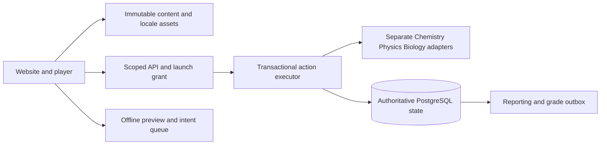

AI Virtual Laboratories is one browser-native platform delivering three laboratory environments—Chemistry, Physics and Biology—with two learning modes per experiment: Simulation Mode and Experiment Mode.

# MASTER BLUEPRINT

**Independent research and production specification · Version 1.0 · 22 November 2026 IST**  
Prepared by Codex research lead and independent catalogue, curriculum and platform investigators. Intended for the project owner, AP education/technical reviewers and the next development agent. Last review as of the date above. This study concerns Andhra Pradesh school deployment and original product design.

## Executive overview

One bilingual website serves government-school students, teachers, school administrators, districts and state operators. A website-first milestone establishes three public subject hubs, enrollment/authorization, curriculum entries, the universal mode choice, a versioned neutral browser-player test and teacher report. After browser integration, build three reusable rooms and produce the subject experiments. Start full practice production with Chemistry Activity 2.3 while simultaneously specifying and testing the Physics glass slab and Biology onion observation slices. The earlier Unreal prototype is a separate reference and remains outside this project.

**Decision status.** Accepted by the brief: three distinct rooms, two modes each, a single platform, research-only engagement and the stated phase order. Proposed: Babylon.js with baseline WebGL2, a role-scoped PostgreSQL ledger and server-confirmed lab actions, immutable content/CDN, accessible HTML equivalent, no mandatory cloud AI. Three.js is a fallback if the Babylon.js pilot has an evidenced blocker. Unity selection is blocked on government distribution/licensing and written review. Mandatory cloud GPU per learner and unbounded exploratory prediction are rejected. AP edition confirmation, Biology dataset, calibrated apparatus, vendor permissions, procurement/legal/funder approval and school-device release qualification remain open. The owner-level register in the ZIP records impact and ownership.

## Evidence coverage

- Labster public catalogue: 311 distinct listed titles across four indexed pages (100 + 100 + 100 + 11), with 312 known official detail routes including a same-title alternate. The archive had 311 detail URLs in October, with 310 exact current card route matches. Tags overlap: Chemistry 240, Physics 36, Biology 261, Health Sciences 199; 24 cards had no visible discipline tag. Dedicated course/collection/unit/skill routes cover cross-subject areas. Published accessibility labels: 181 Yes, 130 No. The normalized data records course, language, time and access provenance.
- Public catalogue and demo page were witnessed using Browser and Computer. Twelve official-public case studies, four per core subject, cover pH, hazards/calorimetry, optics, circuits, motion, microscopy, cells and ecology. Exact gameplay, dashboards and performance were not observed. Labster's 21 January 2026 terms constrain competitive site/service use and software reverse engineering, so vendor runtime and private dashboards require vendor permission. REA CLI verified its browser function on a separate local control, never against Labster runtime.
- Andhra Pradesh: 340 proposed candidates, Chemistry 120, Physics 130, Biology 90 across 13 cited volumes. Of the candidates, 126 come from current-edition content and 214 from prior official volumes. Four of ten discovered current 2026–27 links delivered usable content. Six returned empty downloads; prior official volumes were used where available. The three first activities are exact for documented prior editions. Current medium and numbering are formal education-review gates. Counts measure candidate corpus only. Approximately 40 Chemistry activities remains the owner’s staged production target; choose Physics/Biology counts after curriculum review.
- Government operation: GIGW 3.0 and WCAG 2.2 AA product target, DPDP phased applicability and named education-exception review, resilient cache and least-data identity. Base scenario estimates at 10k/100k/1m registered users in USD per month including labor and reserve are approximately $2.44k/$5.45k/$24.29k. Corresponding modeled peak concurrency is 127/1,265/12,650. Use the full low/base/high scenario assumptions, pricing dates and validation plan before procurement.

## People and two modes

| Role | Primary story and scope |
|---|---|
| Student | Choose an approved activity in one of three subject hubs, enter assigned mode, pause/resume, see confirmed evidence, submit and view rubric feedback. |
| Teacher | Publish a versioned activity and allowed modes for one class, guide procedures, review learner evidence and export authorized class results. |
| School admin | Enroll school identities and grant school-scoped roles, audit local exports and report school readiness. |
| District/state admin | Review course adoption and service readiness through aggregates with suppression; administer scoped school/district rollout as authorized. |
| Content editor/reviewer | Author internationalized activity definitions and evidence contracts. Reviewer signs curriculum, safety, provenance, rights, accessibility, science and version approval. |
| Operator | See minimal operational data, maintain availability and support, recover under audited controls. |

**Simulation Mode** is a guided, curriculum-matched practical with objectives, checkpoints, hints, observations, rubric and feedback. **Experiment Mode** is a bounded student-driven inquiry with hypothesis, control and comparison, editable admitted variables, measurements/data, uncertainty and reflection. The same apparatus, experiment identity, model contracts, valid action vocabulary and progress policies serve both modes. A source controls every asserted observation. AI can explain and propose actions for student confirmation; model and dataset adapters own all measurements.

| Subject | Separate workstation and model scope | Prior-edition representative activity | Launch gate |
|---|---|---|---|
| Chemistry | Analytical fixtures, transfers, conserved ledger, compatibility and evidence-owned observable outcomes. | AP-CHEM-10-2.3, zinc plus dilute sulfuric acid, Grade 10 Activity 2.3, print 38 / PDF 49. | AP edition, educator approved qualitative evidence, exact material safety and validated engine. Ideal amount is an upper bound; rate/yield unknown. |
| Physics | Mechanics, optics and later circuits stations; quantity and measurement validation. | AP-PHYS-10-9.10, parallel glass slab, Grade 10 Activity 9.10, print 184 / PDF 195. | AP approval and specific calibrated slab. Verify Snell geometry, sign, reversibility, scale and uncertainty. |
| Biology | Plant specimen and microscopy, clean practice, validated image views instead of generated measurements. | AP-BIO-09-5.1, onion epidermis compound microscope, Grade 9 Activity 5.1, print 2–4 / PDF 12–14. | AP approval, rights-cleared calibrated image set and independent observation qualification. |

School website menu: Home → three subject hubs → filters and experiment details → mode chooser → accessible player → evidence/assessment → teacher report. Student workspace adds assignments, resume and history. Teacher workspace adds class enrollments, assignment revisions, due dates, rubric and exports. School/district/state workspaces add scoped analytics and rollout. Minimal original UI requires responsive navigation, English/Telugu, semantic actions, readable context controls and equivalence across pointer and keyboard. A reusable scene bundles equipment recipes and station slots; activities configure those slots, model versions and rubrics by content ID instead of copying runtime or room.

## Architecture and essential contracts

An original web application accesses immutable signed content from HTTPS/CDN, lazy-loads the browser scene, and submits actions to a scoped API. The committed session and observations live in a relational ledger. Volatile visuals share identifiers and cue mappings only. An optional local preview estimates a supported result before sync and does not generate a grade. Server replays identical versioned inputs and reconciles conflicts. An optional tutor reads scoped, approved content and confirmed outcome references, and suggests allowlisted intents for the learner to accept. Tutor cannot call the commit path. Server-side school membership, class role, assignment scope and consent purpose gate protected reads and writes.

| Contract | Required fields and behavior |
|---|---|
| ExperimentDefinition | experimentId, labId/subject, grade and source edition/page refs, two mode configurations, sceneId, apparatus/materials, initial inventory with units, variable ranges and admission, scienceModelIds, dataset IDs, objectives, safety/ethics, assessment IDs, version and status. |
| Launch | Request assignmentId if assigned, experimentId, labId, mode, contentVersion, manifest SHA-256, locale and engine ABI. Scope and due-date policy validated before issuing a short-expiry, single-use token tied to student pseudonym, attempt, audience and content. Redeem token via same-origin POST body and authenticated session, never in URL. Replay guard uses atomic token identifier and audited reuse. |
| LabActionRequest | sessionId, labId, experimentId, mode, actorId, targetObjectId, actionType, parametersWithUnits and expectedRevision; optional receiverObjectId, interactionPort, reservationId and choiceId. Actor must match authenticated claims and objects must belong to the confirmed scene. |
| LabActionResult | accepted, reasonCode, committedRevision, scientific/object deltas, typed observations, cue IDs, assessment events, model provenance and uncertainty. Rejection contains no mutation or cues. Prefer explicit type and source on every numeric value. |
| Science model | modelId/version/ABI, subject, qualification, explicit parameter units/domain/uncertainty/source, review status, dataset digest, deployment, validation cases and reason codes. Formula limits and unknowns are visible. |
| LearningEvent | Event ID, sessionId, attemptId, type, trusted UTC occurrence time, revision, idempotency key, immutable evidence IDs and retention class. No personal names, freeform text or instructional secrets. |
| Data placement | Tenant and enrollment, teacher roles, curriculum, lab/experiment versions, model versions, assignment/modes, learner pseudonym, attempt/session, launch grant, action/observation, checkpoint, assessment and revisions, audit/outbox, report projection. SQL DDL uses tenant-aware references. |
| Replay/sync | Enforce idempotency key + payload digest. Same key and body returns original; changed payload or stale revision yields 409 with authoritative revision. 422 unsupported domain/unsafe action leaves state unchanged. Lock session, validate input, execute deterministic adapter, write state/action/evidence/outbox atomically. Offline caches public content only, queues provisional intents and reconciles contiguous admissible revisions before assessment. |

REST surface under /api/v1: GET /catalog (subject, grade, locale, cursor); POST /launch; POST /launch/redeem; GET /sessions/{sessionId}; POST /sessions/{sessionId}/actions; GET /sessions/{sessionId}/checkpoints/{revision}; POST /attempts/{attemptId}/submission; POST /teacher/classes/{classId}/assignments; GET /teacher/classes/{classId}/reports. Mutating calls use CSRF and idempotency headers. Missing/private identifiers receive masked 404 as appropriate. Callbacks and assets use manifest/version identity; report asynchronous grade publication through outbox events. Use schema validation, safe rollback/retirement, cross-tenant tests and version pinning.

Example subject/mode handshake: AP-PHYS-10-9.10, physics, experiment, locale te-IN, pinned 64-character manifest hash and lab@1. Attempt IDs belong to the scoped learner. At revision 4, a student submits select_incident_ray for phys.glass-slab:1 with angle {value:45, unit:"deg"}. If admitted once, object state advances to revision 5 and renderer receives a ray overlay event. A stale command returns 409, REVISION_CONFLICT and revision 5 with empty deltas. Derive the authorized checkpoint GET using the current session ID and returned revision. Analytic observation computes from confirmed permitted geometry and independent model qualification. Research fixtures represent synthetic data.

## Production and verification

Browser engine options: Babylon.js (Apache-2.0) recommended provisionally for open web rendering and glTF. Three.js (MIT) fallback with greater bespoke runtime ownership. Godot Web good authoring option but confirm thread/isolation/export and web runtime cost. Unity Web/URP extensive authoring, but distribution/fees and contractual terms require written confirmation. Prefer 720p Classroom with p95 ≤33.3 ms and p99 ≤66.7 ms on real 4 GB integrated-graphics school device, ≤2 MB compressed shell and ≤12 MB first scene, stable semantics at all quality levels. Use fingerprinted lazy GLB/KTX2, signed model assets, DOM alternative at low capability, no mandatory per-user cloud render. Test on real 4/8/16 GB classes and 1.1, 5, 20 Mbps profiles with checkpoint interruption, warm/cold bytes, p50/95/99 and process memory. None has been measured on the proposed player.

Technical art creates manufacturer-grounded apparatus with measured dimensions/materials, separate collision proxies, one actionable pointer, wrist-length PPE grips and workstations, stable compatible ports, expert-reviewed lens/glass/liquid shading, sensible sound and reduced-motion choices. Render animations and FX after committed actions. Chemistry snapshots material conservation; Physics optics overlay uses server state; Biology focal planes refer to dataset keys.

| Gate | Exit |
|---|---|
| R | Public catalogue and AP source bounds, equal subject architecture, data/reference links and quality report. Runtime permission and incomplete source access stay visible. |
| W | Website first. Three bilingual subject hubs, role scope, mode launch, neutral browser canvas and accessible DOM, restart/resume and one teacher report. |
| B | Browser lab integration tested across school devices with pointer/camera, quality, cache, glass and constrained water transfer. |
| C foundation | After B, build the three reusable room foundations with subject workstations and shared player contracts. |
| S | Each subject independently passes approved guided and exploratory science/assessment checks on its first slice. |
| C reuse sign-off | After S, three reusable rooms with shared runtime/content pipeline. Add second and third activity per room using schema/data and least duplication. |
| G | Jurisdiction and accessibility decisions, lawful school pilot, scale/DR/load, teacher training, support and procurement. |

Every published model needs method, units, permitted domain, version, uncertainty, provenance and independent validation. Theory-only and synthetic checks are software evidence. Chemistry models use a theoretical upper bound, never a substituted reaction rate. Physics starts with deterministic Snell geometry plus external calibration. Biology starts with finite measured image records and remains blocked pending rights and calibration. Law review determines privacy/retention, school flows and third-party AI posture. School rollout measures actual performance and bilingual accessibility before full deployment.

## Start here for the next agent

Only begin after product-owner authorization. Create or use an explicitly authorized separate web workspace. Inspect chapters 10–12, the three proposed experiment definitions, OpenAPI, SQL, acceptance tests and decision register. First deliver a website-only skeleton for all three subjects, synthetic test roster and a neutral player canvas with accessible controls. Prove all six subject/mode payloads pass launch, checkpoint/reopen and exactly-once grade transfer. Apply same-origin, tenant-scoped role checks, schema contract tests, unit checks and CI. Use a current Node LTS toolchain, PostgreSQL 16+ and versioned content package on staging; exact repo/tools are implementation choices. Use local fixture data. Keep previously built Unreal reference project and any existing production repositories out of scope.

Days 1–5 review contracts, grade/edition and governance and build skeleton catalogue; days 6–10 create role policy and versioned assignments; days 11–17 test launch, accessible canvas and teacher receipt; days 18–23 benchmark/cache/sync on actual pilot PCs; days 24–30 resolve W/B, then plan the three separate rooms with approval. The first phase is done when a teacher receives a single confirmed result from a reloadable synthetic attempt and authorized observers can reproduce all six entry points. Science experiments stay pending their individual gates.

## Navigation and source index

- [Published Labster surfaces](docs/01_labster_platform_and_sitemap.md), [public catalogue coverage](docs/02_full_catalog_analysis.md), [twelve case studies](docs/03_deep_dive_experiments.md) and [interactions](docs/06_lab_interactions_camera_cursor_ui.md).
- [Andhra Pradesh corpus](docs/10_curriculum_mapping_and_all_three_lab_roadmaps.md), [Chemistry](docs/10a_chemistry_lab_curriculum_and_production.md), [Physics](docs/10b_physics_lab_curriculum_and_production.md) and [Biology](docs/10c_biology_lab_curriculum_and_production.md).
- [Website](docs/11_website_ux_product_requirements.md), [backend and player](docs/12_website_backend_data_and_lab_api.md), [science and AI](docs/09_scientific_engine_ai_and_two_modes.md) and [roadmap](docs/16_production_roadmap_qa_and_risks.md).
- [Engine and licensing](docs/13_engine_comparison_licensing_decision.md), [device and browser](docs/08_browser_runtime_performance_and_cache.md), [government](docs/14_government_privacy_accessibility_security.md) and [costs](docs/15_infrastructure_scaling_and_cost.md).
- [External source register](SOURCES_AND_EVIDENCE.csv), [requirements trace](TRACEABILITY_MATRIX.csv), [validation](VALIDATION_REPORT.md), [manifest](MANIFEST.json), [checksums](SHA256SUMS.txt) and [fully merged handoff](MASTER_BLUEPRINT_FULL.md).

**Glossary.** AP = Andhra Pradesh in this project, Advanced Placement only in some vendor labels. ABI = engine interface version. CSE = AP Commissionerate of School Education. CRC = archive integrity check. CDN = content delivery network. DAU = daily active users. DOM = browser document controls. GIGW = Guidelines for Indian Government Websites. REA = Reverse Engineer Anything. RBAC = role-based access control. RPO/RTO = acceptable loss window and restoration time. DR = disaster recovery.

**Change log** · Version 1.0, 22 November 2026 IST · Initial research package. Exact file and hash list is in the manifest.
