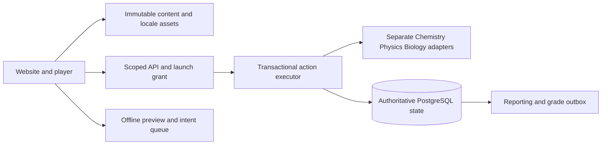
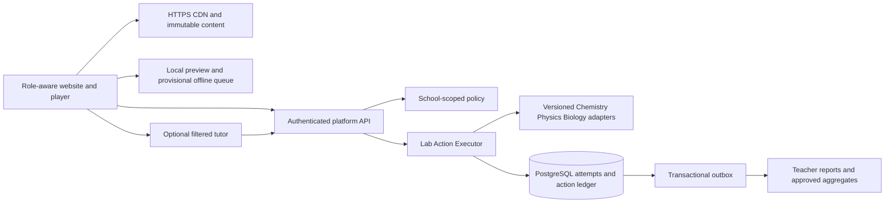

AI Virtual Laboratories is one browser-native platform delivering three laboratory environments—Chemistry, Physics and Biology—with two learning modes per experiment: Simulation Mode and Experiment Mode.

# MASTER BLUEPRINT FULL

**Independent research and production specification · Version 1.0 · 22 November 2026 IST**  
Prepared by Codex research lead and independent catalogue, curriculum and platform investigators. Intended for the project owner, AP education/technical reviewers and the next development agent. Last review as of the date above. This study concerns Andhra Pradesh school deployment and original product design.

## Executive overview

One bilingual website serves government-school students, teachers, school administrators, districts and state operators. A website-first milestone establishes three public subject hubs, enrollment/authorization, curriculum entries, the universal mode choice, a versioned neutral browser-player test and teacher report. After browser integration, build three reusable rooms and produce the subject experiments. Start full practice production with Chemistry Activity 2.3 while simultaneously specifying and testing the Physics glass slab and Biology onion observation slices. The earlier Unreal prototype is a separate reference and remains outside this project.

**Decision status.** Accepted by the brief: three distinct rooms, two modes each, a single platform, research-only engagement and the stated phase order. Proposed: Babylon.js with baseline WebGL2, a role-scoped PostgreSQL ledger and server-confirmed lab actions, immutable content/CDN, accessible HTML equivalent, no mandatory cloud AI. Three.js is a fallback if the Babylon.js pilot has an evidenced blocker. Unity selection is blocked on government distribution/licensing and written review. Mandatory cloud GPU per learner and unbounded exploratory prediction are rejected. AP edition confirmation, Biology dataset, calibrated apparatus, vendor permissions, procurement/legal/funder approval and school-device release qualification remain open. The owner-level register in the ZIP records impact and ownership.

## Evidence coverage

- Labster public catalogue: 311 distinct listed titles across four indexed pages (100 + 100 + 100 + 11), with 312 known official detail routes including a same-title alternate. The archive had 311 detail URLs in October, with 310 exact current card route matches. Tags overlap: Chemistry 240, Physics 36, Biology 261, Health Sciences 199; 24 cards had no visible discipline tag. Dedicated course/collection/unit/skill routes cover cross-subject areas. Published accessibility labels: 181 Yes, 130 No. The normalized data records course, language, time and access provenance.
- Public catalogue and demo page were witnessed using Browser and Computer. Twelve official-public case studies, four per core subject, cover pH, hazards/calorimetry, optics, circuits, motion, microscopy, cells and ecology. Exact gameplay, dashboards and performance were not observed. Labster's 21 January 2026 terms constrain competitive site/service use and software reverse engineering, so vendor runtime and private dashboards require vendor permission. REA CLI verified its browser function on a separate local control, never against Labster runtime.
- Andhra Pradesh: 340 proposed candidates, Chemistry 120, Physics 130, Biology 90 across 13 cited volumes. Of the candidates, 126 come from current-edition content and 214 from prior official volumes. Four of ten discovered current 2026–27 links delivered usable content. Six returned empty downloads; prior official volumes were used where available. The three first activities are exact for documented prior editions. Current medium and numbering are formal education-review gates. Counts measure candidate corpus only. Approximately 40 Chemistry activities remains the owner’s staged production target; choose Physics/Biology counts after curriculum review.
- Government operation: GIGW 3.0 and WCAG 2.2 AA product target, DPDP phased applicability and named education-exception review, resilient cache and least-data identity. Base scenario estimates at 10k/100k/1m registered users in USD per month including labor and reserve are approximately $2.44k/$5.45k/$24.29k. Corresponding modeled peak concurrency is 127/1,265/12,650. Use the full low/base/high scenario assumptions, pricing dates and validation plan before procurement.

## People and two modes

| Role | Primary story and scope |
|---|---|
| Student | Choose an approved activity in one of three subject hubs, enter assigned mode, pause/resume, see confirmed evidence, submit and view rubric feedback. |
| Teacher | Publish a versioned activity and allowed modes for one class, guide procedures, review learner evidence and export authorized class results. |
| School admin | Enroll school identities and grant school-scoped roles, audit local exports and report school readiness. |
| District/state admin | Review course adoption and service readiness through aggregates with suppression; administer scoped school/district rollout as authorized. |
| Content editor/reviewer | Author internationalized activity definitions and evidence contracts. Reviewer signs curriculum, safety, provenance, rights, accessibility, science and version approval. |
| Operator | See minimal operational data, maintain availability and support, recover under audited controls. |

**Simulation Mode** is a guided, curriculum-matched practical with objectives, checkpoints, hints, observations, rubric and feedback. **Experiment Mode** is a bounded student-driven inquiry with hypothesis, control and comparison, editable admitted variables, measurements/data, uncertainty and reflection. The same apparatus, experiment identity, model contracts, valid action vocabulary and progress policies serve both modes. A source controls every asserted observation. AI can explain and propose actions for student confirmation; model and dataset adapters own all measurements.

| Subject | Separate workstation and model scope | Prior-edition representative activity | Launch gate |
|---|---|---|---|
| Chemistry | Analytical fixtures, transfers, conserved ledger, compatibility and evidence-owned observable outcomes. | AP-CHEM-10-2.3, zinc plus dilute sulfuric acid, Grade 10 Activity 2.3, print 38 / PDF 49. | AP edition, educator approved qualitative evidence, exact material safety and validated engine. Ideal amount is an upper bound; rate/yield unknown. |
| Physics | Mechanics, optics and later circuits stations; quantity and measurement validation. | AP-PHYS-10-9.10, parallel glass slab, Grade 10 Activity 9.10, print 184 / PDF 195. | AP approval and specific calibrated slab. Verify Snell geometry, sign, reversibility, scale and uncertainty. |
| Biology | Plant specimen and microscopy, clean practice, validated image views instead of generated measurements. | AP-BIO-09-5.1, onion epidermis compound microscope, Grade 9 Activity 5.1, print 2–4 / PDF 12–14. | AP approval, rights-cleared calibrated image set and independent observation qualification. |

School website menu: Home → three subject hubs → filters and experiment details → mode chooser → accessible player → evidence/assessment → teacher report. Student workspace adds assignments, resume and history. Teacher workspace adds class enrollments, assignment revisions, due dates, rubric and exports. School/district/state workspaces add scoped analytics and rollout. Minimal original UI requires responsive navigation, English/Telugu, semantic actions, readable context controls and equivalence across pointer and keyboard. A reusable scene bundles equipment recipes and station slots; activities configure those slots, model versions and rubrics by content ID instead of copying runtime or room.

## Architecture and essential contracts



An original web application accesses immutable signed content from HTTPS/CDN, lazy-loads the browser scene, and submits actions to a scoped API. The committed session and observations live in a relational ledger. Volatile visuals share identifiers and cue mappings only. An optional local preview estimates a supported result before sync and does not generate a grade. Server replays identical versioned inputs and reconciles conflicts. An optional tutor reads scoped, approved content and confirmed outcome references, and suggests allowlisted intents for the learner to accept. Tutor cannot call the commit path. Server-side school membership, class role, assignment scope and consent purpose gate protected reads and writes.

| Contract | Required fields and behavior |
|---|---|
| ExperimentDefinition | experimentId, labId/subject, grade and source edition/page refs, two mode configurations, sceneId, apparatus/materials, initial inventory with units, variable ranges and admission, scienceModelIds, dataset IDs, objectives, safety/ethics, assessment IDs, version and status. |
| Launch | Request assignmentId if assigned, experimentId, labId, mode, contentVersion, manifest SHA-256, locale and engine ABI. Scope and due-date policy validated before issuing a short-expiry, single-use token tied to student pseudonym, attempt, audience and content. Redeem token via same-origin POST body and authenticated session, never in URL. Replay guard uses atomic token identifier and audited reuse. |
| LabActionRequest | sessionId, labId, experimentId, mode, actorId, targetObjectId, actionType, parametersWithUnits and expectedRevision; optional receiverObjectId, interactionPort, reservationId and choiceId. Actor must match authenticated claims and objects must belong to the confirmed scene. |
| LabActionResult | accepted, reasonCode, committedRevision, scientific/object deltas, typed observations, cue IDs, assessment events, model provenance and uncertainty. Rejection contains no mutation or cues. Prefer explicit type and source on every numeric value. |
| Science model | modelId/version/ABI, subject, qualification, explicit parameter units/domain/uncertainty/source, review status, dataset digest, deployment, validation cases and reason codes. Formula limits and unknowns are visible. |
| LearningEvent | Event ID, sessionId, attemptId, type, trusted UTC occurrence time, revision, idempotency key, immutable evidence IDs and retention class. No personal names, freeform text or instructional secrets. |
| Data placement | Tenant and enrollment, teacher roles, curriculum, lab/experiment versions, model versions, assignment/modes, learner pseudonym, attempt/session, launch grant, action/observation, checkpoint, assessment and revisions, audit/outbox, report projection. SQL DDL uses tenant-aware references. |
| Replay/sync | Enforce idempotency key + payload digest. Same key and body returns original; changed payload or stale revision yields 409 with authoritative revision. 422 unsupported domain/unsafe action leaves state unchanged. Lock session, validate input, execute deterministic adapter, write state/action/evidence/outbox atomically. Offline caches public content only, queues provisional intents and reconciles contiguous admissible revisions before assessment. |

REST surface under /api/v1: GET /catalog (subject, grade, locale, cursor); POST /launch; POST /launch/redeem; GET /sessions/{sessionId}; POST /sessions/{sessionId}/actions; GET /sessions/{sessionId}/checkpoints/{revision}; POST /attempts/{attemptId}/submission; POST /teacher/classes/{classId}/assignments; GET /teacher/classes/{classId}/reports. Mutating calls use CSRF and idempotency headers. Missing/private identifiers receive masked 404 as appropriate. Callbacks and assets use manifest/version identity; report asynchronous grade publication through outbox events. Use schema validation, safe rollback/retirement, cross-tenant tests and version pinning.

Example subject/mode handshake: AP-PHYS-10-9.10, physics, experiment, locale te-IN, pinned 64-character manifest hash and lab@1. Attempt IDs belong to the scoped learner. At revision 4, a student submits select_incident_ray for phys.glass-slab:1 with angle {value:45, unit:"deg"}. If admitted once, object state advances to revision 5 and renderer receives a ray overlay event. A stale command returns 409, REVISION_CONFLICT and revision 5 with empty deltas. Derive the authorized checkpoint GET using the current session ID and returned revision. Analytic observation computes from confirmed permitted geometry and independent model qualification. Research fixtures represent synthetic data.

## Production and verification

Browser engine options: Babylon.js (Apache-2.0) recommended provisionally for open web rendering and glTF. Three.js (MIT) fallback with greater bespoke runtime ownership. Godot Web good authoring option but confirm thread/isolation/export and web runtime cost. Unity Web/URP extensive authoring, but distribution/fees and contractual terms require written confirmation. Prefer 720p Classroom with p95 ≤33.3 ms and p99 ≤66.7 ms on real 4 GB integrated-graphics school device, ≤2 MB compressed shell and ≤12 MB first scene, stable semantics at all quality levels. Use fingerprinted lazy GLB/KTX2, signed model assets, DOM alternative at low capability, no mandatory per-user cloud render. Test on real 4/8/16 GB classes and 1.1, 5, 20 Mbps profiles with checkpoint interruption, warm/cold bytes, p50/95/99 and process memory. None has been measured on the proposed player.

Technical art creates manufacturer-grounded apparatus with measured dimensions/materials, separate collision proxies, one actionable pointer, wrist-length PPE grips and workstations, stable compatible ports, expert-reviewed lens/glass/liquid shading, sensible sound and reduced-motion choices. Render animations and FX after committed actions. Chemistry snapshots material conservation; Physics optics overlay uses server state; Biology focal planes refer to dataset keys.

| Gate | Exit |
|---|---|
| R | Public catalogue and AP source bounds, equal subject architecture, data/reference links and quality report. Runtime permission and incomplete source access stay visible. |
| W | Website first. Three bilingual subject hubs, role scope, mode launch, neutral browser canvas and accessible DOM, restart/resume and one teacher report. |
| B | Browser lab integration tested across school devices with pointer/camera, quality, cache, glass and constrained water transfer. |
| C foundation | After B, build the three reusable room foundations with subject workstations and shared player contracts. |
| S | Each subject independently passes approved guided and exploratory science/assessment checks on its first slice. |
| C reuse sign-off | After S, three reusable rooms with shared runtime/content pipeline. Add second and third activity per room using schema/data and least duplication. |
| G | Jurisdiction and accessibility decisions, lawful school pilot, scale/DR/load, teacher training, support and procurement. |

Every published model needs method, units, permitted domain, version, uncertainty, provenance and independent validation. Theory-only and synthetic checks are software evidence. Chemistry models use a theoretical upper bound, never a substituted reaction rate. Physics starts with deterministic Snell geometry plus external calibration. Biology starts with finite measured image records and remains blocked pending rights and calibration. Law review determines privacy/retention, school flows and third-party AI posture. School rollout measures actual performance and bilingual accessibility before full deployment.

## Start here for the next agent

Only begin after product-owner authorization. Create or use an explicitly authorized separate web workspace. Inspect chapters 10–12, the three proposed experiment definitions, OpenAPI, SQL, acceptance tests and decision register. First deliver a website-only skeleton for all three subjects, synthetic test roster and a neutral player canvas with accessible controls. Prove all six subject/mode payloads pass launch, checkpoint/reopen and exactly-once grade transfer. Apply same-origin, tenant-scoped role checks, schema contract tests, unit checks and CI. Use a current Node LTS toolchain, PostgreSQL 16+ and versioned content package on staging; exact repo/tools are implementation choices. Use local fixture data. Keep previously built Unreal reference project and any existing production repositories out of scope.

Days 1–5 review contracts, grade/edition and governance and build skeleton catalogue; days 6–10 create role policy and versioned assignments; days 11–17 test launch, accessible canvas and teacher receipt; days 18–23 benchmark/cache/sync on actual pilot PCs; days 24–30 resolve W/B, then plan the three separate rooms with approval. The first phase is done when a teacher receives a single confirmed result from a reloadable synthetic attempt and authorized observers can reproduce all six entry points. Science experiments stay pending their individual gates.

## Navigation and source index

- [Published Labster surfaces](docs/01_labster_platform_and_sitemap.md), [public catalogue coverage](docs/02_full_catalog_analysis.md), [twelve case studies](docs/03_deep_dive_experiments.md) and [interactions](docs/06_lab_interactions_camera_cursor_ui.md).
- [Andhra Pradesh corpus](docs/10_curriculum_mapping_and_all_three_lab_roadmaps.md), [Chemistry](docs/10a_chemistry_lab_curriculum_and_production.md), [Physics](docs/10b_physics_lab_curriculum_and_production.md) and [Biology](docs/10c_biology_lab_curriculum_and_production.md).
- [Website](docs/11_website_ux_product_requirements.md), [backend and player](docs/12_website_backend_data_and_lab_api.md), [science and AI](docs/09_scientific_engine_ai_and_two_modes.md) and [roadmap](docs/16_production_roadmap_qa_and_risks.md).
- [Engine and licensing](docs/13_engine_comparison_licensing_decision.md), [device and browser](docs/08_browser_runtime_performance_and_cache.md), [government](docs/14_government_privacy_accessibility_security.md) and [costs](docs/15_infrastructure_scaling_and_cost.md).
- [External source register](SOURCES_AND_EVIDENCE.csv), [requirements trace](TRACEABILITY_MATRIX.csv), [validation](VALIDATION_REPORT.md), [manifest](MANIFEST.json), [checksums](SHA256SUMS.txt).

**Glossary.** AP = Andhra Pradesh in this project, Advanced Placement only in some vendor labels. ABI = engine interface version. CSE = AP Commissionerate of School Education. CRC = archive integrity check. CDN = content delivery network. DAU = daily active users. DOM = browser document controls. GIGW = Guidelines for Indian Government Websites. REA = Reverse Engineer Anything. RBAC = role-based access control. RPO/RTO = acceptable loss window and restoration time. DR = disaster recovery.

**Change log** · Version 1.0, 22 November 2026 IST · Initial research package. Exact file and hash list is in the manifest.

## Full research chapters

## Decision register

22 November 2026 IST · Version 1.0 · Study provenance and product authority are separate.

| ID | Status | Decision | Owner / trigger |
|---|---|---|---|
| DEC-01 | Accepted by project brief | Browser-native website and three subject laboratories, each with Simulation Mode and Experiment Mode. | Product owner |
| DEC-02 | Accepted by project brief | Website → browser lab integration → three reusable environments → curriculum experiments → tests and government deployment. | Product owner |
| DEC-03 | Proposed | Babylon.js WebGL2 starter; progressive enhancement and an accessible DOM workflow with no scene-dependent grading. Three.js fallback if hard-fit needs arise. | Engineering and first school device trial |
| DEC-04 | Proposed | Scoped SQL/event authority, immutable content/model versions, replayable actions, optional proof-only client preview and asynchronous reporting. | Platform architecture review |
| DEC-05 | Proposed for educational review | Lead with AP-CHEM-10-2.3; plan AP-PHYS-10-9.10 and AP-BIO-09-5.1 against the prior official editions until current medium is confirmed. | AP educator and department |
| DEC-06 | Proposed | Clip science to individually admitted conditions, maintain separate adapters and provenance, use local educator hints with optional externally reviewed tutor. | Subject experts and privacy review |
| DEC-07 | Rejected | Per-student cloud GPU rendering as default at state scale. Use local rendering and cache/CDN. | Architecture, with accessibility fallback |
| DEC-08 | Blocked | Vendor runtime capture, authenticated dashboards, proprietary software analysis and benchmark, even where published links exist. | Labster written scope and designated test tenant, with counsel review |
| DEC-09 | Blocked | Unity procurement/distribution decision and legal claim. | Written Unity and procurement determination, budget and ownership |
| DEC-10 | Blocked | AP current-edition title/number verification on six of ten PDF downloads, subject physical validation and data licensing. | AP clarification, laboratory calibration and image release |
| DEC-11 | Blocked | School capacity, accessibility and educational pilot, real device FPS and WAN validation. | District operator and hardware matrix |
| DEC-12 | Proposed | Anonymous public site, school-provided pseudonyms, narrow district/state aggregate, cohort suppression, provider AI off until approval. | Privacy and curriculum reviewers |
| DEC-13 | Rejected | Live diagnostics on unpermitted third-party software, proprietary assets/scripts, unsupported AI calculations and proof by synthetic fixtures. | Research and scientific scope |

No product code, procurement commitment, or claim of government readiness is made here.

## Research method and evidence limits

### Scope and independently reproducible sources

As of 22 November 2026 IST. Team roles: Codex lead (product and runtime control), catalogue investigator, curriculum investigator and platform investigator. Sources are indexed by provenance ID and date. OBSERVED describes bounded, directly witnessed behavior or computed enumeration. PUBLISHED is attributable official documentation or primary research. INFERRED is a reasoned interpretation that names its evidence. PROPOSED is our independent design. UNKNOWN/BLOCKED identifies prerequisite and owner. References to official publisher pages record discovery and published facts. Catalogues include pointers/counts for publisher prose rather than a redistributed copy. Open-text comparisons are independently paraphrased. No institutional or student data was used.

Research questions covered public catalogue identities and taxonomy, published workflows/assessments, runtime signs and access, original scene mechanics, engines/licenses, Andhra Pradesh curriculum, scientific authority, bilingual website roles, public-sector operational design and costs. Catalogue union reconciles indexed cards and same-title variants. AP inventory distinguishes accessible 2026–27 publications from legacy dated and undated official documents. The blueprint distinguishes factual bounds and proposed content at every phase. All current observations remain research evidence.

### Labster access and treatment

Official 21 January 2026 Labster terms sections 2.2.3 and 2.2.9 address reverse engineering and competitive use of the website and services. Literal visible public catalogue/demo navigation preceded review of the restrictions. After identifying them, the remaining vendor analysis used indexed official publications and archived public information. No software, bundles, course account, test tenant, launch, private APIs, gameplay, network traffic or protected audiovisual material were inspected. No account was made or demo form submitted. The published experiment profiles are access-limited. Further live capture and performance measurement require explicit permission and scoped seat access. [Labster Terms of Service and Use](https://www.labster.com/terms-of-service-and-use)

Private UI and exact rendering/interaction/theory scoring data remain unverified. Product architecture in this dossier is independently written around AP, accessibility, science and scale needs. Comparative references are bounded and do not prescribe vendor reproduction. Search-index reach varies; a found link or didactic description establishes listing/publication, not account entitlement, exact edition or in-player formula. Compiler/static artifacts are outside scope.

### REA and browser observation

REA official npm registry package 6.10.1, Node.js 24.22.3 via the existing bundled runtime. The default shell Node 24.14.1 returned an incompatible version error. Read-only doctor reported Codex registration missing/config drift and installed skill v62 vs expected v63. There was no advertised REA MCP in this session. No persistent setup, config change, browser profile change or new native engine was needed. CLI completed `capture-browser-scenario` on a study-owned loopback disclosure control. Evidence ID `ev_9770cb800f152702d602dc025c707ad856af2efb3dcfb2366c4f491b464bebea` verifies Chromium 157.0.8103.79, completed normal UI action and owned-process cleanup. This establishes browser capture capability for the controlled case. Live Labster performance and Codex integrated MCP operation remain unverified. The raw record and minimal reproducible fixture are packaged. [REA official browser documentation](https://github.com/morluto/rea/blob/main/docs/guides/web/browser-observation.md)

Initial Computer Use and Browser public page appraisal is recorded under browser observation. The PhET shell opened but no playable view was confirmed. No public or vendor timing is generalized from the local REA control. No optional invasive capture or third-party protected assets were necessary.

### Comparison and research gaps

- ChemCollective provides concept-sorted virtual chemistry work such as stoichiometry and equilibrium. It informs a symbolic solution/inventory interface and numeric validation discipline. R-CHEMC.
- PhET Bending Light is a public conceptual comparator for optics interactions. This run confirmed the document title and locale control after an initial navigation deadline; it did not test simulation mechanics. R-AX3.
- Amrita and C-DAC Online Labs documents Class 9–12 Physics, Chemistry and Biology alignment to NCERT/CBSE. It is a useful Indian context for theory/simulation distribution and educator training. Andhra Pradesh attribution comes from AP CSE rather than assumed equivalence. R-OLABS.
- Peer-reviewed virtual lab studies cover particular science topics and populations. The product pilot must separately test Andhra Pradesh English/Telugu learning, accessibility and transfer. R-BONDE, R-PLOS, R-HOME, R-GLS.

Priority gaps: 12 of 12 deep dives are published desk cases. Live attempts 0. Labster FPS, frame percentiles, cold/warm bytes and 4/8/16 GB hardware results remain unknown. AP candidate inventory is not educator approval or authoritative proof of all eligible current content. Chemistry quantitative rates/collection, calibrated optical apparatus, approved Biological images and third-party distribution approvals remain blockers. Government costs are documented scenarios, not purchase terms.

## Labster public product surfaces

22 November 2026 IST. Access classes below apply to the observed source, not to the feature's internal implementation.

| Surface | What the evidence establishes | Class and source |
|---|---|---|
| Catalogue | Header links to support, login and demonstration. Main list offers a search field, Higher Education and High School entries, a discipline selector, reset and card links. Cards display title, short description, time and varying tags. Course, skill and concept are alternate discovery routes. The initial AX tree showed a zero count alongside cards, so it was unsuitable as an exact counter. | OBSERVED R-AX1. PUBLISHED R-CAT, R-COURSES |
| Public simulation detail | Demo listing exposes overview, course context, accessibility field, related content, demonstration links and a login/LMS FAQ. | OBSERVED R-AX2. PUBLISHED R-DEMO |
| Curriculum matching | Course suggestions and a textbook matching surface are public. Advanced/Elite plans describe human curriculum-mapping services. | PUBLISHED R-COURSES |
| Help, accessibility and support | Public help centre; keyboard and resizable-text guidance for supported simulations. Accessible-mode support varies by title, browser and generation. | PUBLISHED R-ACCESS, R-A11Y |
| Login and service boundary | Public header links to my.labster.com. Student onboarding describes institution LMS or Course Manager. Authenticated UI and provider-side services were inaccessible to this investigation. | OBSERVED R-AX1. PUBLISHED R-STU |
| Public marketing | Homepage/navigation link to pricing, customer support, guides, case studies, webinars, terms and security. Demo CTA requires following the vendor’s public demonstration process. | OBSERVED R-AX1, R-AX2 |
| Hosting inference | Public marketing, help centre, theory pages, login and partner LMS have distinguishable URL surfaces. Internal databases, runtime service boundaries, deployment model and access mechanisms are unknown. | INFERRED from R-AX1, R-STU, R-THEORY |

Public navigation tree: homepage → catalogue → search / level / discipline / course / concept / skill → simulation detail → demonstration/support or sign-in. Separately, help centre → student, instructor, simulation support, accessibility. Theory site → discipline → title-specific reading. Partner LMS or Course Manager → assignment → player → dashboard is vendor documented. Public listing metadata is separate from institutional entitlements.

| Published journey | Evidence a student or educator encounters | Independent product decision |
|---|---|---|
| Student via school | Instructor publishes assignment or supplies course entry. Learner enters simulation, completes missions/questions and may resume at a checkpoint. Grades sync through supported LMS connections, or appear in the Course Manager. [R-STU, R-SAVE, R-GRADE] | Begin with pseudonymous school enrollment. Expose all three hubs, assignment, mode chooser, explicit save status and student-controlled retry. |
| Instructor | In a course, select simulation, set publication, due date and allowed attempts, customize/apply supported quizzes, view outcomes or export. [R-COURSEMGR, R-QUIZ, R-INST] | Build a class-scoped report with mode and rubric versions, evidence provenance and reconciliation status. Freeze an assigned quiz version and retain prior attempts. |
| Institution admin | Admin-only dashboard for institutional adoption, participation and course activity. [R-ADMIN] | School admin can manage roster and course memberships. District/state obtain aggregated dashboards and approved exports with small-cell suppression. |
| Support | Help documentation recommends device checks and checkpoint recovery. [R-DEVICE, R-SAVE] | Device preflight, recoverable session status, reference code and accessible fallback built into the player shell. |

Public navigation observations describe a compact top menu and dense catalogue cards with thumbnail, title, brief and length. Responsive breakpoints, touch behavior, auth transitions, loading/error variants, proprietary quiz content, exact student and teacher UI and contractual APIs were not functionally tested. Use source links in the consolidated evidence register.

## Labster public simulation catalogue

Research date 22 November 2026 IST. Evidence class **PUBLISHED** for publisher labels and **OBSERVED** for the count and URL reconciliation. This chapter records public descriptions and listing facts. The catalogue observation budget covered indexed pages, archived publisher sitemap records and official detail metadata. Software, in-player interactions, private APIs, enrollment and entitlement require separate evidence.

### Inventory and reconciliation

| Coverage measure | Count |
| --- | ---: |
| Official browse cards on pages 1 through 4 | 100 + 100 + 100 + 11 |
| Unique card titles | 311 |
| Unique detail destinations actually resolved from those cards | 311 |
| Further officially indexed same-title detail route | 1 |
| Distinct known official detail URLs across the two public surfaces | 312 |
| October 2026 archived sitemap detail URLs | 311 |
| Exact October sitemap and current card URL matches | 310 |
| January 2026 archived sitemap detail URLs | 310 |
| Exact January sitemap and current card URL matches | 309 |
| Official detail pages checked for language and accessibility labels | 311 |
| Records with visible course matches | 291 |
| Records with a counted published objectives list | 311 |
| Records with a declared duration | 306 |
| Paid or private simulation workflows observed by the catalogue investigator | 0 |

The publisher advertises more than 300 virtual labs. The four public indexed catalogue pages represent the observed alphabetical partition. The fourth page used a second public query-key spelling recovered through the index. Each card title was paired with its actual link target through the index. Comparison to the 9 October archived sitemap found the same topical set with one same-title route change. An initial current sitemap reconnaissance counted 312 detail-path candidates by prefix. That read retained an aggregate count. The exact current XML set remains unverified. [Catalogue page 1](https://www.labster.com/simulations), [page 2](https://www.labster.com/simulations?b34f36df_page=2), [page 3](https://www.labster.com/simulations?b34f36df_page=3), [page 4](https://www.labster.com/simulations?2bec2a44_page=4), [October archived publisher sitemap](https://web.archive.org/web/20261009105140id_/https://www.labster.com/sitemap.xml)

The extra public URL resolves to the same named intestinal-absorption topic. The unsuffixed detail route declares accessibility mode No. The suffixed route linked from the catalogue declares Yes. Each describes an English, 22-minute entry, with Higher Education in the detail view. Both remain research evidence as version candidates. Their relationship at the assignment or executable content level requires publisher confirmation. The browse-card count stays 311. [Unsuffixed publisher detail](https://www.labster.com/simulations/absorption-in-the-small-and-large-intestines-journey-from-the-stomach-to-the-bloodstream), [catalogue-linked publisher detail](https://www.labster.com/simulations/absorption-in-the-small-and-large-intestines-journey-from-the-stomach-to-the-bloodstream-ae287)

The list covers the observed public catalogue and the identified public same-title alternate. That coverage boundary excludes subscription-only items, unpublished items, proprietary simulator versions, hidden variants and catalogues accessible only after an institutional login. Evidence records contain links and factual metadata. Authored summaries in the twelve representative examples paraphrase the publisher's public descriptions.

### Disciplines, duration and access labels

| Vendor filter tag | Card memberships | Share of 311 cards |
| --- | ---: | ---: |
| Chemistry | 240 | 77.2% |
| Physics | 36 | 11.6% |
| Biology | 261 | 83.9% |
| Health Sciences | 199 | 64.0% |
| No visible discipline label | 24 | 7.7% |
| Multiple visible discipline labels | 268 | 86.2% |

Tags overlap on the same card, so percentages exceed 100%. The labels express vendor taxonomy. Research about physiological topics may carry Chemistry or Physics cross-tags. A subject shortlist needs individual topic review. Environmental Science, Earth and Space Science, Bioengineering and Materials Science appear as course interests. Food Science and Nutrition, Anatomy and Physiology, Microbiology and Biochemistry also appear. These groups use the same catalogue, course and unit relationships. [Official simulation catalogue](https://www.labster.com/simulations), [official course catalog](https://www.labster.com/simulation-courses)

Declared duration ranges from 6 to 74 minutes with median 25 for the 306 cards with values. Five missing durations stay null. The card projection showed both High School and Higher Education on all 311. Individual detail pages list both levels for 278 entries, Higher Education only for 24, High School only for 6 and an explicit empty level for 3. The observed catalogue card and the linked detail disagree on level labels for 33 entries. Model grade suitability for the original platform must come from AP educator review. [Official simulation catalogue](https://www.labster.com/simulations), [example detail level](https://www.labster.com/simulations/absorption-in-the-small-and-large-intestines-journey-from-the-stomach-to-the-bloodstream-ae287)

English appeared in 310 details, Spanish in 170, German in 129, French in 128 and Italian in 108. These are non-exclusive counts of recognized published language labels. Telugu did not appear in the reviewed labels. The publisher's detail designation marked 181 catalogue-linked entries Yes and 130 No for Accessibility Mode. These labels do not establish compatibility with an assistive technology or support for a specific accommodation. [Publisher detail example](https://www.labster.com/simulations/demo), [official simulation catalogue](https://www.labster.com/simulations)

### How the public taxonomy works

The catalogue layers public discipline, education-level, course and skill filtering on an all-simulation list. Public course pages can group a course's simulations into units. Public collections and the skill index provide additional discovery paths. The October archived sitemap contains 29 course routes, 286 unit routes, 34 collection routes and 10 skill routes. These counts measure indexed page identities as of the archive capture. Counts exclude index roots, simulation detail routes and nonmatching URL prefixes. [Course index](https://www.labster.com/simulation-courses), [collections](https://www.labster.com/collections), [skills](https://www.labster.com/simulation-skills), [October archived publisher sitemap](https://web.archive.org/web/20261009105140id_/https://www.labster.com/sitemap.xml)

The three public high school course pages document different objectives. Chemistry emphasizes atomic and material structure, reactions and stoichiometry, thermodynamic concepts and investigation. Physics lists mechanics, circuits and fields, waves and aspects of atomic and nuclear physics. Biology includes cell comparison, genetics, experimental design and ecosystem interpretation. Instructor help describes assignment at simulation, unit and course granularity. The product term AP in Labster's course labels refers to Advanced Placement. Alignment to Andhra Pradesh belongs to the independent curriculum work. [High School Chemistry](https://www.labster.com/simulation-courses/high-school-chemistry), [High School Physics](https://www.labster.com/simulation-courses/hs-physics), [High School Biology](https://www.labster.com/simulation-courses/hs-biology), [Labster instructor catalogue documentation](https://help.labster.com/en/articles/9187903-instructors-understand-and-navigate-labster-s-new-catalog)

| Publisher reference pattern | Original design use |
| --- | --- |
| One title can belong to multiple courses and tags | Model discipline ownership separately from cross-links. Use region, class, curriculum version and outcomes as filters. |
| Courses group discoverable activities into units | Store AP edition, chapter, activity and competency links independently of release sequencing. |
| Technique and duration labels aid discovery | Show teacher-reviewed time estimates, apparatus, setup and learning objectives with annotations. |
| Publisher has an Accessibility Mode label | Publish a compatibility profile per activity with input, alternative workflow, language and assessment parity. |
| Course, unit and individual assignment scopes | Start with activity assignments, then add class playlists tied to curriculum outcomes and independently authored reporting. |
| One title can appear behind alternate detail routes | Preserve stable experiment identity separately from published versions, capability declarations and URLs. |

### Representative evidence across all three subjects

These four examples per lab document vendor-published concepts for comparative research. All twelve are **NOT_TESTED**. Their published technical and activity claims are attributable to official detail pages in the catalogue. Proposed reuse is an original design decision. It receives no credit toward Andhra Pradesh syllabus coverage until it is independently mapped and reviewed.

| Subject | Four sourced examples | Implication for the original platform |
| --- | --- | --- |
| Chemistry | Acids and Bases, Titration, Balancing Equations, Physical and Chemical Changes | Distinguish a configurable pH investigation, an apparatus-backed quantitative practical, a symbolic reasoning task and an observation-classification exercise. Each uses the same progression and evidence contract. |
| Physics | Basic Electricity, Collisions, Vectors and Scalars, Conservation of Energy (Principles) | Reuse boards, connectors, meters, movement rigs, graphing and accessible diagram manipulation. The same action contract accepts differing quantities and validators. |
| Biology | Microscopy, Cell Structure, Mitosis, Trophic Levels | Reuse a curated microscope viewer and evidence labels. Model ecology as a distinct data-backed investigation surface. Keep observation and interpretation explicit. |

The per-title sources, public scope, format and original reuse notes are in [documented examples](data/labster_catalog_documented_examples.csv). Catalogued vendor topics such as pathogen-oriented, genetic engineering or regulated clinical investigations do not inform the proposed curriculum or science models. Their entries retain bibliographic identification only.

### Collection method and gaps

1. Read the publisher-facing search-index copies for all four alphabetical pages. Parse the visible cards in page order using each title hyperlink as a record boundary. Drop image-only links and non-card footer anchors.
2. Resolve each catalogue title anchor through the search index. Store the destination and actual title together. Require unique URL and slug identity; preserve alternate public routes in their own evidence table.
3. Preserve normalized card discipline and level tags. Extract the declared minute when visible. Deal separately with more specific metadata published on linked pages. Use the declared card duration if also sourced from the detail view; the compared records had no disagreement.
4. Inspect structured text windows near the detail and course headings. Record course labels, explicit language/accessibility labels and objective list counts. Count objectives only when the published list boundary was visible. Preserve references to publisher summaries and objective lists, with original paraphrases for the twelve samples.
5. Compare exact URL and entity-type sets using the independent Wayback captures from January and October. Keep public Learning Concept collections, units, courses, skills and the simulation detail list as separate entities.
6. Validate the CSV/JSON rows, unique title and URL count, source IDs and count reconciliation. The artifact contains original research metadata, no full publisher prose, game packages, protected screenshots, assets or credentials.

The terms dated January 21, 2026 restrict reverse engineering software components in section 2.2.3 and cover competitive use of the site/services in section 2.2.9. The catalogue investigator used indexed public bibliographic references and archived public routes for detailed documentation after discovering those clauses. A normal public link or archived target records discoverability. An authorized runtime or dashboard session, benchmarking, exact revision identity and nonpublic workflow coverage remain separate due diligence. [Labster Terms of Service and Use](https://www.labster.com/terms-of-service-and-use), [archived October public catalogue](https://web.archive.org/web/20261029185344id_/https://www.labster.com/simulations)

### Research outputs

- [Normalized CSV](data/labster_catalog.csv) and [equivalent JSON](data/labster_catalog.json)
- [Archive-based taxonomy routes](data/labster_catalog_taxonomy.csv) and [same-title route evidence](data/labster_catalog_alternate_routes.csv)
- [Numeric coverage and set comparisons](EVIDENCE/public_sources/labster_catalog_coverage.json)
- [Catalog field guide](data/labster_catalog_data_dictionary.md) and [per-listing source ledger](SOURCES_LABSTER.csv)

The [concept crosswalk](data/labster_ap_concept_crosswalk.csv) links twelve vendor titles to independently sourced AP candidates across all three subjects. It records topic similarities and proposed reuse of original platform components.

## Twelve public simulation case studies

22 November 2026 IST. Sample is balanced by concept area (4 per core subject) and spans instruments, variable selection, procedural/assessment patterns, accessibility metadata and biological observations. All twelve are published desk analyses. Zero simulations were launched, completed or benchmarked. Model terms below describe visible or documented concepts. Simulation-specific camera, pointer, animation behavior, collisions, output precision, variable limits, content variants and persistence remain unknown unless cited. Labster’s 2024 Series and historical interface are documented in R-SERIES and compared in chapter 06. Exact title-to-runtime-generation mapping was unavailable.

| ID | Subject and simulation | Published mechanics and remaining gap | Mode interpretation | Original production takeaway | Sources |
|---|---|---|---|---|---|
| DD-C01 | Chemistry — Acids and Bases: Acidity and Alkalinity in Everyday Substances (26 min) | Published pH reading, solution selection, mixing/reset and embedded quizzes. Molecular close-ups illustrate scale change. | choice-enabled (inferred) | Create pH instrument registration; teacher chooses an AP-specific version; keep a model limit panel. | R-DDAC |
| DD-C02 | Chemistry — Advanced Acids and Bases (30 min) | Published environmental samples, pH readings, two molecular animations, equilibrium concepts and neutralization. | guided with choices (inferred) | Separate input/sample identity from qualitative animation and supported equilibrium data. | R-DDADV |
| DD-C03 | Chemistry — Chemistry Safety: Hazard symbols (15 min) | Published hazard identification and protective equipment decision using example chemicals. Timing, interactions and scoring are unknown. | guided (inferred) | Assess evidence-based PPE and bilingual symbol literacy via original prompts. | R-CAT, R-THEORY |
| DD-C04 | Chemistry — Basic Chemistry Thermodynamics: Solve the challenge of storing renewable energy (42 min) | Published calorimetry technique and thermodynamics concept. Specific instrument control, instrument error and outputs are unknown. | unknown | Propose graphing heat transfer from a separate validated dataset; no reuse of vendor content. | R-CAT, R-THEORY |
| DD-P01 | Physics — Basic Electricity: Understand how electricity works (16 min) | Published basic circuit construction and charge/energy conservation; bulb comparison. Lead routing and exact success/error conditions unknown. | guided (inferred) | Represent circuit graph and grade wiring independently from 3D. | R-DDELE, R-THEORY |
| DD-P02 | Physics — Collisions: Elastic and inelastic forces (15 min) | Published pool table context with momentum and elastic/inelastic differentiation. Numeric meters and player controls unknown. | guided (inferred) | For original scene use independent collision tests, masses and uncertainty. | R-CAT, R-THEORY |
| DD-P03 | Physics — Electrical Resistance: Apply Ohm's law to simple circuits (36 min) | Published learner builds a resistor to repair a radio. Vendor performance, validation and allowable variables are unknown. | guided (inferred) | Later AP circuit workstation; publish instrument range and contact validation. | R-CAT, R-THEORY |
| DD-P04 | Physics — Light and Polarization: Learn from Einstein the properties of light | Published optical table with laser, mirrors and glass for reflection and refraction. No runtime path or comparison tested. | choice-enabled (inferred) | AP slice uses geometric slab and pin analog, with numeric scope bounded separately. | R-DDOPT |
| DD-B01 | Biology — Confocal Microscopy (30 min) | Published confocal micrographs and 3D renderings. Focus implementation, tolerances and image attribution unknown. | guided (inferred) | Treat stack manifests and calibration as independent evidence with accessible views. | R-CAT, R-THEORY |
| DD-B02 | Biology — Cell Structure: Cell theory and internal organelles (25 min) | Published sample microscopy plus cell-structure assembly and organelle recognition. Exact interactions and grading unknown. | guided (inferred) | For onion slide give labelled walls and specify which organelles are not resolved. | R-CAT, R-THEORY |
| DD-B03 | Biology — Biomes: Identify and create the main biomes on Earth (35 min) | Published Biome Generator changes parameters and shows feedback. Valid ranges, underlying model and scientific validation unknown. | choice-enabled (inferred) | Future ecology should use audited data and show supported scenarios with evidence. | R-CAT |
| DD-B04 | Biology — Microscopy | Published small-intestine images and comparison of light, fluorescence and electron modality. Data identity and workflow controls unknown. | guided (inferred) | Teach field of view and optics limitations using rights-cleared plant data. | R-DDMIC |

Vendor materials support the existence of choice-enabled episodes in some titles. They do not establish a catalogue-wide open-ended scientific execution mode. Use the 12-desk sample to plan authorized observation, including four exact actions per title, progress states, controls, accessibility and documented rights. Obtain written scope for vendor runtime measurement and licensed demo identities. See the evidence and coverage report.

## Pedagogy, missions and assessment

### Published evidence and strength

- R-BONDE is an early 91-student learning evaluation associated with the Labster product family. An author disclosed a financial interest. Treat it as a reason to test guided simulation, not a forecast for AP outcomes.
- R-PLOS randomized 189 undergraduate participants in a microbiology preparation context, with blinded practical assessment. It reported similar gains and no significant lab-score difference versus demonstration. A limited comparison and a null difference do not establish universal interchangeability.
- R-HOME studied 112 students in home versus classroom conditions for the same desktop virtual simulation. Use it to motivate testing both settings. Separate device/access disparity from learning effects.
- R-GLS reports that immersive presentation can raise liking without raising learning and that a generative strategy can alter outcomes. Formal objectives, cognitive load, accessibility and transfer drive the design. Vendor quiz-score claims on the catalogue receive no assumed AP effect size.
- R-SCORE, R-QUIZ and R-SAVE document guided assessment and resumption. The publicly described system can require a correct answer before progression, varies quiz points based on tries, and uses mission saving. Our rubrics separately report first reasoning, after-feedback mastery and safe practice.

### Two-mode learning and assessment

| Stage | Simulation Mode | Experiment Mode |
|---|---|---|
| Prepare | Objectives, glossary and accessible explanation, planning question, teacher safety cue | Choose hypothesis, independent/dependent/control variables; model and domain card |
| Operate | Recoverable checklist, hint ladder, option to read equivalent text, safety feedback | Configure within enabled domain, record a control and comparison, show measurement provenance |
| Observe | Table or accessible equivalent, annotate apparatus and evidence | Repeat supported cases and differentiate instrument resolution from genuinely variable data |
| Explain | Explain outcome and limitation in student's own words; transfer item with new context | Graph or ordered table, claim/evidence/reasoning, alternative explanation and limitation |
| Assess | Correctness, safe procedure, interpretation, reflection | Design validity, evidence quality, interpretation/uncertainty, conclusion |

Proposed rubric for both modes uses four criteria worth 0–2 each. 0 indicates absent or unsupported evidence, 1 partial, 2 meets the published criterion. Preserve criterion values, evidence IDs, rubric version and feedback. Teacher comments are separate from automatic result. Report first attempt, latest attempt and practice separately. Time and hint use support teacher diagnosis. They do not drive mastery scores. Locale-specific term IDs map to educator-reviewed English and Telugu labels, with narrated captions, accessible tables, model limitations and SI/unit notation in both locales. Use separate content reviewer and assessment reviewer.

Chemistry emphasizes the distinction between detectable qualitative outcome and a modelled upper bound. Physics separates geometric ideal from drawing/instrument error. Biology separates specimen observations, optical artifacts and variability between sampled fields. In Biology, evaluation uses safe plant material and non-personal imagery.

### AP pilot

Pre-register concept, transfer and accessibility endpoints with AP educators. Use a short pretest, equivalent immediate and deferred posttests, optionally a separately supervised physical skill rubric. Compare teacher-led preparation with the proposed guided/experiment sequence. Randomize by intact class where practical; account for class and school clustering and report response rates, attrition, effect intervals and device/medium strata. Use no live student telemetry until data governance approval and school/parent workflow are in place. Evaluate text/table fallback with equivalent rubric and include students who ordinarily use assisted technology. Primary external study sources are R-BONDE, R-PLOS, R-HOME and R-GLS.

## Teacher, learner, institution and LMS

Labster's Course Manager FAQ documents co-instructors, scheduled publication/due dates, attempt limits, and a standalone grade view. The FAQ says this standalone route does not sync LMS gradebooks. Labster's separate LMS dashboard guide describes course-linked publishing, per-simulation and per-student views, grades/engagement export, attempt counts, time, responses and selectable best/first/latest sync. Student documentation distinguishes automatic LMS sync from Course Manager access and Study.com submission. Vendor support documents a customized quiz editor with place-in-simulation review, adding or editing supported questions, saving and applying to an assignment. Public documentation also describes institution-level adoption and role-restricted dashboard access. Entitlement flags, data schemas, private screen rendering and integration reliability are unverified. [R-COURSEMGR, R-INST, R-QUIZ, R-GRADE, R-ADMIN]

### Proposed production model

- A teacher filters approved content by grade, medium, subject and skill, reviews both modes and selects which to assign. Due date uses school timezone. The assignment references immutable experiment version, immutable rubric ID including its version and the locale bundle version. Changes after any submission create a new version and do not relabel existing evidence.
- A student sees teacher feedback, current attempt, stored probe points and submitted score. School handles account recovery locally. Per-learner action detail is available only within authorized class and scope. Exports use expiring links and generate an audit event. Raw action exports are unavailable for district/state dashboards.
- Content editor submits dependency, accessibility, translation, model-admission and curriculum checks. A distinct reviewer signs the release manifest. Rollback changes future launch routing and preserves prior version replay.
- For later LMS integration, evaluate 1EdTech LTI 1.3 OIDC initiation and Deep Linking/Assignment and Grade Services. Store authorized platform/deployment identifiers, explicit allowlisted redirect origin, nonce, state, scoped grant and tenant mapping. Grade update dedupes by assignment, student mapping and attempt ID, and outbox retries have a dead-letter review. Initial website pilot uses first-party course manager and export.
- Acceptance: a bilingual grade-domain teacher publishes one assignment in each subject, a pseudonymous test learner finishes an attempt through the player, grade evidence arrives exactly once, and a different school teacher cannot read it. Verify the student can view feedback and an authorized school admin can see aggregate results. Approve external LMS deployment and data exchange separately.

External references: R-STU, R-INST, R-GRADE, R-QUIZ, R-ADMIN, R-COURSEMGR, R-LTI.

## Interaction and apparatus operation

Published vendor differences include legacy LabPad with theory/mission controls and 2024 Series location markers and hints in a more exposed viewport. Vendor documentation describes mission saving and distinguishes checkpoint reload capabilities. Accessibility mode has keyboard, resizable text and an in-simulation reading route for compatible titles. Exact camera speeds, collision/mating rules, persistence internals, motion curves, hardware haptics and user-controlled fluid parameters remain unobserved. Specific published activities are recorded in chapter 03. [R-SERIES, R-SAVE, R-A11Y]

### Original player interaction contract

1. Canvas/DOM share a focus manager and a single actionable target. Mouse hover uses a ray over curated collision proxies. A keyboard and switch focus list exposes the same committed targets and controls with names and availability. Touch uses tap-to-select plus explicit operation controls. Avoid cursor lock by default. Escape always restores user navigation.
2. The world-space bench start affordance and a DOM Start button call the same launch command. Show subject, mode, session-save state and help in a thin header. Draw context actions outside the active apparatus silhouette and provide a pause/reduced-motion alternative.
3. Define explicit object identity, picking proxy, stable grip anchors and mating-port identities. Double-hand visual support uses left/right wrist rigs with grip/target constraints and an accessible sequential equivalent. A glass grip, bottle support/pour grip, optics pin and microscope focus grip get separate pose clips. Visibility changes and soft IK never alter scientific state.
4. Select target/destination → show placement ghost and admission hint → send expected-revision command → receive authoritative state and motion-cue IDs → play camera/hand/audio cues. Camera framing starts only for approved transitions and is optional. A cancelled preview has no state effect. A cancel after commit may visually fast-forward or request a separate valid domain operation if available, never undo material implicitly.
5. Stable port constraints admit chemistry solids/liquids only on destination with capacity/headspace and compatible reagents; Physics instruments snap to optical plane and UI units, with defined off-bench errors; Biology staged slide travel requires compatible objective, valid field/plane and collision interlock. Sound is redundant with a text label or status; avoid purported haptics.
6. Atomic ledger/outbox transaction validates actor, mode, expected revision, equipment permissions, preconditions, model domain, reservation, conserved quantities and capacity. Only then updates state, revision, event and optional cue. Model failure, duplicate, lost connectivity, wrong receiver/bin, expired reservation and concurrency each have error paths. Cues reconcile to authoritative state upon reconnect.
7. Percussive spatial SFX, liquid stream, edge lighting, shadow and meniscus communicate apparatus state. Keep display tiers semantically identical. Never use VFX continuity to infer reaction rate or quantity. Biology data viewport and Physics overlay are semantic equivalents across modes.

Misuse acceptance: disabled invalid actions still expose one readable explanation; unsupported chemistry pairing creates no gas events; a misplaced physics ray has no observation; zoom beyond an acquired Biology objective cannot fabricate detail; two tabs racing the same revision create one commit; aborting a drag mid-pour before commit changes neither ledger nor revision. After commit stop motion can skip cues but state remains authoritative.

## Original apparatus, animation and browser graphics production

**22 November 2026 IST. Proposed production plan.** Use three original rooms with separate subject workstations, inventory, safety/ethics rules and scientific adapters. Share stable rig, picking, interaction ports, camera, accessibility, UI, audio event, asset manifest and PBR conventions. Prioritize textbook-approved variants and three vertical slices before populating any stockroom.

| Lab | First slice props and composition | Next-room production priorities |
|---|---|---|
| Chemistry | AP-CHEM-10-2.3 Worktop with virtual-only reaction tube, holder/stand, officially confirmed stopper/delivery components and reading aids. Plan independent clear silhouette, open sightlines and high-contrast labels. | Glassware variants, GL45 reagent library, LDPE wash bottle, balances and metrology, clamps/spatulas, model-derived liquid transfer and waste routes. Wait for science and curriculum approval before activating combinations. |
| Physics | AP-PHYS-10-9.10 Lab table with rectangular glass block, marked paper, optical pins, straightedge and protractor. Keep switchable orthographic diagram and stable close-up. No live laser or light source required for the pin activity. | Modular optics bench and lens holders, meters/leads and low-voltage circuit boards, rail/carriage and masses, spring scale, then magnetics, waves and thermal kit. Each model decides ranges and uncertainty. |
| Biology | AP-BIO-09-5.1 Plant microscopy workstation with specimen slide/coverslip, forceps, stage and objective controls, licensed calibrated image positions and a comparison pane. | Microscope variants, reference slide library, petri dishes as non-culture specimen containers where approved, pipette/dropper trays, plant observation and ecological visualizations. Rights and scientific QA control depiction and image use. |

### Source and ownership

Gather product manual or public dimension sheet, SKU/revision, measured reference and date. Keep source links, permitted internal photos, independent measurement and documentary references apart from redistributable textures and meshes. Do not use manufacturer logos, trademark silhouettes where legally restricted, or vendor screenshots/media as finished work. Assign original authorship and per-file rights at intake. Production asset acceptance requires approved dimensions/tolerances, mass, material, capacity, calibration semantics where relevant, one preferred medium/quality variant and exact archive revision. A manufacturer capacity or label is a reference value. Content validates actual simulation values and conditions independently.

Evidence anchors: DWK DURAN tube catalogue 261301307 lists 14 × 130 mm, capacity designation 16 mL and borosilicate glass. The cited Class A mixing cylinder 3212/04 example is 10 mL, ±0.10 mL catalogue tolerance, 0.2 mL graduations and 159 mm high. In the product, confirm selected SKU and whether a cylinder is marked to contain or deliver. Standard examples do not assign an uncertainty to textbook observations. DWK low form spout and GL45 bottle, Thermo Fisher Nalgene LDPE certificate, Eisco slab/bench and Evident CX23 manual provide design references. PH0566A's detail page uses inconsistent inch and metric width labels (1.5 in vs 50 mm). Record metric data as the vendor's listed dimensions pending confirmation. The source gives no numerical refractive index; use model provenance/calibration. CX23 example lists X/Y stage movement 76/30 mm, a 174 × 89 mm stage and 10× field 20 eyepiece. These values do not establish school microscope SKU, exact performance or cellular dimensions. [PL-DWK-TUBE](https://www.dwk.com/duran-test-tube-beaded-rim-16-ml-14-x-130-mm-261301307) [PL-DWK-CYL](https://www.dwk.com/pyrex-mixing-cylinders-class-a-batch-certified-with-polyethylene-stopper-10-ml-321204) [PL-DWK-BEAKER](https://www.dwk.com/na/laboratory-products/duran-beaker-low-form-with-spout) [PL-DWK-GL45](https://www.dwk.com/na/duran-original-gl-45-laboratory-bottle-clear-without-screw-cap-and-pouring-ring-250-ml-218013602) [PL-LDPE](https://documents.thermofisher.com/TFS-Assets/LCD/certificate/Certificates%20of%20Compliance/7124895010-COC_400200-0250-TS.pdf) [PL-EISCO-BLOCK](https://www.eiscolabs.com/products/ph0566a) [PL-EISCO-BENCH](https://www.eiscolabs.com/products/ph0616opt) [PL-EVIDENT](https://adobeassets.evidentscientific.com/content/dam/mis/cx23/brochures/N8601724-022023_CX23_A4_Global_web.pdf)

### Asset pipeline and metadata

1. Author a scale-true master .blend with SI metres, applied transform and visible datum. Record bounding geometry, volume and interaction limits separately. Use thickness on glass and instrument enclosures, bevels sized to reference, weighted normals and manufactured seams. Stage selection, contact and camera targets need distinct nodes. For repeated instances share meshes/materials and give each instance its own logical ID, temperature/quantity/state and accessibility label.
2. Create LOD0 close-up, LOD1 typical bench and optional LOD2 background silhouettes. Reuse noncritical modular geometry, keep graduations/ports legible at active LOD, repack UVs, physically flag albedo/emission sRGB and normal/roughness/metallic/occlusion linear. Bake reusable neutral illumination and occasional wear. Use concise original decals, normal maps and encoded texture atlases. Never treat rendered scratches or lighting as measurable observations.
3. Export versioned GLB from approved Blender release, then validate glTF schema and extension support. Transcode visible textures to KTX2/Basis as supported. ETC1S for low-frequency albedo when artifacts acceptable, UASTC for precision normal maps/critical graphics when performance allows. Use tangent/normal QA against the selected decoder and device compression formats. Mesh compression must prove decoder cost and geometry correctness on school hardware. Keep source, hi-poly, low-poly, collisions, animation references, licenses and validation output in custody. Blender glTF exposes export behaviors that do not directly reproduce a Cycles shader graph. [PL-BLENDER-GLTF](https://docs.blender.org/manual/en/latest/addons/import_export/scene_gltf2.html) [PL-GLTF](https://registry.khronos.org/glTF/) [PL-KTX](https://github.com/KhronosGroup/glTF/blob/main/extensions/2.0/Khronos/KHR_texture_basisu/README.md) [PL-GLTFVALID](https://github.com/KhronosGroup/glTF-Validator)
4. In the model manifest record assetId, contentHash, units, bounds, license, author, source/evidence IDs, assetVersion, approved scientific component ID, required renderer features, LOD descriptors, rig clip names, affordance keys, grip poses, collision proxies, fit/mating ports, camera anchors, material role tags, lifecycle cues and localized label/description IDs. Pin UI and accessibility evidence to content release.
5. Preserve source references and files. Manufacturer manuals, textbook publications and third-party images remain links or approved extracts. Original redistributable micropictures need author, stain/specimen/field context, microscope/calibration, acquisition record, field locations and pixel-length calibration. Use versioned crop/tile metadata with any transforms. A vector diagram receives an explanatory status and no synthetic claim of a measured micrograph.

### Interaction, rigs and safety cues

Scene has one authoritative input focus and visible pointer. Hover uses a small preselected target group and a low-cost ray or label selector; a DOM object-list alternative addresses grouped parts and independent key/range actions. On object press choose a semantic hold, place, attach, transfer, align, read, focus or cancel action. The shared executor confirms compatible port, hand occupancy, reservation, revision, permissions and scientific domain. A camera/hand clip is a presentation of accepted state. Local reactive hover/previews never commit inventory or grading. On reject release reservation, offer reason and preserve apparatus and observation. On reconnect restore last confirmed revision and exact supporting content hashes.

Use wrist-only original blue nitrile rig with separate left/right skeleton and contact-aware clips. True two-hand interactions have role assignments: stabilizing and manipulating. For a selected acid-metal scenario keep virtual safety cues and teacher controls consistent with official activity. Do not attach a flame/bench cue unless exact approved workflow and school-accessibility alternative are defined. Use a vent-safe port state machine for authorized modelling; on graphics low tier teach the same reading and causal sequence with a flat representation. Chemistry transfer payload controls displayed fluid volume, vessel fill curve and lag; render meniscus or fill line; reserve and reconcile material in executor. For optics use independent ray geometry from the scientific adapter. A pretty refracted scene is neither a measurement nor the source of ray results. Biology paired stage/focus view uses a licensed image/annotation guided by committed stage and objective; acceptance does not use renderer blur to calculate sample geometry or magnification. Skipped animation or GPU reset must recover canonical state.

Frame camera to transport, detail or reading plane on explicit action unless camera assist disabled. Cap speed and ease, preserve reduced-motion mode and return focus on escape. Make flows readable with sound disabled and no high-speed click requirements. Implement audio buses for ambience, instructor/captioning and deterministic state cues. Spatialize local metal/glass clicks modestly and give equivalent status in text. Never embed personal files, microphone/voice collection or unapproved media.

### Target budgets and visual acceptance

| Setting | Classroom | Balanced | Premium |
|---|---|---|---|
| Minimum provisional device class | 4 GB RAM, integrated GPU, Chrome WebGL2 | 8 GB RAM integrated/newer GPU | 16 GB with capable GPU |
| Render target | 720p scale floor, 30 fps target | 900p adaptive, 30+ fps | 1080p adaptive, 60 fps goal |
| Initial experiment total transfer ceiling | 2 MB compressed shell + ≤12 MB first scene, measured as separate network budgets | 32 MiB | 55 MiB optional |
| Active view draw-call ceiling | 120 | 200 | 320 |
| Active view triangle ceiling | 150k | 300k | 650k |
| Texture GPU-resident goal | ≤128 MiB | ≤256 MiB | ≤512 MiB |
| Dynamic lighting | 1 trimmed shadow pass where necessary, baked ambient | 1 strong + local fill and moderate environment | reserved additional features after comparison |
| Optical materials | stable well-defined edges, labeled guides and ordered layer fallback | selected glTF transmission where budget permits | stronger filtered reflection/transmission tested on closeups |

Budgets are pre-test assumptions. Classroom response at 30 fps is ≤33.33 ms average frame budget. Classroom acceptance targets are p95 ≤33.3 ms and p99 ≤66.7 ms on representative 4 GB WebGL2 school hardware at the 720p scale floor. Capture the full distribution. Total first launch has a 15 MiB outer envelope, including transfer metadata and overhead outside the 2 MB shell and 12 MB scene targets. Record shader compile stutter, dropdown/switch freeze, input-to-confirmed feedback and page/worker memory across three scene swaps. Verify fixed camera shots against independent reference, asset widths, wall thickness, annotated markings, actual interaction contact, recovery, dual keyboard/gameplay and student agency. Fix instrument readings/appearance first, then timing. Avoid overlapping screen-space transparencies for arbitrary combinations. Use baked low-cost reflections and rim visibility with labeled reference reading and separate visual fallbacks. Slide or scale typography uses vector or high-contrast atlas and semantic DOM equivalents.

Gate B proof includes three plated fixed views per asset, 100 timed actions per subject including fallback and context restore, a full content reopen and teacher evidence, operation on classroom group hardware and minimum bandwidth, and regression comparison to reviewed product captures. Usable ruler/protractor and visible glass are independent checks. Measure memory, p50/p95/p99, transferred bytes, warm and cold startup following actual device reboots/cache conditions. Freeze budgets only after captures. Simulated quality settings are to be implemented after research.

## Browser delivery and performance

Labster documents browser delivery, 4 GB RAM, Intel UHD 600 class graphics and a stable network of at least 1.1 Mbps, with browser and Chromebook/iPad paths varying by support page and title [R-DEVICE, R-CHROME]. Vendor troubleshooting reports a Unity-content memory message and describes WebGL/GPU optimisation. That supports a Unity/WebGL delivery indication for documented cases, not a conclusion about every lab, Unity version, WebAssembly bytes, current backend, cache implementation, GPU allocation, full resource mix or internal algorithms [R-UNITY, R-CHROME]. The same vendor has published quality-setting guidance. Conditions, menu availability and gains were not measured here.

R-REACTRL captures an independent loopback browser control on Chromium 157.0.8103.79, Windows 11 build 26200, Ryzen 5 4600H, 25,085,435,904 reported RAM bytes, Radeon integrated and GTX 1660 Ti adapters installed. Active browser GPU is unknown. REA reports 1,687 ms scenario duration, complete capture and a completed click revealing a checkpoint label. This measures the tool control only. There was no game render or WAN transfer. No Labster player data were derived from this control.

### Production benchmark plan

| Measure | Method | Initial proposed acceptance |
|---|---|---|
| Load | Fresh profile/cache, application shell and one scene; record first visible document and input-ready cue separately. Measure 5 cold and 5 warm trials per hardware/network/subject; for percentile claims collect ≥30 starts. | Shell ≤2 MB compressed; first Classroom scene ≤12 MB transferred, with ≥85% unchanged scene bytes served by browser cache on warm rerun; ready ≤25 s at 5 Mbps and ≤12 s warm at the same profile. |
| Frame time | Capture browser trace and requestAnimationFrame timestamps for the same 120 s route, excluding visibility background intervals with explicit count; record p50/95/99 and frame spikes, CPU/GPU, context loss. Separate quality, camera effects, meshes and configuration. | Classroom p95 ≤33.3 ms and p99 ≤66.7 ms on 4 GB baseline at 720p; Balanced at 900p on 8 GB targets p95 ≤25 ms and p99 ≤50 ms. Premium on 16 GB targets p95 ≤16.7 ms and p99 ≤33.3 ms at 1080p. |
| Memory | Record entire process-tree RSS/private memory, GPU memory when available, JS and WASM separately where browser exposes them. Run ≥30 min and switch lab scenes 10 times to expose leaks. | Classroom incremental peak process memory initially ≤450 MB, no crash or monotonic scene-retention growth. Baseline pending real school devices. |
| Network and recovery | Test 1.1, 5, 20 Mbps, model 80–150 ms RTT, abrupt disconnect/reconnect, blocked request, stale service worker, update, eviction, quota, browser restart, duplicated action. Separate disk cache, service worker and CDN hit rates. | Validated controls available in all tiers. Save state is explicit. Reconciliation preserves exactly-once action and grades across recoverable errors. At 1.1 Mbps the optional 3D pack may take longer; prioritize lightweight route. |
| Accessibility | Real keyboard-only, screen reader, switch-style input, at least one Telugu font/IME combination and low bandwidth with 3D off. | Every graded action and equivalent observation possible with accessible DOM; identical engine outcome regardless of view. |

Acquire 4 GB integrated-GPU lab PC and typical 8 GB school device via pilot operator; use 16 GB class on same route. Record dates, serial-free class, display/DPR, driver, OS/build, mains status, memory, browser, Chrome trace configuration, model/content build hashes, throttling, client-side CPU/GPU, test path and exclusions. Reproducible raw logs must retain run ID and input version. Separate scoped consented telemetry from benchmark artifacts. Labster has a separate permission gate. All numbers except the public document/kernel identities and measured tool control are engineering acceptance proposals.

### Cache and deployment

Fingerprint assets by full content digests and stream progressive GLB/KTX2 and locale bundles from HTTPS CDN. Application shell revalidates, immutable objects use long cache lifetimes, private responses use no-store, and the service worker caches only public immutable content. Stage manifest → verify digest/signature → download dependencies → atomically activate; keep the previous working revision until no active attempt is using it. Service worker coordinates sync, not grade authority. Use bounded local storage with LRU eviction and an explicit offline pack choice. Share geometry/materials but isolate subject runtime bundles. Track cold and warm separately; a CDN hit can still require a full download into the browser.

## Scientific model registry and two modes

The shared Lab Action Executor accepts a typed intent. Each immutable experiment selects one or more separately versioned domain adapters. Guided and exploratory configurations vary objectives, enabled choices and rubric while reusing the same authoritative state contract. The renderer, animation system and tutor read accepted events. Server replay is the source of committed state for enrolled/graded use. The browser runs deterministic previews or licensed image selection Offline, then queues actions against the last confirmed revision. During reconciliation the server validates each action and recomputes from inputs. This distinction is visible in the UI.

### Model properties and admission

Every parameter carries code, dimensional units, origin/fit set identity, measurement or theoretical status, version, inclusive domain, uncertainty type, reviewer and relevant calibration date. Use rational/fixed-point integers for exact chemical bookkeeping within the supported unit lattice, explicit rounding when converting for display, and float64 for well-conditioned optical geometry. Bookmark each model digest and include immutable data hash, action fixture version and algorithm ABI. Reject out-of-range, invalid units, missing calibration, missing rights and unsupported state combinations with reason codes. Accepted outputs retain regime, uncertainty and evidence class; null means no supported prediction.

| Module | Chemistry | Physics | Biology |
|---|---|---|---|
| First source | AP activity and bounded reaction stoichiometry | AP optical slab and OpenStax law of refraction [R-SNELL] | AP plant epidermis observation and OpenStax microscope reference [R-MICRO] |
| First model ID | CHEM-ZN-ACID-BOUND@0.1.0 | PHYS-SLAB-RAY@0.1.0 | BIO-ONION-STACK@0.1.0 |
| State | Vessels, contents, identities, moles, pH only when qualified, gas routing and virtual safety | Incident ray, normal, geometry, calibration, material, ruler and angle readout | Specimen/image IDs, magnification, selected field, acquired plane and calibration |
| Medium term | Mass/atom/charge balance; only approved acid–base/electrolyte reactions enter registry. PHREEQC 3 is a candidate for validated aqueous speciation, Cantera for validated chemistry mechanisms and thermodynamics. Neither supplies zinc acid rate data by default. [R-PHREEQC, R-CANT, R-CHEMC] | Analytical mechanics and ray geometry first. DC circuit solver with KCL/KVL and limits later. Integration methods require convergence, conservation regression and singular cases. | Observational datasets and audited annotator agreement first. Later empirical plant/ecology studies use measured data with provenance, variability and qualified domain. No interpolated specimen condition or quantitative growth from plausible animation. |
| Unknowns | Passivation, temperature effects, dissolved gases, rate, pressure, actual yield, side reactions/matrix | Material dispersion, refractive-index tolerance and real pin/protractor alignment until measurement | Specimen preparation variance, stage calibration, image-stack rights and measurement uncertainty |

#### AP-CHEM-10-2.3 — bounded virtual acid–metal reaction

Book-version trace in curriculum chapter 10a. Guided route identifies reagent, vessel and safe collection logic, predicts gas identity and records a qualitative outcome using reviewed content. Experiment Mode varies virtual symbolic reactant amount under the same whitelist, records theoretical limiting reactant and an upper-bound gas amount. Atom/charge check for an ideal ionic model is Zn(s) + 2H⁺(aq) → Zn²⁺(aq) + H₂(g). Sulfate remains a spectator in this teaching ledger. For a synthetic bookkeeping test input of 2 normalized µmol of Zn and 3 µmol of admitted acid equivalents, the upper bound is min(2, 3/2) = 1.5 µmol H₂ and 0.5 µmol Zn unconsumed at that bound. With 2 µmol Zn and 5 µmol acid-equivalent, the upper bound is 2 µmol H₂ and 1 µmol excess acid equivalent. These small fixture values are numerical tests only. They have no corresponding physical procedure, concentration, collected volume or kinetics. Proposed fixture domain 0–10 µmol equivalent for each reactant with step 0.5 µmol. Actual teaching admission and apparatus material depend on AP educator and chemistry review. Gas/pressure/ignition effects remain disabled for exploratory prediction; contextual qualitative depiction requires an approved reference. No interchangeable metals/acids, concentration thermochemistry or gas-volume transformation without supporting evidence. Gating: verify positive/control qualitative data and bounds against independent review. Reaction animations represent an admitted step, not a rate.

#### AP-PHYS-10-9.10 — rectangular glass slab

Guided route identifies normal, incident ray, internal refraction and parallel emerging ray, draws an observation and compares two incident angles. Exploratory route varies only admitted incident angle (0–60°, proposed), slab thickness (10–30 mm, proposed) and lab-vetted material records. Example uses n_air=1.000 and n_glass=1.500 dimensionless ideal inputs, d=20 mm and i=45° across parallel faces in the same medium. Reference computations give r=28.1255°, e=45°, transverse offset d·sin(i−r)/cos(r)=6.58285 mm. At i=0°, all angles and displacement are zero. Proposal uses ideal synthetic optical constants until a particular slab is independently measured, indexed by wavelength/temperature. For a validated protractor use calibration-derived resolution and angular uncertainty, report separate model and measurement values and propagate independent uncertainty with appropriate derivatives or a documented Monte Carlo. Unsupported: rotated faces without mounted fixture, index outside model mask, marked ray entering a side face, or numeric validation without calibration. Tests: reversal, angles from normal, negative thickness, same-index offset zero, control fixture, accessible construct ray equivalents.

#### AP-BIO-09-5.1 — onion epidermis under a compound microscope

Guided investigation selects an approved prepared plant slide, traverses approved low/high objective views, adjusts focus within a discrete acquired stack, identifies visible cell walls and annotates one field. Experiment Mode compares fields or objective views, records stable visible-wall annotations, observations, magnification and measurement when calibration exists. Browser receives immutable field coordinates/index, plane metadata, µm/pixel from a stage-micrometer calibration, objective, uncertainty, rights and photo identity. Optional distance from tagged pixels is distance_px × scale_um_per_px; report calibration and mark uncertainty, include pixel-selection uncertainty and propagate covariance if present. An illustrative arithmetic fixture of 100 px and synthetic 0.50 µm/px yields 50 µm, not an onion-cell measurement. Synthetic fixture only. Proposed objective categories 4×, 10×, 40× are enabled only when those measured image records exist; selectable positions and focus remain finite manifest keys. No interpolation across specimens/time and no inference about missing organelles or unobserved quantitative features. Needed before release: rights-cleared image stacks, calibration frames and held-out slide/field annotations from independent educator and microscopist. Keep morphology comparisons and alternative accessible text linked to the same data. No clinical, genetic manipulation or live pathogen workflow.

### Validation and AI policy

Chemistry golden cases use exact conservation, expected upper bounds and controlled virtual hazards. Physics uses independent reference geometry, analytic limits, and separately measured comparison on the intended specimen. Biology validates image hashes, optical metadata, crop/coordinate registration, lens resolution expectations, repeat-label agreement and measurement variation at sample level. Simulation Mode can only use approved model/data domains. Data version promotion is an approval act by reviewer; failed or blocked validation leaves the new mode disabled or an explicitly labelled offline-only draft. Cross-browser reproducibility, bad revisions, precision regressions, dataset-not-found, unsupported mixtures and invalid/closed commands are separate software tests.

The tutor reads signed curriculum, glossary, question metadata allowed for student role and confirmed observation events. It may propose structured commands described by the versioned allowlist and tutor-facing evidence keys. A human student chooses to actuate; every action passes the same executor. Student names, school IDs and freeform log text stay out of remote provider input. Use educator-authored hints offline and disable the remote feature pending contract, consent and spend review. Apply per-day class caps, response length caps, latency circuit breaker, retrieval citations, guard against prompt injection and redact private details. Ambiguous or out-of-domain questions receive a limitation and reference, with no generated data, changes to safety thresholds or grading. Evaluate false claims, unsafe intent, hallucinated units, bilingual terminology and user correction against a maintained rubric.

## Andhra Pradesh curriculum mapping and all-three-lab roadmap

**Research snapshot 22 November 2026 IST · PUBLISHED curriculum evidence · PROPOSED product plan**

### Coverage and evidence

The public CSE AP academic-year form returned ten 2026–27 science textbook records for the Telugu–English filter across Classes 6–10. Classes 6–9 listed semester 1 and 2 science books. Class 10 listed Physical Science and Biological Science as separate books. The same grade queries under the English-only filter returned zero rows. This describes the observed form responses. The legacy official title-wise index separately lists English Medium, Telugu Medium and several other-language variants. The two listings have different scopes. [CSE AP current academic textbook form](https://cse.ap.gov.in/loadacademictextbookpublicview), [CSE AP legacy title-wise index](https://cse.ap.gov.in/textBooksDownloadingPagetitleWise)

| Grade | Current textbook results inspected | Official fallback consulted | Chemistry | Physics | Biology |
|---|---|---|---:|---:|---:|
| 6 | Semester 2 acquired. Semester 1 listed, empty response. | Legacy general science semester 1. | 35 | 12 | 20 |
| 7 | Semester 2 acquired. Semester 1 listed, empty response. | Legacy general science semester 1. | 14 | 23 | 11 |
| 8 | Semester 2 acquired and screened with English OCR. Semester 1 listed, empty response. | Legacy separate Physical Science and Biology semester 1. | 4 | 39 | 16 |
| 9 | Semester 2 acquired. Semester 1 listed, empty response. | Legacy separate Physics/Physical Science and Biology listings. | 15 | 28 | 17 |
| 10 | Physical and Biological Science listed. Both current links returned empty responses on two government hosts. | Legacy official Physical Science and Biology. | 52 | 28 | 26 |
| Total | 4/10 current files acquired, 6 blocked at file delivery | 13 official volumes cited across current and legacy | 120 | 130 | 90 |

There are **340 edition-specific candidate rows**, including **126 tied to acquired current 2026–27 volumes** and 214 tied to older official editions. Current versus legacy by subject is Chemistry 30/90, Physics 75/55, and Biology 21/69. A row records a visible activity or observation opportunity with its source, PDF page and a proposal for an original virtual adaptation. Class, chapter, numbering and edition travel with each record. Different editions may present related concepts. Dedupe identical source-page activity references, then curate concept families before selecting a production slate. Approximate 40 Chemistry experiments is a planning target alongside curriculum review. The Physics and Biology production counts are open.

The scope covers Class 6–10 textbook activities discoverable in the sampled corpus. It includes suitable measurement, experiment, observation and evidence-classification tasks. The four acquired volumes contain unnumbered and practice material with uneven screen coverage. One volume had scanned pages, so OCR grouping and source-image spot checks were required. Workbooks, teacher manuals, Classes 1–5 integrated EVS, upper-secondary board practicals, current first-semester files, separate editions for other media, and independent Telugu expertise remain gaps. Eligibility for a production activity remains under review. Retain the blocked rows and hashes in the source audit. [Access and source evidence](EVIDENCE/public_sources/AP_TEXTBOOK_ACCESS.json), [Candidate catalog](data/ap_experiment_catalog.csv)

### Stable curriculum bindings

| Candidate | Official source and location | Product content in the two modes | Approval gate |
|---|---|---|---|
| `AP-CHEM-10-2.3` | Class X Physical Science, Acids, Bases and Salts, §2.1.2, Activity 2.3, legacy official English page p.38, PDF p.49. | Simulation guides apparatus, evidence and teacher checkpoint. Experiment compares eligible limiting-reactant scenarios with model bounds. | Obtain exact current edition page and approved stock, teacher/safety review, scientific model validation. |
| `AP-PHYS-10-9.10` | Class X Physical Science, Light – Reflection and Refraction, Activity 9.10, Figure 9.10, legacy official English page p.184, PDF p.195. | Simulation traces rays through the slab. Experiment compares one of angle, thickness or registered optical index at a time. | Obtain exact current edition page, qualify geometry and meters, and review accessible route. |
| `AP-BIO-09-5.1` | Class IX Biology, The Fundamental Unit of Life, Activity 5.1, legacy bilingual English page p.2, PDF p.12. | Simulation identifies visible onion epidermis structures. Experiment compares approved views and records scale-bound measurements. | Obtain exact current edition page, release a calibrated rights-cleared image stack, and complete imaging and Telugu educator review. |

The Class X UM-labeled file contains English-facing activity text. The legacy Telugu–English AP index also surfaced a distinct 2024–25 PDF. The current portal's catalogue presence verifies title availability as listed. The year-specific content binding for the three candidates remains pending. A district curriculum owner should record school adoption, book ID, imprint, medium and exact English/Telugu pages in the content manifest. Treat older classroom terminology as evidence for drafting the candidate. [Class X government Physical Science](https://cse.ap.gov.in/downloadBooks/Physics%20Books/10_Physics_Textbook_UM.pdf/10), [Class IX government Biology](https://cse.ap.gov.in/downloadBooks/Biology%20Books/9_Biology_Textbook.pdf/9)

### Candidate ranking and release path

Score each candidate from 0 to 3 for curriculum impact, evidence strength, shared asset reuse and classroom testability. Subtract 0 to 3 for specialist asset/model cost. Require exact current source, rights and safety sign-offs before approved publishing irrespective of score. If two source records express the same task, select one product ID and attach both as curriculum cross-references. Retain earlier versioned references for saved assignments and teacher review. A Telugu reviewer signs labels, glossary, unit reading, step wording and parallel alternative assessments. English and Telugu routes share task IDs, same unit conventions and same evidence. Product team owns wording and authored visuals.

1. **Website** · Expose all three subject hubs and both modes from one experiment card contract. System administrators review draft metadata, locale and rights. Include teacher preview, assignment, completion with evidence and separate eligibility labels for data and inference.
2. **Browser integration** · Use tiny registered fixture scenes for the three subject adapters. Demonstrate launch with exact experiment ID/mode/version, action rejection, save/reload, evidence reporting and a keyboard-only route. Build phase completes after those shared contracts work across all three subject types.
3. **Three environments** · Create one reusable room/environment for each. Confirm separately named workstations, canonical object/scene IDs, shared pointer and camera interactions, alternate controls and package loading. Produce an experiment as data plus small content packages selecting room and workstations. Keep its workflow out of room-level animation state.
4. **Curriculum-aligned experiments** · Start Chemistry Activity 2.3 while carrying the Physics and Biology source and validation work. Produce all three slices before first subject production gate. Second cases verify room reuse. Suggested second tasks are Chemistry indicators, Physics simple pendulum and Biology stomata image comparison. All three require version-specific curriculum checks and model/data qualification. Exact portfolio split follows discovery of missing current editions and teacher prioritization.
5. **Test and deploy** · Assess all subjects on the same school-device and low-connectivity test matrix. Run matched evidence/score checks for two modes and both languages. Audit feedback for scientific accuracy, evaluate child privacy and verify the platform recovers durable observations after transient failure or interrupted sync.

#### Three-subject release checklist

| Gate | Chemistry | Physics | Biology |
|---|---|---|---|
| Current curriculum | Exact grade/activity + approved stock | Exact grade/activity + geometric interpretation | Exact grade/activity + approved specimen/labels |
| Original interaction | Correct build-up of a reaction station | An optics setup supporting adjustment and measurement | An optical instrument with true stage views and dataset bounds |
| Experiment Mode authority | Bounded stoichiometric ledger or fixed observations | Typed analytic calculators and calibrated meters | Versioned calibrated images and dataset-backed observations |
| Accessible evidence | Gas/indicator text alternatives and safe motion | Ray tables, keyboard marks, and label distinctions | Keyboard region navigation, structured morphology descriptions |
| Second activity reuse | Existing vessel/indicator with new content manifest | Existing rail or timing station with a different preset | Existing optical stack and region viewer with a different dataset |
| Production status | Proposed, binding and model pending | Proposed, binding and model pending | Proposed, binding and data pending |

The per-subject chapters specify apparatus and content dependencies. [Chemistry](docs/10a_chemistry_lab_curriculum_and_production.md), [Physics](docs/10b_physics_lab_curriculum_and_production.md), [Biology](docs/10c_biology_lab_curriculum_and_production.md)

## Chemistry laboratory curriculum and production

### Curriculum evidence and scope

The Class X official Physical Science book identifies “Acids, Bases and Salts,” §2.1.2, Activity 2.3, p.38 in the English-facing legacy UM-file variant, PDF p.49. It describes a teacher-assisted zinc and dilute sulfuric acid observation, routes gas to a soap solution and asks learners to identify gas based on a demonstration. Fig. 2.1 shows the apparatus. The text invites comparison with other acids. Those comparison conditions need separate scientific treatment. The verified activity and figure apply to the cited legacy bytes. The current AP catalogue lists the Physical Science title, but the year-specific link returned no bytes. The AP exam material independently lists acid-metal gas evolution as a familiar concept. [Official textbook](https://cse.ap.gov.in/downloadBooks/Physics%20Books/10_Physics_Textbook_UM.pdf/10#page=49), [Current AP catalogue](https://cse.ap.gov.in/loadacademictextbookpublicview), [Official SSC study materials](https://bse.ap.gov.in/QP_25/10_Success_Non-Languages_Revised_Book_21.12.2024.pdf)

The research catalogue records 120 Chemistry candidates across Grades 6–10. They comprise 63 materials/separation bench, 31 aqueous solutions bench and 26 reaction bench rows, including potential duplicate concepts across editions. Candidate families range from classification and mixing through solvent separation, pH, neutralization, precipitation, oxidation and material reactivity. Products should select a documented subset based on AP educator review, risks and useful asset reuse. The planned approximately 40 activities remain to be selected. The closest public Labster listing shares the acid/base analysis concept and describes pH measurement and mixing. Its outcomes do not establish the AP zinc workflow. [Chemistry candidate catalogue](data/ap_chemistry_catalog.csv), [Labster concept reference](https://www.labster.com/simulations/acids-and-bases)

### Proposed room and two-mode journey

Use one reusable Chemistry room with front-accessible reagent rack, sink and disposal scene anchors, general and gas-evolution benches, and evidence panel visible from setup and review views. Assign each model a durable object, port and grip ID. Speaker or narration sound has a text equivalent. Students can use a keyboard command menu to position, pour and inspect, with state announcement and direct focus on ledger evidence. High contrast and accessible color names distinguish indicators.

**Simulation Mode** for `AP-CHEM-10-2.3` starts with the teacher checkpoint and a compatible-bench highlight. The learner selects an approved recipe, assembles the reaction vessel and gas path and observes the fixed virtual demonstration of gas identification. The durable log records materials, amount provenance, actual compatible route and evidence event. The reflection asks what gas evidence supports and what it cannot establish quantitatively. Wrong port, missing receiver or unconfirmed safety prerequisite returns an actionable rejection. Provide a reset/checkpoint route. Disable any actionable at-home ignition prompt.

**Experiment Mode** supports a hypothesis about the limiting reactant. The learner compares approved zinc and acid amount presets on the same apparatus and science authority with a constant registered stock. The report separates virtual evidence from computed bound. Under the stated dilute zinc/acid reaction model, the net ionic coefficient relation is Zn + 2H⁺ → Zn²⁺ + H₂. A stoichiometric fixture with 1 mmol Zn and 1 mmol admitted available acid equivalents has 0.5 mmol theoretical hydrogen at complete conversion. This is a reference calculation for a software test. It says nothing about generation rate or collected volume. Zero-input fixtures give zero theoretical yield and an observation state governed by the chosen evidence case. Real stock concentration, equivalent definition, Zn purity and reference data require sign-off before release. No automatic compounds or hazards are introduced by free-text tutoring.

Reject unsupported acid substitutions, unknown concentration, nonmatching ports, unregistered solids, sealed blocked gas paths and vessel overflow. A nitric acid substitution requires separate approved chemistry and must never be represented as another identical hydrogen-producing case. Allow only validated ranges and units from the reaction model register. Record reaction extent, conservation results, neglected processes and uncertainty. Do not derive bubbles, flame, pressure, time-to-completion or safety from stoichiometry alone. The build contract should keep result quantities independent of animation timing.

### Asset and validation plan

| Workstation | Reusable apparatus | Source/fidelity priorities |
|---|---|---|
| Reaction | clear reaction tubes, compatible caps and stopper bores, gas tubing, clamp, stand, receiver, support rack | Manufacturer geometry by SKU, contact fit and volume, keyed stopper/port IDs, bend limits, virtual-only gas confirmation cue. |
| Aqueous | cylinder, graduated pipette or dropper, assorted beakers, wash bottle, glass stirring rod, indicator and pH scale panels | Verify dimensions, calibration ranges and graduations against manufacturer reference. Liquid level and transferred amount come from one ledger. |
| Materials and separation | funnels, filters, grains, sieve, dish, containers and balance | Record clean surfaces, mesh LOD, local material identity, filter port, solids retention and readable scales. |

Prioritize tube/receiver occlusion, meniscus and tracking hand contacts in the school-quality view. Use rigid proxies for contact and reserve snap positions as approved bounds. Preserve distance units with glTF meters. Candidate minimum sequence is assemble → measure → deliver → observe → save → explain. Validate each domain rejection and quantity conservation in software, then validate expected observable evidence separately using teacher-reviewed material. Cross-lab reuse covers containers, stands, indicators, accessibility controls and observation contracts when dimensional and compatibility semantics match. Reuse existing Unreal asset references only following rights and workflow review and a separate implementation request.

1. Curriculum owner acquires the exact current edition and reconciles its prompt, diagrams and teacher checkpoint with the older source.
2. Website team defines launch/result schemas, stock and content manifests, writing samples and teacher rubric. Browser team verifies one dummy action before producing chemistry assets.
3. Chemistry team implements the room and verifies a second logical work zone using shared bench equipment.
4. Subject reviewer validates Activity 2.3 in both modes. Complete analysis of virtual unsupported cases and original bilingual records. Compare likelihood of instructor interpretation with result evidence.
5. Follow with indicators and separation. Add reactive families only after validation, beyond a fixed guided demonstration where scientifically justified.

## Physics laboratory curriculum and production

### Curriculum evidence and scope

Class X Physical Science, “Light – Reflection and Refraction,” Activity 9.10, Fig. 9.10, p.184 in the English-facing government legacy variant (PDF p.195), traces refraction through a rectangular glass slab using alignments viewed through its opposite sides. The same chapter distinguishes the incident, refracted and emergent paths and relates refraction angles through Snell’s law. The current portal lists Class X Physical Science. Its year-specific link returned an empty body. Class VIII current semester 2 supplies visible Physics activities across electricity, mirrors and lenses, and earth/sky observation. Class VII semester 2 gives current time, motion, heat and basic optics evidence. Class IX semester 2 gives current energy, static charge and sound evidence. Use the annual adopted book before approving exact public wording of Activity 9.10. [Official Physical Science book](https://cse.ap.gov.in/downloadBooks/Physics%20Books/10_Physics_Textbook_UM.pdf/10#page=195), [Class VIII current volume](https://cse.ap.gov.in/loadsupdocumentuploadbyid?req_doc_id=2026-2027T08170092611141717074CXHP), [Official year selector](https://cse.ap.gov.in/loadacademictextbookpublicview)

The 130 Physics candidates group into 40 mechanics rail, 37 optics rail, 25 low-voltage electrical workstation, 12 thermal workstation, 12 earth-and-sky modeling and 4 wave/sound rows. The counts include multiple editions. Production counts depend on teacher review and model qualification. The closest public Labster analogue publishes a learning objective about reflection/refraction and an optical table scenario. Its narrative and lesson content provide context for comparison. The AP glass slab and pin-alignment sequence has original task design and independent science. [Physics candidate catalogue](data/ap_physics_catalog.csv), [Labster concept reference](https://www.labster.com/simulations/wave-model-of-light-principles)

### Proposed room and two-mode journey

Create a reusable Physics room with a long alignment rail, a separate low-voltage board, mechanics bench, thermal and acoustic instruments, and a workstation for projected motion/data examples. Controls expose pause, playback, view of coordinate axes, unit selections and a measurement table. Use high contrast and line-style distinctions for rays. Provide a keyboard equipment selector and numeric positioning route using the same validity/revision rules as pointer placement. Design the optics board as a 2D physical coordinate surface with world-space representation and a focusable recorded evidence table.

**Simulation Mode** for `AP-PHYS-10-9.10` guides an incident line, draw slab faces and normal, set alignment markers, trace the viewed direction across the parallel slab, and compare incoming and emergent orientations. Explain which orientation matches and how the displacement is measured. Move the learner to the relevant work surface with optional reduced motion. Check marker alignment against a reviewer-set tolerance and provide plain-language errors for markers off the board or on the wrong side. Save incident angle, measured emergent direction, signed displacement, slab identity and observation version.

**Experiment Mode** enables a comparative question such as “What happens to lateral shift as incidence angle increases with fixed slab geometry and glass identity?” The learner varies one admitted control (incident angle, registered index or thickness), records each trial with fixed controls and plots shift with units. Use a monochromatic geometric ray model with parallel faces and the same outer medium on both sides. For inward angles measured from the surface normal, `r = asin(n_outer sin(i)/n_slab)` and `d = t sin(i-r)/cos(r)`, where `t` is normal slab thickness and `d` is the lateral shift magnitude for positive common-domain angles. Keep model coordinates separate from render positions and camera perspective. Round instruments after computing the underlying quantities. Treat the initial admissible angle range, input presets, physical glass index, indicator resolution and variable step size as review-controlled parameters. Do not trust generic material names for quantitative index data.

Acceptance fixtures are normal incidence → zero shift, equal indices → zero shift, fixed angles and indices → displacement proportional to thickness, and emergence angle equals incidence for symmetric parallel-face conditions. Check ideal equations within chosen numeric tolerance and present scale/placement uncertainty separately. Reject negative or zero thickness, invalid index, angle outside the domain, incomplete geometry, off-face intersection and unreadable edge/grazing cases. Disable implied real laser operation. Future cases for rough interfaces, dispersion, nonparallel faces or different outside media require new qualified contracts. Choose a locally available optical-index and instrument specification with version, conditions and tolerance before publishing measurements. [Official book’s visible refraction activity and law](https://cse.ap.gov.in/downloadBooks/Physics%20Books/10_Physics_Textbook_UM.pdf/10#page=195)

### Asset and validation plan

| Workstation | Reusable equipment | Source and realism tasks |
|---|---|---|
| Optics | rail, clear slab, calibrated scale, angle tool, adjustable mounts, lenses, mirrors, screens | Source radii, focal lengths and material index for approved presets. Use readable etched scales, snap compatibility and committed ray-coordinate output. |
| Mechanics | track, mass and trolley set, timer, force gauge, springs, clips | Reference nominal dimensions and load limits. Calibrate virtual meter uncertainty; show geometry discretization and ideal-model assumptions. |
| Electrical | low-voltage boards, leads, cells, resistors, meters, switches, compass | Terminal semantics, polarity, ranges, current limits, rating labels. Use the circuit solve result for meter displays. |
| Thermal and waves | classroom thermometer, temperature display, sources, cooling surfaces, slinky, tuning fork | Distinguish modeled thermal quantities from observations. Use measurable frequency/phase with muted, captioned equivalent. |

As in Chemistry and Biology, support one minimum-performance texture tier and detail-on-demand. Physics also requires line clarity over dark or bright scenes and unit/axis labels at browser minimum sizes. Camera and hand position preserve scene context and can be overridden in reduced motion. Geometry, energy/momentum conservation where applicable, and meter transfer behavior each have independent tests and explicit model domains.

1. Curriculum reviewer confirms the exact Class X record and produces an original bilingual objectives/rubric package. Select independent glass/index/screen reference and ruler accuracy.
2. Website foundation integrates subject and mode with a one-action optics probe. A browser fixture proves data through checkpoint and teacher dashboard using both control paths.
3. Create the optics bench in the reusable Physics room. Add no new interaction shell for subsequent apparatus families. Compare low/medium browser tiers with fixed geometry fixtures.
4. Produce and numerically verify the approved slab in both modes. Ask teachers to check interpretation of two different plausible placements yielding similar-looking rays. Test with four different pupil accessibility profiles and teacher-guided reset.
5. Reuse rail or math components for mirrors and lenses. Stage current Class VII simple pendulum, then basic low-voltage circuit, then thermal/wave observed datasets. Verify second and third activities with different logical workstations and same launch, saving and scoring contracts.

## Biology laboratory curriculum and production

### Curriculum evidence and scope

Class IX AP SCERT Biology, “The Fundamental Unit of Life,” Fig. 5.1, Fig. 5.2, and Activity 5.1, p.2 (PDF p.12), describes an onion epidermis wet mount, compound-microscope inspection from low to higher power, and a drawing of visible structures. The continuation on printed p.4 uses related plant material observations. The legacy official bilingual source itself is readable. The current Class IX semester 1 titled record returned an empty file in this run, so the exact 2026–27 binding remains pending. Current Class VII semester 2 supports plants and animal life-process candidates, Class VIII semester 2 supports crop classification and Class VI semester 2 supports living things, germination and environment. [Class IX official Biology PDF](https://cse.ap.gov.in/downloadBooks/Biology%20Books/9_Biology_Textbook.pdf/9#page=12), [Current AP catalogue](https://cse.ap.gov.in/loadacademictextbookpublicview)

The Biology catalogue records 90 candidates, of which 44 address plant/ecology, 31 microscopy and 15 organism function. These counts cover source-book records with related topics across editions. The rich Biology progression begins with licensed specimen imagery and visible-structure descriptions, then expands to controlled plant observations and organism model comparisons. Build a dataset-specific production queue according to rights and data acquisition cost. Labster publicly describes a Light Microscopy learning scenario on prepared chicken intestine. AP Activity 5.1 focuses on a plant sample. The shared idea is zoom, sample preparation and observable evidence. [Biology candidate catalogue](data/ap_biology_catalog.csv), [Labster concept reference](https://www.labster.com/simulations/light-microscopy)

### Proposed room and two-mode journey

Use one reusable Biology room with a microscopy workstation, slide/sample storage, a plant evidence bench and an organism/ecology display. Support 3D controls with focusable labeled microscope navigation, optional motion, accepted key actions, a low-bandwidth image-viewer alternative and a panel for specimen, field, magnification label and scale provenance. The mouse and keyboard choose the same stage field and control IDs. Save named image overlay targets and fields rather than screen pixels. Label any illustrative mount preparation animation as a virtual example. No learner-uploaded biological specimens enter the workflow.

**Simulation Mode** for `AP-BIO-09-5.1` opens with a plant sample and microscope familiarization. Learner identifies objective, stage, coarse/fine controls, slide and coverslip objects using approved virtual assembly, starts with a low-power view, then selects an allowed higher view. Task evidence is to identify actual cell boundaries and visible nucleus where supported by the selected recorded field. Learners choose a structured diagram, accessible descriptive labels or an optional drawing. Preserve label and anchor semantics across translations. Disclose when a requested nucleus position falls on a plane where evidence is ambiguous.

**Experiment Mode** starts with a question about visibility, detail or measured size over the approved stack. Learners compare registered objectives, one measured field/region or a focus plane within the dataset. The released dataset provides species, tissue, source identity, licence, accession/slide ID, optics, objective choices, lighting/stain labels, field registration, pixels, spatial calibration and uncertainty, reviewer/test version and accessible summaries. `length_um = image_pixel_distance × calibrated_um_per_pixel` is available only where the specific dataset view has calibration. Use the source plane, not device zoom, UI scale or interpolation, for the conversion. Show image registration/cropping uncertainty and repeatability notes. State visibly whether evidence is observed, illustrative, or computed from recorded values. The dataset is a qualification task. Candidate tool state bounds are discrete `(slideId, objectiveId, fieldId, planeId)` values admitted by its manifest. Lens clearance/interlock uses the model of reviewed hardware for that animation.

Acceptance fixtures verify cursor-to-image-coordinate conversion across pan, zoom and resized canvas, measurement against a registered scale target, image/plane linkage, stable restored state and the loss of measurement on missing calibration. Test invalid fields, collision/unsafe virtual settings, different ratios, unavailable image sources and objective swaps requiring a reviewed transition. Reports remain observation-led and point to an evidence ID. Prohibit AI-induced extrapolation of growth, sample changes, disease status or arbitrary predicted microscopy. If data approval is delayed, preserve a descriptive classroom path using independently reviewed illustrations with quantitative affordances disabled.

### Asset and validation plan

| Workstation | Reusable equipment | Source and realism tasks |
|---|---|---|
| Optics and sample handling | compound microscope model, stage knobs, objective turret, focus knobs, condenser, forceps, slide and coverslip | Manufacturer reference, objective clearances, actual slide dimensions and calibration. Keep physical magnification labels aligned to the admitted view data. |
| Plants | virtual plant tray, pots, treatment labels, sample grids, timeline and classifier | Record plant identity, stage/condition metadata, evidence licence, acquisition date and measurement uncertainty. Use time-series lookup by approved record. |
| Ecology and organism function | curated organism/sample icons, comparative viewers, source cards, schematic models | Teacher-reviewed, rights-cleared material. Explain uncertainty in contexts; no real handling of specimens, exposures, diagnostics or live culture procedures. |

The image viewer is a performance-critical part of the environment. Stream by objective and field using a preview + full-resolution level strategy and consent-safe caching of public approved content. Preserve image orientation and scale metadata through texture changes. Content packaging separates low-bandwidth annotated reference and full-res evidence payload. Unlike generic asset texture compression, microscope imagery requires a reviewer to check compression effects on morphology and measurement. Three-dimensional posture or hand clarity supports interaction. Measurements remain linked to the image stack even when visuals render in 2D. Budget resources and validate cached first-use experience across the same hardware classes as Physics and Chemistry.

1. Obtain current Class IX edition and teacher sign-off for plant slide observation. Acquire independently rights-cleared slide imaging with calibrations and author English/Telugu morphology descriptions.
2. Verify a website lab fixture that launches Biology in each mode, controls the selected field and persists evidence to the teacher dashboard. Run keyboard and screen-reader journeys through an equivalent image route.
3. Deliver the reusable Biology room and define the optical/data interface with version and safety controls. Instrument geometry comes before photorealism.
4. Qualify Activity 5.1, its image controls and observation rubric. Teacher pilot checks whether users can distinguish optical magnification, display zoom, resolution and calibration.
5. Reuse microscope and evidence UI for the Class IX stomata candidate, then add one approved plant observation and one ecological comparison. Admission keeps datasets, interpretation assumptions and source identity independent for each activity.

## Website-first product specification

### Sitemap and navigation

- Public Home → Labs → Chemistry, Physics, Biology → filterable catalogue → experiment detail → two-mode chooser → role-aware launch. Include support, accessibility, status and English / Telugu in header/footer.
- Student Home → assignments, three hubs, resume, history/feedback and settings. Login shows school login options and help without legal/identity collection before approval.
- Teacher → Classes → roster summary → assignment builder → report/attempt evidence → approved export. Teachers see a live sample journey for both modes across all three subjects.
- School Administration → enrollment and role grants, devices, school reports and exports. District Administration → permitted school roll-ups, training and service incidents. State Administration → aggregate indicators, statewide content rollout, approval and accessibility status. Content workspace is separate and guarded by editor/reviewer permissions.

### Original interface

Desktop uses a narrow semantic sidebar, readably spaced two/three-column content grid and a full-width Player viewport. Mobile uses compact single-column flow and a sticky launch/save control with consistent order. Provide an accessible 2D HTML path on phone and an opt-in large viewport requirement for the target 3D fidelity. Chips indicate meaningful grade, time, mode and readiness; distinguish both modes with pictogram, accessible label and narrative. Build the design from dark slate text, warm off-white surfaces, dark green/blue focus states, and Telugu-capable family (e.g. Noto Sans Telugu after glyph/accessibility QA). Use clear headings, distinct visited link styles, focus rings, proportional spacing, supports text enlargement, disabled reasons and locale-independent numeric parsing. Final design research validates contrast and fonts by device. No existing vendor design assets required.

Experiment detail exposes approved class/book, objective, apparatus/experience preview, estimated duration, model scope, language and access option. Suggested columns:
```
[App nav       Chemistry > Class 10 > Activity 2.3     language]
[Title, objective, edition, apparatus, support and accessibility]
[ Simulation Mode      | Experiment Mode                   ]
[ Guided practical     | Your hypothesis and variable choices ]
[ Enter guided lab     | Open investigation                ]
```
Player header: subject / title / mode · saved at revision / offline · view/help/exit. Bench/canvas and keyboard control list share targets. Results: observation ledger, claim evidence, attempts, rubric and download where authorized. Teacher report: filters, assignment counts, rubric, attempts, provisional/offline reconciliation, individual evidence click-through only in own classes.

### Requirements and acceptance

- REQ-01: public English/Telugu subject hubs with canonical URLs and strict subject, grade, locale filtering; headings and controls usable at 200% zoom, on narrow screen and with keyboard.
- REQ-02: session owner chooses one mode for each approved activity. Mode, subject, experiment and version all appear in player start and saved state. No silent fallback.
- REQ-03: scoped class/student/admin access through server verified membership and role scope. User switches school context explicitly. Cross-school read/write tests, aggregated district/state.
- REQ-04: teacher can publish with due date, rubric, allowed modes and attempt policy. Reports reflect class and variant and distinguish unsubmitted/rejected sync. No time-speed grading.
- REQ-05: website pilot includes an independent neutral browser canvas that sends one synthetic action. Select each subject and mode, launch, move pointer and accessible input, reload, resume, submit and see grade once. Its result is synthetic QA evidence only.
- REQ-06: localized instructions, keyboard and DOM equivalent with identical science actions and mastery evidence. Avoid motion dependence.
- REQ-07: teacher reviewer must approve science, medium equivalence, safety/ethics, assets/rights and data before release. See roadmap and contracts.

Initial navigation can use accessible server-rendered pages with progressive enhancement and lazy player loading. Version URL paths for contracts, publication status in catalogue. Prefer data tables, visible keyboard focus and real-world capture QA over layout screenshots alone.

## Website, player and data contracts



The CDN supplies only signed/fingerprinted content and locale assets. The website establishes role and roster identity and resolves an assignment → experiment/mode/content digest. The player renders confirmed state. API validates each action and routes to a model adapter selected by the pinned content. PostgreSQL stores commit, immutable model identity, checkpoint, observation and outbox in the same unit. Async workers produce tenant-scoped report materializations and future LMS sync. A bounded browser queue replays student's intent when online. Tutor proposes typed steps with no direct science-write privilege.

### Canonical data ownership

| Entity | Ownership and lifecycle |
|---|---|
| District, school, class | Tenant/scoped operator. District only aggregate. Class membership must be active to create or access a new attempt. Each link carries the enforcement keys. |
| Person and pseudonym | Authentication identity is broker/local school mapping. Domain records use opaque learner IDs and tenant ID. Split and encrypt optional contact metadata. |
| Curriculum, lab, experiment version | Editorial provenance, content/locale digest and immutable version on release. Lab ID chemistry/physics/biology; a subject has one reusable scene plus configuration. |
| Assignment, attempt, session | Assignment pins content, permitted modes and rubric. Attempt owns mode, learner and progress state. Session owns revision, authoritative state and execution timestamps. |
| Lab action, observation, checkpoint | Unique session/revision and idempotency keys; bounded payload; output/digest references; any regrading appends a rubric decision linked to old one. Persist deterministic checkpoint state. |
| Assessment, report, audit | Assessment has unique attempt/rubric version; audit for permissions/exports/key state with trusted clock. District/state reports aggregate and suppress small cohorts. |
| Locale, consent and policy | Student preferences are separate from grade. Retention is configurable and reviewed. Minimize operational telemetry, pseudonymize and apply school and statutory retention. |

### Lifecycle and failure

Role-authenticated student requests launch with an approved experiment/mode and assignment. API creates/reuses attempt under idempotency key. Returns short-lived single-use token with audience, attempt, subject/mode, expiry, manifest hash and ABI. The same-origin player redeems server-side over HTTPS from body under CSRF-safe session, never puts it into query, referrer or persistent client logs. A row-locked token identifier limits replay. Renewal requires active owner and assignment policy. Use opaque one-time grants with server lookup or signed claims with row-backed JTI and expiration. Player session reads revisions; mutations send idempotency key and expected revision. Commit path is:
```
authenticate + school/assignment/mode scope → inspect idempotency
→ lock owning session → check expectedRevision and state
→ validate target + ports + versioned model domain → calculate model
→ append action/observations, checkpoint and outbox → set revision → return
```
An identical key/payload returns original result. Same key/different body gives 409. Stale revision gives 409 with current revision. The client derives the same-session GET /sessions/{sessionId}/checkpoints/{revision} from this value. 422 covers unsupported/safety/calibration without advancing state. 401/403 cover auth; 404 masks other tenant's private resources. 410 covers expired or revoked content/attempt; 429 throttles. Long model experiments use job version/outbox with CAS and cancellation before commit; the three initial slices use short deterministic steps. Potential cue rendering failures never trigger re-commit.

The offline queue is assigned to device-scoped encrypted state where supported, clears on logout, and stores immutable action, expected revision and idempotency key. Browser can never commit grade offline. On reconnect read server state; replay only a contiguous admissible chain. On conflict present confirmed state and allow explicit restart/branch as a separate draft where allowed. Teacher score reflects submitted server result only. Online outbox is at-least-once with consumers deduped by event ID. Ended methods emit no false successes during transient outages. Schemas and example payloads in the specification bundle are tied to these behaviors.

## Browser engine comparison and licensing decision

**As of 22 November 2026 IST. Decision PROPOSED pending Gate B and procurement approval.** Use Babylon.js on WebGL2 for the initial 3D runtime across Chemistry, Physics and Biology. Use a DOM application shell, Web Worker model preview, and the same engine-independent action contract for the accessible player. Use Three.js with WebGL2 as the first substitution candidate only if a controlled Babylon spike fails. Consider WebGPU per device after the WebGL2 path passes. Preserve glTF, the content manifest and scientific contracts through any renderer change.

| Candidate | Vendor-documented delivery and legal basis | Project implications to test |
|---|---|---|
| Babylon.js | JS/TS browser engine, WebGL2 and WebGPU, Apache-2.0 for the engine. [PL-BABYLON](https://github.com/BabylonJS/Babylon.js) [PL-BAB-WEBGL](https://doc.babylonjs.com/setup/support/webGL2/) | Integrate in the first-party page, load a content-addressed glTF room and DOM prompts, and use existing scene graph, animation, picking and PBR. Prove glass against thin geometry, GPU context recovery, camera/help behavior and memory. Pin optional loaders/decoders and audit their own notices. |
| Three.js | MIT. WebGPURenderer uses WebGPU by default and documents WebGL2 fallback. [PL-THREE-LIC](https://github.com/mrdoob/three.js/blob/dev/LICENSE) [PL-THREE-WEB](https://threejs.org/manual/pages/webgpurenderer) | Lightweight renderer path with strong direct web integration. A replacement would own scene authoring conventions, state-driven interaction adapters, camera and accessibility UX. Test explicit WebGLRenderer baseline and validate feature parity before a WebGPU renderer move. |
| Godot 4 Web | MIT engine. Web export requires WebAssembly and WebGL2 Compatibility rendering. Single-thread export is default since 4.3. Threads need cross-origin isolation and relevant headers. Official stable documentation rules out Godot 4 C# Web export. [PL-GODOT-LIC](https://godotengine.org/license/) [PL-GODOT-WEB](https://docs.godotengine.org/en/stable/tutorials/export/exporting_for_web.html) | An editor-driven option when staffing favors Godot. Browser export has a larger boundary between DOM shell and game. Proof must cover launch/WASM, material parity, consented LMS embedding, checkpoint/reopen, cache invalidation and site-owned accessibility. Use the standard single-thread path in the spike. |
| Unity 6 Web / URP | Unity 6 Web provides a browser build route. The pinned 6000.x build, Web renderer and each URP feature must be checked for the actual device and browser. Editor and Industry terms govern license and runtime distribution. [PL-UNITY-WEB](https://docs.unity.com/en-us/engine/6000.0/manual/platform-specific/webgl/intro/browsercompatibility) [PL-UNITY-EDITOR](https://unity.com/legal/editor-terms-of-service/software) [PL-UNITY-IND](https://unity.com/legal/industry-terms-of-service) | Mature authoring, animation and tooling. Budget the extra player packaging/interop and confirm target materials, cache, startup and memory. Do not make the production plan depend on vendor entitlements pending written authorizations. |

The choice prioritizes browser-native asset delivery and first-party accessible UI, a shared TypeScript boundary, and source/asset portability. Renderer cost is local device compute. Cloud cost is dominated by data delivery, staff and service usage. No engine's advertised features establish classroom performance. DOM semantics and the accessible parallel player remain application responsibilities for every candidate. Host the base site with clean same-origin API contracts, independent immutable content and separate physical validation. Identical scientific units, model version, action IDs and grading apply across engines and graphics tiers.

### Unity procurement disposition

Unity Editor Software Terms displayed **16 November 2026**. They measure eligibility continuously over the trailing 12 months. They use the client's gross revenues and/or funding for covered third-party services, and the budget of the entire government/non-profit/educational entity when that institution uses the Editor. Industry customers exceeding USD 1,000,000 under the rule may only use Unity Industry. Edtech is a cited possible Industry category. Confirm the actual contracting entity, legal classification, budget denominator and subcontractor/editor users in writing. [PL-UNITY-EDITOR](https://unity.com/legal/editor-terms-of-service/software)

Industry Terms displayed **3 August 2026**. §§2.1(b–c) and 2.2 make distribution of incorporated runtime and deployment to non-Authorized Users subject to the applicable grant, authorization and fees. Obtain explicit India browser deployment/distribution rights for school students and teachers, distribution channels, staging/DR and contract transfer, including public downloads/offline assets where required. Negotiate recurring seats, build machines, licensing telemetry/online activation, hosted add-ons, runtime distribution fees and notice requirements. The Education Grant's listed eligibility governs authoring seats at a qualifying institution. The published grant cannot settle entitlement for a contractor's state-scale student runtime. Work with procurement and local counsel on tender IP rights, notice, perpetual use after handover, escrow, security, subcontractors and data location. No seats, bundles or concession prices assumed. [PL-UNITY-IND](https://unity.com/legal/industry-terms-of-service) [PL-UNITY-EDU](https://unity.com/legal/egl-eligibility-criteria)

### Decision experiment

Build W first with a synthetic inert object, mock model and a confirmed observation that the teacher can retrieve. Then compare the same three original asset packs (graduated glass transfer, optical block alignment, microscope stage and specimen image) under the same scripted action replay, accessibility task and WebGL2 device matrix. Record pinned browser/OS/CPU/GPU/RAM, transfer from fresh and warm caches, soft launch time, p50/p95/p99 frame timing, heap/process memory, context restore, visuals and teacher-grade parity. Set thresholds before capture and retain the raw distribution. A candidate may substitute only if it passes the same timings, model/event parity and custody requirements and costs less to maintain. No runtime performance measured by this comparison.

### Adoption gates

- Ship a locked dependency graph, SBOM, copyright/license texts and package-specific NOTICEs. Apache-2.0, MIT, fonts, art/audio, model data, codecs and examples are reviewed separately. Recheck exact pinned versions before distribution.
- Source and legal choose the authoring/runtime tier independently of Labster's stack. Record signed procurement disposition before committing to a commercial editor.
- Evaluate 4 GB integrated GPU classroom devices first, including policy-disabled hardware acceleration. A fully operable DOM player is an acceptance route for unsupported devices and accessibility preferences.

## Government delivery, privacy, accessibility and security

**22 November 2026 IST. Published framework and proposed controls.** Before procurement or a live student pilot, obtain AP procurement, legal, data protection, IT security and accessibility approvals. Keep the directorate or appointed school authority's roles and written terms in a data-flow register. Planned controls require evidence at Gate G.

### DPDP timeline and processing decisions

The 2023 Act defines child as below 18 years. Its commencement instrument is Gazette G.S.R. 843(E), with first-stage sections on publication, section 6(9) and section 27(1)(d) after one year, and most operational sections including 7–10 after 18 months. Rules G.S.R. 846(E) commence Rules 1, 2 and 17–21 on publication, Rule 4 after one year, and Rules 3, 5–16, 22 and 23 after 18 months. The Gazette PDFs are dated 13 November 2025 and the MeitY portal shows the items on 14 November 2025 with a December corrigendum. Using the Gazette issue date as the planning anchor gives 13 November 2025, 13 November 2026, and 13 May 2027. Counsel should confirm the controlling publication timestamp and calendar computation for contract deadlines. The first and one-year stages have passed by the research date on either publication convention. Product controls should be operational ahead of the May 2027 stage. The Rules prescribe notice, security and breach handling requirements with different commencement from reporting obligations that may already apply separately. [PL-DPDP-ACT](https://www.meity.gov.in/static/uploads/2024/02/Digital-Personal-Data-Protection-Act-2023.pdf) [PL-DPDP-TIME](https://www.meity.gov.in/static/uploads/2025/11/c56ceae6c383460ca69577428d36828b.pdf) [PL-DPDP-RULE](https://www.meity.gov.in/static/uploads/2025/11/53450e6e5dc0bfa85ebd78686cadad39.pdf) [PL-DPDP-INDEX](https://www.meity.gov.in/documents/act-and-policies/digital-personal-data-protection-rules-2025-gDOxUjMtQWa?pageTitle=Digital-Personal-Data-Protection-Rules-2025)

Section 9 sets child-data protections including verifiable parental/lawful-guardian consent and restrictions on detrimental processing, behavioral monitoring and targeted advertising. Section 9(4) authorizes prescribed conditional exemptions from (1) and (3). Rule 12 Fourth Schedule Part A limits the education-institution row to tracking/monitoring for its educational activities or enrolled children's safety. Part B has separate purposes and necessity restrictions, including qualifying public-funds services in the interests of a child. Establish the specific class/purpose and conditions per use. Do not assume the vendor is the exempt institution, or that analytics, support transcripts or AI forwarding are exempt. Section 16 contemplates restrictions on transfers and leaves stricter applicable law effective. Rule 15 contains the notified-order framework for making data available to a foreign State or related person/entity. Contract, subprocessor and service-specific residency review applies to origins, CDN logs, authentication, support, log shipping and DR. [PL-DPDP-ACT](https://www.meity.gov.in/static/uploads/2024/02/Digital-Personal-Data-Protection-Act-2023.pdf) [PL-DPDP-RULE](https://www.meity.gov.in/static/uploads/2025/11/53450e6e5dc0bfa85ebd78686cadad39.pdf)

| Processing | Default collection and custody | Required decision before real data |
|---|---|---|
| Enrollment and identity | School-owned roster/token map. Product gets tenant-bound random learner ID, assignment/class mapping and language. Isolate identity storage and encryption key from attempts. | Identify fiduciary and processor with written instructions, valid basis for each purpose, age/guardian workflow or substantiated exception, and authorized data recipients. |
| Learning evidence | Store experiment version, mode, accepted actions/observations needed for review, rubric outcomes and progress. Limit admin views to approved aggregate reporting. | Decide learner/teacher access and disclosure, records retention, official report exports and small-cell suppression. |
| Telemetry | First-party operational metrics with coarse device/network buckets and no learner IDs where possible. Restrict access to necessary security logs. | Agree operational purposes, log residency, duration, access roles, purpose limits and deletion. Disable ads, behavior trackers and third-party scripts. |
| AI and uploads | AI off by default. Curated bilingual guidance remains available offline. Send only minimal experiment schema/context through approved server gateway when enabled. No roster, identifiable answers, images, voice, IDs or report text. | Confirm model service regions/subprocessors, retention/training settings, language benchmark, independent moderation and procurement. Pause/disable upon category violations. |
| Support and account recovery | School staff verify and reissue learner access. Staff use SSO/MFA and break-glass audit. Tickets use scoped diagnostic codes and sanitized descriptions. | Define follow-the-sun alert duty, escalation paths, storage limits and account recovery evidence. |

Pseudonymous linkage can remain personal data. Retain only fields needed for educational purpose, approved audit or legal hold. Proposed schedule for pilot planning is 90 days diagnostic detail, with a separate regulated security log profile; learner/class evidence through one academic year plus approved appeal window; identity mappings through authorized school roster use; signed reports subject to records policy; independently define expiry of backup copies and restore-time deletion replay. Rule 6 mentions one year for particular detection/review logs and personal data, subject to other law. Rule 8(3) sets a minimum year for relevant personal data, associated traffic data and other processing logs for Seventh Schedule purposes. Validate legally required category and clock before shortening or mixing with operational logs. Publish bilingual notices and requests channels for access, correction, erasure and grievance as applicable. Complete an export/deletion drill across primary records, support tickets, object store and backups. [PL-DPDP-ACT](https://www.meity.gov.in/static/uploads/2024/02/Digital-Personal-Data-Protection-Act-2023.pdf) [PL-DPDP-RULE](https://www.meity.gov.in/static/uploads/2025/11/53450e6e5dc0bfa85ebd78686cadad39.pdf)

### Incident operations and procurement

- Isolate tenants in authorization checks and database access. Review reads, export URLs, attempts and audit events by school hierarchy; explicit admin scope plus least privilege. Encrypt transport, backups and protected data at rest, use managed keys and rotating credentials, lock service-to-service origins, and assign expiry to release capabilities. Sign immutable deployment manifests and verify them client/server side. Tests use synthetic fixtures only.
- Maintain a roster of duty leads, approvers, designated official, operations, schools and incident contacts. Categorize, contain, preserve scoped evidence and time-sync logs. CERT-In covered incidents are reportable within six hours of notice; covered organizations retain ICT system logs securely in India for a rolling 180 days and designate a point of contact. Counsel and IT verify listed event categories and applicability. Independently plan DPDP Rule 7 notifications to affected Data Principals without delay and Board notification without delay followed by detailed information within 72 hours or approved extension when applicable. A shortened incident scenario can require both paths. [PL-CERTIN](https://www.cert-in.org.in/PDF/CERT-In_Directions_70B_28.04.2022.pdf) [PL-DPDP-RULE](https://www.meity.gov.in/static/uploads/2025/11/53450e6e5dc0bfa85ebd78686cadad39.pdf)
- AP tender owner determines applicable contract/portal policy, hosting route, approved provider and services/regions, subcontractors, and whether the State requires Safe-to-Host/CQW certification. MeitY's 20 March 2026 cloud selection guidance is addressed to central ministries/departments. Use it as procurement evidence rather than presume it binds every AP project. Ask NICSI or winning empanelled provider for confirmed region and government rate card. The contract should require operational account handover, reproducible builds, export/restore portability, code/assets and data ownership, source/notice register, patch SLA, exit and deletion attestations, and incident cooperation. [PL-MEITY-CLOUD](https://www.meity.gov.in/static/uploads/2026/03/a49a9e2bfb5bbd9057cf3efafda5b8d7.pdf) [PL-NIC-CLOUD](https://nicsi.nic.in/nicsi/nicsi-cloud/) [PL-GIGW-MATRIX](https://guidelines.india.gov.in/annexure-ii-matrix-to-check-conformity/)

### Accessibility and localization acceptance

GIGW 3.0 describes a WCAG 2.1 AA baseline and provides a conformity checklist with quality, accessibility and security audit items. The product target is WCAG 2.2 AA plus the applicable GIGW matrix and review of RPwD Act ICT provisions. Engage testers with disabilities and a Telugu educator. Automated checks augment keyboard-only, screen-reader and zoom trials in real classrooms. [PL-GIGW-AA](https://guidelines.india.gov.in/focus-areas/) [PL-GIGW-MATRIX](https://guidelines.india.gov.in/annexure-ii-matrix-to-check-conformity/) [PL-WCAG](https://www.w3.org/TR/WCAG22/) [PL-RPWD](https://www.indiacode.nic.in/handle/123456789/2155?locale=en)

- Student, teacher and admin routes have semantic structure, visible focus, captions/transcripts, color-independent status, content reflow, consistent help and accessible error recovery. Provide language metadata (en-IN and te-IN), separately version Telugu text/audio and validate conjunct shaping, numerals, subscript and scientific symbols at zoom.
- Provide a DOM object/port list, focusable magnified instrument interfaces, key remapping, discrete actions for any drag or two-hand cue, pointer-lock escape, and an explicit toggle for motion/audio. Both players share the same IDs, action executor, graded evidence and timing accommodations. Units and values are read in the correct language, available as text, and graphs include focusable data tables with uncertainty.
- Chemistry test obtains a discrete transfer and observation via screen reader. Physics test places optical pins via coordinates, reads incidence/refraction from labeled edges and compares graph values without color dependency. Biology test steps a virtual stage, reviews a licensed micrograph via accessible structured annotation and submits the same explanation rubric as the visual player.
- District leads train teachers on both modes, semantics and helpdesk routing. Run pilot with urban and low-bandwidth rural school clusters, device inventory and scheduled load. Staff repeat pause/resume, shared-device sign-out, restore, export and accessible recovery drills. Gate G requires sign-off from district education, accessibility lead, security assessor, legal/fiduciary lead and procurement.

## Deployment, load and operating-cost scenarios

**As of 22 November 2026 IST. Proposed workload and price comparator in USD/month.** A single classroom web shell and three on-device laboratory environments share APIs, hosted artifacts and a data plane. Normal lessons require no dedicated cloud GPU. Availability, vendor procurement, capacity and all assumed rates require validation. Estimates are pre-tax and exclude development/asset production, schools' devices/network, annual certification, legal/procurement and contract-specific rates.

```text
Classroom browser
  public host + public CDN -> signed manifest -> shell + immutable asset/model packs
  private API host -> WAF/rate policy -> load balancer -> stateless apps
      -> private relational writer -> transactional outbox -> report/analytics workers
      -> short-lived private report download
      -> approved science verification workers as needed
      -> optional quota-limited tutor gateway -> approved model endpoint
Private service telemetry -> bounded metrics + restricted security logs
Relational writer + private artifacts -> protected backups -> approved secondary India site
CI -> checks -> signed release -> staged canary -> atomic manifest promotion/rollback
```

Public assets and textbooks/imagery approved for distribution contain no student data. Host assets separate from authenticated learner and institution routes. No shared caching of private progress, results, exports or authorization headers. Product app shell, static previews and immutable room packs use hashes, ETags and content versions. Player offers explicit prefetch, warm-start reuse and a low-bandwidth tier. Active attempts pin experiment, model, content and renderer ABI, allowing a rollback without invalidating prior evidence. Local offline records are a scoped pending queue with clear state and retry. The server validates grants, revisions, membership and idempotency before confirmation and grading. Retain rollback assets and honor erase/expiry at sign-out on shared lab PCs.

Deploy apps stateless across two availability zones where service selection allows. Use Postgres for identity-limited educational data and accepted actions, partitioned by time with access scoped by tenant and indexed revision keys. Queue export/aggregate workloads through a transactional outbox. Stage old raw events in encrypted immutable private storage permitted by retention policy, retaining compact grade/checkpoint/provenance data for direct access. Rolling cumulative analytics use coarse school/grade aggregates, no vendor advertising or tracking. Allocate a minimal authorized SRE view, immutable dependency release, uptime probes on public catalog/launch fixtures, synthetic restore drills and school-specific help codes.

The costing comparator uses AWS public rates for CloudFront/S3 in India and Mumbai Lightsail equivalent resources. It does not select the live contract provider. Mumbai is listed for Lightsail and AWS lists Hyderabad as a separate region. Regional defense requires separate qualified replicated storage/compute and restore design. Lightsail databases do not allow instance access from a different AWS region. Treat DB snapshots or logical exports, backup domain/credentials, secondary region warm-up/service transfer, replication, cross-region networking and region-specific rates as procurement/load-test items. Do not count a same-region high availability replica as DR. Review service and government-specific hosting eligibility, outbound data locations and logs. NICSI/MeghRaj/empanelled equivalent is a procurement option. [PL-CF-PAY](https://aws.amazon.com/cloudfront/pricing/pay-as-you-go/) [PL-S3-MUM](https://pricing.us-east-1.amazonaws.com/offers/v1.0/aws/AmazonS3/current/ap-south-1/index.json) [PL-LIGHTSAIL](https://aws.amazon.com/lightsail/pricing/) [PL-LIGHT-REGION](https://docs.aws.amazon.com/lightsail/latest/userguide/understanding-regions-and-availability-zones-in-amazon-lightsail.html) [PL-AWS-REGIONS](https://docs.aws.amazon.com/global-infrastructure/latest/regions/aws-regions.html) [PL-LIGHT-DB](https://docs.aws.amazon.com/lightsail/latest/userguide/amazon-lightsail-faq-databases.html) [PL-NIC-CLOUD](https://nicsi.nic.in/nicsi/nicsi-cloud/)

### Rate and workload inputs

| Input | Low | Base | High |
|---|---:|---:|---:|
| DAU / registered, instructional day | 5% | 12% | 25% |
| Sessions / active learner | 1 | 1.15 | 1.35 |
| In-hour start fraction, busiest 60 minutes | 12% | 25% | 40% |
| Average minutes/session | 15 | 22 | 30 |
| MiB transferred per session after browser cache | 12 | 28 | 65 |
| CDN byte and request hit assumptions per asset stream | 96% | 90% | 78% |
| Static HTTPS requests/session | 15 | 25 | 45 |
| Private API requests per concurrent minute | 3 | 6 | 10 |
| Stored learning events/session, 0.001 MiB each | 18 | 35 | 65 |
| Tutor turns/session, output/input tokens per turn | 0, 180/900 | 0.5, 300/1,300 | 2, 550/2,200 |
| Daily report jobs per active learner | 0.004 | 0.012 | 0.035 |
| Tickets per active instructional day | 0.0001 | 0.00035 | 0.0008 |
| Handling hours/ticket | 0.35 | 0.5 | 0.75 |
| Base monthly staff hours for 10,000 + per-ticket hours | 30 | 100 | 240 |
| Staff blended USD/hour | 12 | 18 | 25 |
| Non-event objects and additional snapshot provision (GiB) | 25 / 20 | 65 / 55 | 180 / 140 |
| Observability allowance at 10,000 USD/month | 15 | 50 | 120 |
| Contingency on modeled subtotal | 10% | 15% | 20% |

- Price assumptions are US dollar public pay-as-you-go without discounts. CloudFront India edge viewer egress is first 1 TB free, next 9 TB USD 0.109/GB, next 40 TB 0.085, next 100 TB 0.082, next 350 TB 0.080 for tiers reached here. HTTPS USD 0.012/10,000 after first 10 million. S3-to-CloudFront transfer is waived for AWS origin fetches within the stated terms. India viewer egress still bills CDN edge to client on a hit. Apply allowance only if procurement confirms customer eligibility and no other workload consumes it. AWS flat-rate CDN comparison depends on allowances, features and contract.
- Mumbai S3 public price list publication 21 November 2026 UTC, AmazonS3 offer version 20261121172919. Standard storage first 51,200 GB-Mo USD 0.025/GB-Mo SKU USGUTP2JY23N9GH2. Tier 1 requests SKU UJ844B8DVMQUFJQP USD 0.000005/request, Tier 2 SKU SF3QQQMZGA3PPF33 USD 0.0000004/request.
- Lightsail public monthly list price proxies are 4 GiB IPv4 Linux app USD 24, 8 GiB report worker USD 44, load balancer USD 18, encrypted HA database tiers USD 60/120/230/490/980 (2/4/8/16/32 GiB memory), backup USD 0.05 per GB-month and disk USD 0.10 per allocated GB-month. Quote alternative equivalent regions and managed sizes near capacity. Compare guaranteed performance, logging and procurement terms. The cheapest managed database tier on the official sheet lacks data encryption and is excluded.
- AI benchmark uses public GPT-6 Luna standard short-context list rates USD 0.10 input and USD 0.50 output per million tokens, no cache discount assumed. This is a price index, with no model deployment, endpoint approval or India processing assumption. Include reasoning tokens in output estimates. Require authorized India or conforming processing where applicable. Implement per-school/learner quotas, routing, throttle and off switches. Both modes are fully operable with a curated non-LLM tutor.
- Cloudflare R2 Standard comparator USD 0.015/GB-month, USD 4.50/million class A, USD 0.36/million class B and zero Internet egress from R2 under the terms. Public docs list Asia-Pacific location hints but omit a public India jurisdiction option. Evaluate only eligible non-personal/public assets under contract, confirm logs/edge locality and services. This potential cost lever is excluded from the table. [PL-CF-PAY](https://aws.amazon.com/cloudfront/pricing/pay-as-you-go/) [PL-CF-FLAT](https://aws.amazon.com/cloudfront/pricing/) [PL-S3-MUM](https://pricing.us-east-1.amazonaws.com/offers/v1.0/aws/AmazonS3/current/ap-south-1/index.json) [PL-LIGHTSAIL](https://aws.amazon.com/lightsail/pricing/) [PL-OPENAI-RATE](https://developers.openai.com/api/docs/models/gpt-6-luna) [PL-R2-RATE](https://developers.cloudflare.com/r2/pricing/) [PL-R2-LOC](https://developers.cloudflare.com/r2/reference/data-location/)

### Reproduction and interpretation

Use 22 instructional days per month. DAU = registered × fraction. Starts per day = DAU × sessions/active learner. Monthly sessions = starts per day × 22. Model peak concurrency = ceil(starts per day × peak-hour fraction × session length ÷ 60), assuming evenly spaced starts within that hour. Size for scheduled class-boundary spikes separately. Peak API RPS = ceil(concurrency × API requests/active minute / 60). Report jobs = ceil(DAU × 22 × report propensity per active instructional day). Schedule reports and rollout pushes outside class-start windows.

Viewer GiB = sessions × MiB per session / 1024. Approximate AWS GB/TB arithmetic by GiB/TiB tiers in this planning sheet. CDN asset requests = sessions × static request count. Billing bins are applied after the always-free assumptions. Origin fills = viewer GiB × (1 − CDN byte hit), origin requests = CDN requests × (1 − request hit). Monthly S3 costs = estimated stored GiB × storage rate + origin requests × Tier 2 + (reports + 3000 content/report maintenance operations + ceil(sessions/10,000) archive writes) × Tier 1. The origin GET proxy uses the asset stream and a low-volume report proxy. Private API requests, export download bytes, logs and health checks require independent metering in pilot.

Six-month working data estimate = max(40, ceil(monthly sessions × events/session × 0.001 MiB × 6 × 1.6 / 1024 + registered × 0.008 MiB / 1024)). Hot database = max(40, ceil(monthly sessions × events/session × 0.001 MiB × 1.6 × 1.15 / 1024 + registered × 0.008 MiB / 1024)). Event archive = ceil(5 months × monthly sessions × events/session × 0.001 MiB / 1024) before compression. Object input adds the archive to the non-event provision and 0.25 MiB/report estimate. This is a cost sizing retention assumption for selected data, subject to the approved data-specific legal schedule. Expiry, actual index and report size must be profiled. Rent snapshot bytes as the scenario-specific overhead plus 2× hot DB. An archive or separate disk contingency is modeled above 800 estimated hot GiB at the corresponding list rate. Off-region storage transfer and effective DR standby are unresolved. Before launch add awarded cross-region variation, support and contingency explicitly.

App nodes = max(2, ceil(peak API RPS / 120) + 1), pending measured per-node throughput. Workers = max(1, ceil(report jobs / 18,000)); DB estimates select the smallest provisional tier for each hot size bracket, not a performance finding. Labor = (base hours × (registered/10,000)^0.18 + ceil(DAU × 22 × ticket rate) × handle hours) × blended hourly rate. Observability = allowance × (registered/10,000)^0.45. Add infra, labor and reserve. AI = total turns × (input tokens × USD 0.10 + output tokens × USD 0.50) / 1,000,000. Amounts below are rounded, while the machine readable CSV keeps more digits. Rounding at billing-unit level may differ.

| Registered | Scenario | DAU | Peak concurrent | Reports/mo | Viewer GiB/mo | Infra incl. optional AI | Staff | Total incl. reserve |
|---:|---|---:|---:|---:|---:|---:|---:|---:|
| 10,000 | low | 500 | 15 | 44 | 129 | 191 | 368 | 615 |
| 10,000 | base | 1,200 | 127 | 317 | 830 | 233 | 1890 | 2441 |
| 10,000 | high | 2,500 | 675 | 1,926 | 4713 | 782 | 6825 | 9128 |
| 1,00,000 | low | 5,000 | 150 | 440 | 1289 | 247 | 591 | 922 |
| 1,00,000 | base | 12,000 | 1,265 | 3,168 | 8302 | 1181 | 3561 | 5453 |
| 1,00,000 | high | 25,000 | 6,750 | 19,251 | 47131 | 5761 | 17331 | 27711 |
| 10,00,000 | low | 50,000 | 1,500 | 4,400 | 12891 | 1554 | 1287 | 3124 |
| 10,00,000 | base | 1,20,000 | 12,650 | 31,680 | 83016 | 8679 | 12440 | 24286 |
| 10,00,000 | high | 2,50,000 | 67,500 | 1,92,501 | 471313 | 50970 | 96245 | 176658 |

At 1,000,000 in base, 3,036,000 sessions × 28 MiB yields about 83,016 GiB. Reducing session bytes by 25% saves roughly 20,754 GiB of viewer delivery at the applicable marginal tier (about USD 1,702 before reserve). A cache hit improvement from 90% to 95% halves modeled S3 origin GETs and fills, while CloudFront viewer egress stays tied to client bytes. At base, disabling the modeled 1,518,000 AI turns saves about USD 425 before reserve. Concentrating 40% of starts rather than 25% into the peak hour at the same activity raises peak-concurrency estimates by 60%, with workload effects distinct from total traffic. A 30-day calendar with the same active workload raises monthly volume by about 36% versus 22 teaching days. These are marginal comparisons, not a capacity promise.

Proposed SLOs to confirm with district and provider: 99.9% monthly launch/API availability excluding documented school ISP loss, p95 supported school link API journey below 400 ms server portion excluding reports, async reports with visible status, RPO ≤15 min and RTO ≤4 h for district pilot. Exercise the baseline and 2× peak launch bursts, slow/reconnecting last-mile, app-node failure, DB failover, signed-content rollback, cold rehydration, private report bursts, data deletion and tenant export. Capture network/firewall whitelist needs and use school timetable-scheduled CDN warming within contract. Establish district L1 triage and escalation before school enrollment. Scale from a small synthetic test and district cohort before claiming capacity for lakhs.

## Production roadmap, gates and risks

Research only. Effort ranges in the backlog are planning units, not procurement quotes. No milestone starts by implied approval.

| Gate | Required objective and exit evidence | Lead |
|---|---|---|
| R Research | Enumerated public catalogue counts reconciled, AP editions and provenance clear, three valid model plans, sources/links verified, independent handoff. Record evidence gaps and rights before calling the access-dependent parts complete. | Research lead, legal, AP educators |
| W Website | English/Telugu original navigable roles, RBAC, public three-hub catalogue, two-mode chooser, neutral canvas test, checksum/ABI launch, reload/resume, teacher result exactly once, keyboard equivalent. | Platform lead, UX/accessibility and QA |
| B Browser integration | Classroom/8 GB/Premium capability cases, accessible HTML route, profile/telemetry, stable cursor, reduced motion, wrist-only grips, visible glass and quantitative water-transfer fixture, measured load/memory/frame times and recovery. | Web graphics, performance and QA |
| C Room foundation | Before S, ship independently scoped Chemistry, Physics and Biology room packages and verify shared player fixtures. | Technical art and platform |
| S Three science slices | Guided/exploratory AP-CHEM-10-2.3, AP-PHYS-10-9.10, AP-BIO-09-5.1 with data/model admission, approved rubric and accessibility. | Three domain specialists and educators |
| C Reuse sign-off | After S, prove the second and third activities within each room without cloning the engine. Verify shared commands, assets, authoring and content CI. | Technical art, science and product |
| G Delivery | DPDP/GIGW and procurement review, bilingual teacher pilot, representative school hardware, concurrency, DR and support plan. | Government liaison, platform/security |

### Sequence

Website → validate browser laboratory integration → build three reusable environments → produce curriculum-aligned experiments → test and deploy. Curriculum and asset planning can happen in parallel before production; publishing remains gated.

| Period after implementation approval | Outcome |
|---|---|
| Days 1–5 | Ratify the data and privacy boundaries. Build catalog contracts, public subject hubs, locale navigation and model/asset manifests with neutral fixtures in a new web repo. |
| Days 6–10 | Auth and tenant RBAC with school users, versioned assignments and attempt mocks, stage-safe scoped events. |
| Days 11–17 | Website entry, same-origin token redemption, neutral canvas and DOM controls, API action, checkpoint/restart, teacher report; negative cross-scope tests. |
| Days 18–23 | Browser integration with capability check, package/cache, fault exercise, 4/8/16 GB tests and accessibility/translation fixes. |
| Days 24–30 | Sign off W and B where measured. Plan, then implement original three-room scene packages only when integration is proven. Obtain scientific files and reviewers before enabling quantitative or measured outcomes. |

| Risk | Impact | Owner and mitigation |
|---|---|---|
| Vendor terms and private player access | Missing direct Labster benchmarking | Research/legal request explicit permission and test tenant. Keep published coverage and unknowns. |
| Current AP edition or medium numbering changes | Wrong classroom assignment | Education lead validates bilingual version and mapping; retain edition in every citation and release. |
| Chemistry/biology measurements unavailable | Misleading numeric output | Science leads admit finite domain only, show unknowns, gather held-out data with provenance. |
| Graphics budgets fail on shared PCs | Access and device exclusion | Performance lead uses warm cache, 2D equivalent, light quality, content budgets, restart replay. |
| Mass login after class starts | Burst overload | Platform lead tests staggered prefetch and scale-out actions; async exports and observability. |
| Child data and export errors | Privacy/contract impact | Legal/ops verify roles and purpose, school maps identity, use narrow logs, redact external AI, rehearse data incident. |
| Rights/Unity uncertainty | Procurement delay | Procurement confirms distribution. Open web engine is provisional baseline. Approved fonts, meshes, audio and image data only. |
| Unit/content schema drift | Invalid grades/model state | Runtime checks manifest ABI, pins versions, dataset digests, migration and rollback replay. |

Definition of done for next task: approved separate web repo, readable original catalogue and dual-mode launch across all subjects, simulated checkpoint proof, grade read in correct teacher role, cross-tenant tests, English/Telugu focus and table path, immutable sample evidence and scoped decisions. No production science outcome is claimed from the neutral browser gate.

## Appendix A — Contract files included in full

The content below is the proposed interface source. Relative JSON references are file-local in the packaged OpenAPI. Use the named schema code blocks or the separate identical files when writing implementation tests. Fixture identity, values and tokens are synthetic. The production backend, database and renderer are not deployed.

### experiment_definition.schema.json

```json
{
  "$schema": "https://json-schema.org/draft/2020-12/schema",
  "type": "object",
  "properties": {
    "experimentId": {
      "type": "string",
      "pattern": "^[A-Za-z0-9][A-Za-z0-9_.:@-]{0,127}$"
    },
    "labId": {
      "enum": [
        "chemistry",
        "physics",
        "biology"
      ]
    },
    "title": {
      "type": "string",
      "minLength": 1,
      "maxLength": 350
    },
    "subject": {
      "enum": [
        "chemistry",
        "physics",
        "biology"
      ]
    },
    "grade": {
      "type": "integer",
      "minimum": 6,
      "maximum": 12
    },
    "curriculumReferences": {
      "type": "array",
      "items": {
        "type": "object",
        "properties": {
          "sourceId": {
            "type": "string",
            "pattern": "^[A-Za-z0-9][A-Za-z0-9_.:@-]{0,127}$"
          },
          "locator": {
            "type": "string",
            "minLength": 1,
            "maxLength": 350
          },
          "editionStatus": {
            "type": "string",
            "minLength": 1,
            "maxLength": 350
          }
        },
        "required": [
          "sourceId",
          "locator",
          "editionStatus"
        ],
        "additionalProperties": false
      },
      "minItems": 1,
      "maxItems": 100
    },
    "modeConfigurations": {
      "type": "object",
      "properties": {
        "simulation": {
          "type": "object",
          "properties": {
            "summary": {
              "type": "string",
              "minLength": 1,
              "maxLength": 350
            },
            "actionTypes": {
              "type": "array",
              "items": {
                "type": "string",
                "pattern": "^[A-Za-z0-9][A-Za-z0-9_.:@-]{0,127}$"
              },
              "minItems": 1,
              "maxItems": 100
            },
            "steps": {
              "type": "array",
              "items": {
                "type": "string",
                "minLength": 1,
                "maxLength": 350
              },
              "minItems": 1,
              "maxItems": 100
            },
            "rubricId": {
              "type": "string",
              "pattern": "^[A-Za-z0-9][A-Za-z0-9_.:@-]{0,127}$"
            }
          },
          "required": [
            "summary",
            "actionTypes",
            "steps",
            "rubricId"
          ],
          "additionalProperties": false
        },
        "experiment": {
          "type": "object",
          "properties": {
            "summary": {
              "type": "string",
              "minLength": 1,
              "maxLength": 350
            },
            "actionTypes": {
              "type": "array",
              "items": {
                "type": "string",
                "pattern": "^[A-Za-z0-9][A-Za-z0-9_.:@-]{0,127}$"
              },
              "minItems": 1,
              "maxItems": 100
            },
            "steps": {
              "type": "array",
              "items": {
                "type": "string",
                "minLength": 1,
                "maxLength": 350
              },
              "minItems": 1,
              "maxItems": 100
            },
            "rubricId": {
              "type": "string",
              "pattern": "^[A-Za-z0-9][A-Za-z0-9_.:@-]{0,127}$"
            }
          },
          "required": [
            "summary",
            "actionTypes",
            "steps",
            "rubricId"
          ],
          "additionalProperties": false
        }
      },
      "required": [
        "simulation",
        "experiment"
      ],
      "additionalProperties": false
    },
    "sceneId": {
      "type": "string",
      "pattern": "^[A-Za-z0-9][A-Za-z0-9_.:@-]{0,127}$"
    },
    "requiredApparatus": {
      "type": "array",
      "items": {
        "type": "string",
        "pattern": "^[A-Za-z0-9][A-Za-z0-9_.:@-]{0,127}$"
      },
      "minItems": 1,
      "maxItems": 100
    },
    "allowedSubstances": {
      "type": "array",
      "items": {
        "type": "string",
        "pattern": "^[A-Za-z0-9][A-Za-z0-9_.:@-]{0,127}$"
      },
      "minItems": 0,
      "maxItems": 100
    },
    "initialInventory": {
      "type": "array",
      "items": {
        "type": "object",
        "properties": {
          "objectId": {
            "type": "string",
            "pattern": "^[A-Za-z0-9][A-Za-z0-9_.:@-]{0,127}$"
          },
          "materialId": {
            "type": "string",
            "pattern": "^[A-Za-z0-9][A-Za-z0-9_.:@-]{0,127}$"
          },
          "quantity": {
            "type": "object",
            "properties": {
              "value": {
                "type": "number"
              },
              "unit": {
                "enum": [
                  "mol",
                  "umol",
                  "mL",
                  "g",
                  "mm",
                  "deg",
                  "um",
                  "px",
                  "1",
                  "K",
                  "Pa"
                ]
              }
            },
            "required": [
              "value",
              "unit"
            ],
            "additionalProperties": false
          }
        },
        "required": [
          "objectId",
          "materialId",
          "quantity"
        ],
        "additionalProperties": false
      },
      "minItems": 0,
      "maxItems": 100
    },
    "supportedVariableRanges": {
      "type": "object",
      "additionalProperties": {
        "type": "object",
        "properties": {
          "min": {
            "type": "number"
          },
          "max": {
            "type": "number"
          },
          "step": {
            "type": "number",
            "exclusiveMinimum": 0
          },
          "unit": {
            "enum": [
              "mol",
              "umol",
              "mL",
              "g",
              "mm",
              "deg",
              "um",
              "px",
              "1",
              "K",
              "Pa"
            ]
          },
          "admission": {
            "enum": [
              "synthetic_fixture_only",
              "pending_approval",
              "reviewed"
            ]
          }
        },
        "required": [
          "min",
          "max",
          "step",
          "unit",
          "admission"
        ],
        "additionalProperties": false
      }
    },
    "scienceModelIds": {
      "type": "array",
      "items": {
        "type": "string",
        "pattern": "^[A-Za-z0-9][A-Za-z0-9_.:@-]{0,127}$"
      },
      "minItems": 1,
      "maxItems": 100
    },
    "learningObjectives": {
      "type": "array",
      "items": {
        "type": "string",
        "minLength": 1,
        "maxLength": 350
      },
      "minItems": 1,
      "maxItems": 100
    },
    "safetyRules": {
      "type": "array",
      "items": {
        "type": "string",
        "minLength": 1,
        "maxLength": 350
      },
      "minItems": 1,
      "maxItems": 100
    },
    "assessmentIds": {
      "type": "array",
      "items": {
        "type": "string",
        "pattern": "^[A-Za-z0-9][A-Za-z0-9_.:@-]{0,127}$"
      },
      "minItems": 1,
      "maxItems": 100
    },
    "contentVersion": {
      "type": "string",
      "pattern": "^[A-Za-z0-9][A-Za-z0-9_.:@-]{0,127}$"
    },
    "publicationStatus": {
      "enum": [
        "research_fixture",
        "review_pending",
        "approved"
      ]
    },
    "datasetIds": {
      "type": "array",
      "items": {
        "type": "string",
        "pattern": "^[A-Za-z0-9][A-Za-z0-9_.:@-]{0,127}$"
      },
      "minItems": 0,
      "maxItems": 100
    }
  },
  "required": [
    "experimentId",
    "labId",
    "title",
    "subject",
    "grade",
    "curriculumReferences",
    "modeConfigurations",
    "sceneId",
    "requiredApparatus",
    "allowedSubstances",
    "initialInventory",
    "supportedVariableRanges",
    "scienceModelIds",
    "learningObjectives",
    "safetyRules",
    "assessmentIds",
    "contentVersion",
    "publicationStatus",
    "datasetIds"
  ],
  "additionalProperties": false
}
```

### lab_action.schema.json

```json
{
  "$schema": "https://json-schema.org/draft/2020-12/schema",
  "$defs": {
    "request": {
      "type": "object",
      "properties": {
        "sessionId": {
          "type": "string",
          "format": "uuid"
        },
        "labId": {
          "enum": [
            "chemistry",
            "physics",
            "biology"
          ]
        },
        "experimentId": {
          "type": "string",
          "pattern": "^[A-Za-z0-9][A-Za-z0-9_.:@-]{0,127}$"
        },
        "mode": {
          "enum": [
            "simulation",
            "experiment"
          ]
        },
        "actorId": {
          "type": "string",
          "format": "uuid"
        },
        "targetObjectId": {
          "type": "string",
          "pattern": "^[A-Za-z0-9][A-Za-z0-9_.:@-]{0,127}$"
        },
        "actionType": {
          "type": "string",
          "pattern": "^[A-Za-z0-9][A-Za-z0-9_.:@-]{0,127}$"
        },
        "parametersWithUnits": {
          "type": "object",
          "maxProperties": 16,
          "additionalProperties": {
            "type": "object",
            "properties": {
              "value": {
                "type": "number"
              },
              "unit": {
                "enum": [
                  "mol",
                  "umol",
                  "mL",
                  "g",
                  "mm",
                  "deg",
                  "um",
                  "px",
                  "1",
                  "K",
                  "Pa"
                ]
              }
            },
            "required": [
              "value",
              "unit"
            ],
            "additionalProperties": false
          }
        },
        "expectedRevision": {
          "type": "integer",
          "minimum": 0
        },
        "receiverObjectId": {
          "type": "string",
          "pattern": "^[A-Za-z0-9][A-Za-z0-9_.:@-]{0,127}$"
        },
        "interactionPort": {
          "type": "string",
          "pattern": "^[A-Za-z0-9][A-Za-z0-9_.:@-]{0,127}$"
        },
        "reservationId": {
          "type": "string",
          "format": "uuid"
        },
        "choiceId": {
          "type": "string",
          "pattern": "^[A-Za-z0-9][A-Za-z0-9_.:@-]{0,127}$"
        }
      },
      "required": [
        "sessionId",
        "labId",
        "experimentId",
        "mode",
        "actorId",
        "targetObjectId",
        "actionType",
        "parametersWithUnits",
        "expectedRevision"
      ],
      "additionalProperties": false
    },
    "result": {
      "type": "object",
      "properties": {
        "accepted": {
          "type": "boolean"
        },
        "reasonCode": {
          "enum": [
            "OK",
            "REVISION_CONFLICT",
            "WRONG_MODE",
            "NOT_AUTHORIZED",
            "ACTION_UNSUPPORTED",
            "MODEL_UNQUALIFIED",
            "INVALID_UNITS",
            "OUTSIDE_DOMAIN",
            "BAD_PORT",
            "CAPACITY_EXCEEDED",
            "INCOMPATIBLE_MATERIAL",
            "CALIBRATION_MISSING",
            "IDEMPOTENCY_MISMATCH",
            "STATE_CONFLICT",
            "VERSION_MISMATCH",
            "CANCELLED",
            "PAYLOAD_TOO_LARGE",
            "NOT_FOUND",
            "SESSION_EXPIRED",
            "RATE_LIMITED"
          ]
        },
        "committedRevision": {
          "type": "integer",
          "minimum": 0
        },
        "scientificStateDelta": {
          "type": "array",
          "items": {
            "type": "object",
            "properties": {
              "path": {
                "type": "string",
                "pattern": "^/",
                "maxLength": 256
              },
              "operation": {
                "enum": [
                  "set",
                  "remove"
                ]
              },
              "value": {}
            },
            "required": [
              "path",
              "operation",
              "value"
            ],
            "additionalProperties": false
          },
          "minItems": 0,
          "maxItems": 100
        },
        "objectStateDelta": {
          "type": "array",
          "items": {
            "type": "object",
            "properties": {
              "path": {
                "type": "string",
                "pattern": "^/",
                "maxLength": 256
              },
              "operation": {
                "enum": [
                  "set",
                  "remove"
                ]
              },
              "value": {}
            },
            "required": [
              "path",
              "operation",
              "value"
            ],
            "additionalProperties": false
          },
          "minItems": 0,
          "maxItems": 100
        },
        "observations": {
          "type": "array",
          "items": {
            "type": "object",
            "properties": {
              "observationId": {
                "type": "string",
                "format": "uuid"
              },
              "metric": {
                "type": "string",
                "pattern": "^[A-Za-z0-9][A-Za-z0-9_.:@-]{0,127}$"
              },
              "value": {
                "anyOf": [
                  {
                    "type": "object",
                    "properties": {
                      "value": {
                        "type": "number"
                      },
                      "unit": {
                        "enum": [
                          "mol",
                          "umol",
                          "mL",
                          "g",
                          "mm",
                          "deg",
                          "um",
                          "px",
                          "1",
                          "K",
                          "Pa"
                        ]
                      }
                    },
                    "required": [
                      "value",
                      "unit"
                    ],
                    "additionalProperties": false
                  },
                  {
                    "type": "null"
                  },
                  {
                    "type": "string",
                    "minLength": 1,
                    "maxLength": 350
                  }
                ]
              },
              "uncertainty": {
                "type": "object",
                "properties": {
                  "kind": {
                    "enum": [
                      "known",
                      "interval",
                      "unknown",
                      "not_applicable"
                    ]
                  },
                  "lower": {
                    "type": [
                      "number",
                      "null"
                    ]
                  },
                  "upper": {
                    "type": [
                      "number",
                      "null"
                    ]
                  },
                  "note": {
                    "type": "string",
                    "minLength": 1,
                    "maxLength": 350
                  }
                },
                "required": [
                  "kind",
                  "lower",
                  "upper",
                  "note"
                ],
                "additionalProperties": false
              }
            },
            "required": [
              "observationId",
              "metric",
              "value",
              "uncertainty"
            ],
            "additionalProperties": false
          },
          "minItems": 0,
          "maxItems": 100
        },
        "visualCueIds": {
          "type": "array",
          "items": {
            "type": "string",
            "pattern": "^[A-Za-z0-9][A-Za-z0-9_.:@-]{0,127}$"
          },
          "minItems": 0,
          "maxItems": 100
        },
        "audioCueIds": {
          "type": "array",
          "items": {
            "type": "string",
            "pattern": "^[A-Za-z0-9][A-Za-z0-9_.:@-]{0,127}$"
          },
          "minItems": 0,
          "maxItems": 100
        },
        "assessmentEvents": {
          "type": "array",
          "items": {
            "type": "string",
            "pattern": "^[A-Za-z0-9][A-Za-z0-9_.:@-]{0,127}$"
          },
          "minItems": 0,
          "maxItems": 100
        },
        "modelProvenance": {
          "anyOf": [
            {
              "type": "object",
              "properties": {
                "modelId": {
                  "type": "string",
                  "pattern": "^[A-Za-z0-9][A-Za-z0-9_.:@-]{0,127}$"
                },
                "modelVersion": {
                  "type": "string",
                  "pattern": "^[A-Za-z0-9][A-Za-z0-9_.:@-]{0,127}$"
                },
                "qualification": {
                  "enum": [
                    "synthetic",
                    "theoretical",
                    "empirical",
                    "unavailable"
                  ]
                },
                "sourceIds": {
                  "type": "array",
                  "items": {
                    "type": "string",
                    "pattern": "^[A-Za-z0-9][A-Za-z0-9_.:@-]{0,127}$"
                  },
                  "minItems": 1,
                  "maxItems": 100
                },
                "modelDigest": {
                  "type": "string",
                  "pattern": "^[a-f0-9]{64}$"
                },
                "datasetDigest": {
                  "type": "string",
                  "pattern": "^[a-f0-9]{64}$"
                }
              },
              "required": [
                "modelId",
                "modelVersion",
                "qualification",
                "sourceIds"
              ],
              "additionalProperties": false
            },
            {
              "type": "null"
            }
          ]
        },
        "uncertainty": {
          "type": "object",
          "properties": {
            "kind": {
              "enum": [
                "known",
                "interval",
                "unknown",
                "not_applicable"
              ]
            },
            "lower": {
              "type": [
                "number",
                "null"
              ]
            },
            "upper": {
              "type": [
                "number",
                "null"
              ]
            },
            "note": {
              "type": "string",
              "minLength": 1,
              "maxLength": 350
            }
          },
          "required": [
            "kind",
            "lower",
            "upper",
            "note"
          ],
          "additionalProperties": false
        }
      },
      "required": [
        "accepted",
        "reasonCode",
        "committedRevision",
        "scientificStateDelta",
        "objectStateDelta",
        "observations",
        "visualCueIds",
        "audioCueIds",
        "assessmentEvents",
        "modelProvenance",
        "uncertainty"
      ],
      "additionalProperties": false,
      "if": {
        "properties": {
          "accepted": {
            "const": true
          }
        }
      },
      "then": {
        "properties": {
          "reasonCode": {
            "const": "OK"
          }
        }
      },
      "else": {
        "properties": {
          "reasonCode": {
            "not": {
              "const": "OK"
            }
          },
          "scientificStateDelta": {
            "maxItems": 0
          },
          "objectStateDelta": {
            "maxItems": 0
          },
          "observations": {
            "maxItems": 0
          },
          "visualCueIds": {
            "maxItems": 0
          },
          "audioCueIds": {
            "maxItems": 0
          },
          "assessmentEvents": {
            "maxItems": 0
          },
          "modelProvenance": {
            "type": "null"
          }
        }
      }
    },
    "provenance": {
      "type": "object",
      "properties": {
        "modelId": {
          "type": "string",
          "pattern": "^[A-Za-z0-9][A-Za-z0-9_.:@-]{0,127}$"
        },
        "modelVersion": {
          "type": "string",
          "pattern": "^[A-Za-z0-9][A-Za-z0-9_.:@-]{0,127}$"
        },
        "qualification": {
          "enum": [
            "synthetic",
            "theoretical",
            "empirical",
            "unavailable"
          ]
        },
        "sourceIds": {
          "type": "array",
          "items": {
            "type": "string",
            "pattern": "^[A-Za-z0-9][A-Za-z0-9_.:@-]{0,127}$"
          },
          "minItems": 1,
          "maxItems": 100
        },
        "modelDigest": {
          "type": "string",
          "pattern": "^[a-f0-9]{64}$"
        },
        "datasetDigest": {
          "type": "string",
          "pattern": "^[a-f0-9]{64}$"
        }
      },
      "required": [
        "modelId",
        "modelVersion",
        "qualification",
        "sourceIds"
      ],
      "additionalProperties": false
    }
  }
}
```

### science_model_contract.schema.json

```json
{
  "$schema": "https://json-schema.org/draft/2020-12/schema",
  "type": "object",
  "properties": {
    "modelId": {
      "type": "string",
      "pattern": "^[A-Za-z0-9][A-Za-z0-9_.:@-]{0,127}$"
    },
    "version": {
      "type": "string",
      "pattern": "^[A-Za-z0-9][A-Za-z0-9_.:@-]{0,127}$"
    },
    "subject": {
      "enum": [
        "chemistry",
        "physics",
        "biology"
      ]
    },
    "abi": {
      "type": "string",
      "pattern": "^[A-Za-z0-9][A-Za-z0-9_.:@-]{0,127}$"
    },
    "description": {
      "type": "string",
      "minLength": 1,
      "maxLength": 350
    },
    "sourceIds": {
      "type": "array",
      "items": {
        "type": "string",
        "pattern": "^[A-Za-z0-9][A-Za-z0-9_.:@-]{0,127}$"
      },
      "minItems": 1,
      "maxItems": 100
    },
    "variables": {
      "type": "array",
      "items": {
        "type": "object",
        "properties": {
          "quantityId": {
            "type": "string",
            "pattern": "^[A-Za-z0-9][A-Za-z0-9_.:@-]{0,127}$"
          },
          "unit": {
            "enum": [
              "mol",
              "umol",
              "mL",
              "g",
              "mm",
              "deg",
              "um",
              "px",
              "1",
              "K",
              "Pa"
            ]
          },
          "sourceId": {
            "type": "string",
            "pattern": "^[A-Za-z0-9][A-Za-z0-9_.:@-]{0,127}$"
          },
          "domain": {
            "type": "string",
            "minLength": 1,
            "maxLength": 350
          },
          "uncertainty": {
            "type": "string",
            "minLength": 1,
            "maxLength": 350
          },
          "kind": {
            "enum": [
              "theoretical",
              "empirical",
              "synthetic",
              "unavailable"
            ]
          }
        },
        "required": [
          "quantityId",
          "unit",
          "sourceId",
          "domain",
          "uncertainty",
          "kind"
        ],
        "additionalProperties": false
      },
      "minItems": 1,
      "maxItems": 100
    },
    "calibrationStatus": {
      "enum": [
        "unavailable",
        "pending",
        "theoretical_only",
        "reviewed"
      ]
    },
    "implementation": {
      "enum": [
        "analytic",
        "mass_ledger",
        "recorded_dataset",
        "numerical",
        "external_solver"
      ]
    },
    "deployments": {
      "type": "array",
      "items": {
        "enum": [
          "browser_preview",
          "server_authority",
          "replay_worker"
        ]
      },
      "minItems": 1,
      "maxItems": 100
    },
    "unsupportedReasonIds": {
      "type": "array",
      "items": {
        "type": "string",
        "pattern": "^[A-Za-z0-9][A-Za-z0-9_.:@-]{0,127}$"
      },
      "minItems": 1,
      "maxItems": 100
    },
    "validationCaseIds": {
      "type": "array",
      "items": {
        "type": "string",
        "pattern": "^[A-Za-z0-9][A-Za-z0-9_.:@-]{0,127}$"
      },
      "minItems": 1,
      "maxItems": 100
    },
    "datasetId": {
      "type": [
        "string",
        "null"
      ]
    },
    "datasetSha256": {
      "anyOf": [
        {
          "type": "string",
          "pattern": "^[a-f0-9]{64}$"
        },
        {
          "type": "null"
        }
      ]
    },
    "reviewStatus": {
      "enum": [
        "proposed",
        "blocked",
        "qualified"
      ]
    }
  },
  "required": [
    "modelId",
    "version",
    "subject",
    "abi",
    "description",
    "sourceIds",
    "variables",
    "calibrationStatus",
    "implementation",
    "deployments",
    "unsupportedReasonIds",
    "validationCaseIds",
    "datasetId",
    "datasetSha256",
    "reviewStatus"
  ],
  "additionalProperties": false
}
```

### science_models.json

```json
[
  {
    "modelId": "CHEM-ZN-ACID-BOUND",
    "version": "0.1.0",
    "subject": "chemistry",
    "abi": "lab@1",
    "description": "Ideal limiting-reactant upper bound with exact element and charge ledger",
    "sourceIds": [
      "AP-REF-10-PS"
    ],
    "variables": [
      {
        "quantityId": "amount",
        "unit": "umol",
        "sourceId": "AP-REF-10-PS",
        "domain": "Synthetic 0–10, step 0.5; source supports the qualitative system only",
        "uncertainty": "Exact for fixtures, physical yield unknown",
        "kind": "synthetic"
      }
    ],
    "calibrationStatus": "theoretical_only",
    "implementation": "mass_ledger",
    "deployments": [
      "browser_preview",
      "server_authority"
    ],
    "unsupportedReasonIds": [
      "INCOMPATIBLE_MATERIAL",
      "OUTSIDE_DOMAIN"
    ],
    "validationCaseIds": [
      "CHEM-T01",
      "CHEM-T02",
      "CHEM-T03"
    ],
    "datasetId": null,
    "datasetSha256": null,
    "reviewStatus": "proposed"
  },
  {
    "modelId": "PHYS-SLAB-RAY",
    "version": "0.1.0",
    "subject": "physics",
    "abi": "lab@1",
    "description": "Analytic ray trace with planar parallel faces and calibration boundary",
    "sourceIds": [
      "AP-REF-10-PS",
      "R-SNELL"
    ],
    "variables": [
      {
        "quantityId": "incidentAngle",
        "unit": "deg",
        "sourceId": "R-SNELL",
        "domain": "0–60° fixture, relative to face normal",
        "uncertainty": "Ideal calculation; independent physical calibration pending",
        "kind": "theoretical"
      },
      {
        "quantityId": "slabThickness",
        "unit": "mm",
        "sourceId": "AP-REF-10-PS",
        "domain": "10–30 mm fixture range, not from book",
        "uncertainty": "Real slab uncertainty pending",
        "kind": "synthetic"
      }
    ],
    "calibrationStatus": "theoretical_only",
    "implementation": "analytic",
    "deployments": [
      "browser_preview",
      "server_authority"
    ],
    "unsupportedReasonIds": [
      "OUTSIDE_DOMAIN",
      "CALIBRATION_MISSING"
    ],
    "validationCaseIds": [
      "PHYS-T01",
      "PHYS-T02",
      "PHYS-T03"
    ],
    "datasetId": null,
    "datasetSha256": null,
    "reviewStatus": "proposed"
  },
  {
    "modelId": "BIO-ONION-STACK",
    "version": "0.1.0",
    "subject": "biology",
    "abi": "lab@1",
    "description": "Rights-cleared images keyed by acquired objective, field and focal plane with scale metadata",
    "sourceIds": [
      "AP-REF-09-1",
      "R-MICRO",
      "R-BIA"
    ],
    "variables": [
      {
        "quantityId": "length",
        "unit": "um",
        "sourceId": "R-MICRO",
        "domain": "Acquired field and target mask only; no approved pixels yet",
        "uncertainty": "Requires scale calibration and positional observer variation",
        "kind": "unavailable"
      }
    ],
    "calibrationStatus": "unavailable",
    "implementation": "recorded_dataset",
    "deployments": [
      "browser_preview",
      "server_authority"
    ],
    "unsupportedReasonIds": [
      "OUTSIDE_DOMAIN",
      "CALIBRATION_MISSING",
      "MODEL_UNQUALIFIED"
    ],
    "validationCaseIds": [
      "BIO-T01",
      "BIO-T02",
      "BIO-T03"
    ],
    "datasetId": null,
    "datasetSha256": null,
    "reviewStatus": "blocked"
  }
]
```

### launch_and_event.schema.json

```json
{
  "$schema": "https://json-schema.org/draft/2020-12/schema",
  "$defs": {
    "request": {
      "type": "object",
      "properties": {
        "assignmentId": {
          "anyOf": [
            {
              "type": "string",
              "format": "uuid"
            },
            {
              "type": "null"
            }
          ]
        },
        "experimentId": {
          "type": "string",
          "pattern": "^[A-Za-z0-9][A-Za-z0-9_.:@-]{0,127}$"
        },
        "labId": {
          "enum": [
            "chemistry",
            "physics",
            "biology"
          ]
        },
        "mode": {
          "enum": [
            "simulation",
            "experiment"
          ]
        },
        "contentVersion": {
          "type": "string",
          "pattern": "^[A-Za-z0-9][A-Za-z0-9_.:@-]{0,127}$"
        },
        "manifestSha256": {
          "type": "string",
          "pattern": "^[a-f0-9]{64}$"
        },
        "locale": {
          "enum": [
            "en-IN",
            "te-IN"
          ]
        },
        "engineAbi": {
          "type": "string",
          "pattern": "^[A-Za-z0-9][A-Za-z0-9_.:@-]{0,127}$"
        }
      },
      "required": [
        "assignmentId",
        "experimentId",
        "labId",
        "mode",
        "contentVersion",
        "manifestSha256",
        "locale",
        "engineAbi"
      ],
      "additionalProperties": false
    },
    "launch": {
      "type": "object",
      "properties": {
        "launchToken": {
          "type": "string",
          "minLength": 32,
          "maxLength": 1024
        },
        "studentPseudonym": {
          "type": "string",
          "format": "uuid"
        },
        "labId": {
          "enum": [
            "chemistry",
            "physics",
            "biology"
          ]
        },
        "experimentId": {
          "type": "string",
          "pattern": "^[A-Za-z0-9][A-Za-z0-9_.:@-]{0,127}$"
        },
        "mode": {
          "enum": [
            "simulation",
            "experiment"
          ]
        },
        "attemptId": {
          "type": "string",
          "format": "uuid"
        },
        "manifestSha256": {
          "type": "string",
          "pattern": "^[a-f0-9]{64}$"
        },
        "engineAbi": {
          "type": "string",
          "pattern": "^[A-Za-z0-9][A-Za-z0-9_.:@-]{0,127}$"
        },
        "expiresAt": {
          "type": "string",
          "format": "date-time"
        },
        "locale": {
          "enum": [
            "en-IN",
            "te-IN"
          ]
        }
      },
      "required": [
        "launchToken",
        "studentPseudonym",
        "labId",
        "experimentId",
        "mode",
        "attemptId",
        "manifestSha256",
        "engineAbi",
        "expiresAt",
        "locale"
      ],
      "additionalProperties": false
    },
    "event": {
      "type": "object",
      "properties": {
        "eventId": {
          "type": "string",
          "format": "uuid"
        },
        "sessionId": {
          "type": "string",
          "format": "uuid"
        },
        "attemptId": {
          "type": "string",
          "format": "uuid"
        },
        "type": {
          "enum": [
            "attempt.opened",
            "checkpoint.committed",
            "observation.committed",
            "assessment.submitted",
            "attempt.closed"
          ]
        },
        "occurredAt": {
          "type": "string",
          "format": "date-time"
        },
        "revision": {
          "type": "integer",
          "minimum": 0
        },
        "idempotencyKey": {
          "type": "string",
          "pattern": "^[A-Za-z0-9][A-Za-z0-9_.:@-]{0,127}$"
        },
        "evidenceIds": {
          "type": "array",
          "items": {
            "type": "string",
            "format": "uuid"
          },
          "minItems": 0,
          "maxItems": 100
        },
        "retentionClass": {
          "enum": [
            "attempt_record",
            "operational_short"
          ]
        }
      },
      "required": [
        "eventId",
        "sessionId",
        "attemptId",
        "type",
        "occurredAt",
        "revision",
        "idempotencyKey",
        "evidenceIds",
        "retentionClass"
      ],
      "additionalProperties": false
    }
  }
}
```

### example_activity_2_3.json

```json
{
  "experimentId": "AP-CHEM-10-2.3",
  "labId": "chemistry",
  "subject": "chemistry",
  "title": "Acid–metal qualitative reaction and ideal bounds",
  "grade": 10,
  "curriculumReferences": [
    {
      "sourceId": "AP-REF-10-PS",
      "locator": "Activity 2.3, print 38, PDF 49",
      "editionStatus": "Prior official edition; current edition confirmation pending"
    }
  ],
  "modeConfigurations": {
    "simulation": {
      "summary": "Curriculum-guided practical",
      "actionTypes": [
        "identify_reagent",
        "propose_virtual_amount",
        "compare_observation"
      ],
      "steps": [
        "Identify curricular materials",
        "Review teacher safety cue",
        "Explain the qualitative outcome"
      ],
      "rubricId": "CHE-GUIDED@1"
    },
    "experiment": {
      "summary": "Bounded inquiry with the same apparatus and state",
      "actionTypes": [
        "identify_reagent",
        "propose_virtual_amount",
        "compare_observation"
      ],
      "steps": [
        "Form a limiting-reactant hypothesis",
        "Compare two bounded symbolic cases",
        "Report a theoretical amount and limitation"
      ],
      "rubricId": "CHE-INQUIRY@1"
    }
  },
  "sceneId": "room-chemistry@1",
  "requiredApparatus": [
    "chem.reaction-tube",
    "chem.stand",
    "chem.transfer",
    "chem.gas-observation"
  ],
  "allowedSubstances": [
    "Zn",
    "acid_equivalent"
  ],
  "initialInventory": [
    {
      "objectId": "chem.reaction-tube:1",
      "materialId": "chem.reaction-tube",
      "quantity": {
        "value": 1,
        "unit": "1"
      }
    },
    {
      "objectId": "chem.stand:1",
      "materialId": "chem.stand",
      "quantity": {
        "value": 1,
        "unit": "1"
      }
    },
    {
      "objectId": "chem.transfer:1",
      "materialId": "chem.transfer",
      "quantity": {
        "value": 1,
        "unit": "1"
      }
    },
    {
      "objectId": "chem.gas-observation:1",
      "materialId": "chem.gas-observation",
      "quantity": {
        "value": 1,
        "unit": "1"
      }
    }
  ],
  "supportedVariableRanges": {
    "amount": {
      "min": 0,
      "max": 10,
      "step": 0.5,
      "unit": "umol",
      "admission": "synthetic_fixture_only"
    }
  },
  "scienceModelIds": [
    "CHEM-ZN-ACID-BOUND@0.1.0"
  ],
  "learningObjectives": [
    "Compare an ideal bound with a qualitative outcome"
  ],
  "safetyRules": [
    "Teacher review; no gas ignition, heating or pressurization"
  ],
  "assessmentIds": [
    "CHE-GUIDED@1",
    "CHE-INQUIRY@1"
  ],
  "contentVersion": "0.1.0-research",
  "publicationStatus": "research_fixture",
  "datasetIds": []
}
```

### example_physics_experiment.json

```json
{
  "experimentId": "AP-PHYS-10-9.10",
  "labId": "physics",
  "subject": "physics",
  "title": "Refraction in a parallel glass slab",
  "grade": 10,
  "curriculumReferences": [
    {
      "sourceId": "AP-REF-10-PS",
      "locator": "Activity 9.10, print 184, PDF 195",
      "editionStatus": "Prior official edition; current edition confirmation pending"
    }
  ],
  "modeConfigurations": {
    "simulation": {
      "summary": "Curriculum-guided practical",
      "actionTypes": [
        "place_optic",
        "select_incident_ray",
        "observe_ray"
      ],
      "steps": [
        "Locate the normal",
        "Trace the ray",
        "Compare emerging incidence"
      ],
      "rubricId": "PHY-GUIDED@1"
    },
    "experiment": {
      "summary": "Bounded inquiry with the same apparatus and state",
      "actionTypes": [
        "place_optic",
        "select_incident_ray",
        "observe_ray"
      ],
      "steps": [
        "Vary the marked incident angle",
        "Record values with units",
        "Interpret offset and uncertainty"
      ],
      "rubricId": "PHY-INQUIRY@1"
    }
  },
  "sceneId": "room-physics@1",
  "requiredApparatus": [
    "phys.glass-slab",
    "phys.raycard",
    "phys.protractor",
    "phys.ruler"
  ],
  "allowedSubstances": [],
  "initialInventory": [
    {
      "objectId": "phys.glass-slab:1",
      "materialId": "phys.glass-slab",
      "quantity": {
        "value": 1,
        "unit": "1"
      }
    },
    {
      "objectId": "phys.raycard:1",
      "materialId": "phys.raycard",
      "quantity": {
        "value": 1,
        "unit": "1"
      }
    },
    {
      "objectId": "phys.protractor:1",
      "materialId": "phys.protractor",
      "quantity": {
        "value": 1,
        "unit": "1"
      }
    },
    {
      "objectId": "phys.ruler:1",
      "materialId": "phys.ruler",
      "quantity": {
        "value": 1,
        "unit": "1"
      }
    }
  ],
  "supportedVariableRanges": {
    "incidentAngle": {
      "min": 0,
      "max": 60,
      "step": 1,
      "unit": "deg",
      "admission": "synthetic_fixture_only"
    },
    "slabThickness": {
      "min": 10,
      "max": 30,
      "step": 1,
      "unit": "mm",
      "admission": "synthetic_fixture_only"
    }
  },
  "scienceModelIds": [
    "PHYS-SLAB-RAY@0.1.0"
  ],
  "learningObjectives": [
    "Distinguish transverse displacement from emergent direction"
  ],
  "safetyRules": [
    "Virtual ray markers and pins only; reject invalid mounted geometry"
  ],
  "assessmentIds": [
    "PHY-GUIDED@1",
    "PHY-INQUIRY@1"
  ],
  "contentVersion": "0.1.0-research",
  "publicationStatus": "research_fixture",
  "datasetIds": []
}
```

### example_biology_experiment.json

```json
{
  "experimentId": "AP-BIO-09-5.1",
  "labId": "biology",
  "subject": "biology",
  "title": "Onion epidermis through a compound microscope",
  "grade": 9,
  "curriculumReferences": [
    {
      "sourceId": "AP-REF-09-1",
      "locator": "Activity 5.1, print 2–4, PDF 12–14",
      "editionStatus": "Prior official edition; current edition confirmation pending"
    }
  ],
  "modeConfigurations": {
    "simulation": {
      "summary": "Curriculum-guided practical",
      "actionTypes": [
        "select_field",
        "select_acquired_plane",
        "mark_visible_boundary"
      ],
      "steps": [
        "Select an approved prepared slide",
        "Inspect acquired low/high field views",
        "Annotate a visible cell wall"
      ],
      "rubricId": "BIO-GUIDED@1"
    },
    "experiment": {
      "summary": "Bounded inquiry with the same apparatus and state",
      "actionTypes": [
        "select_field",
        "select_acquired_plane",
        "mark_visible_boundary"
      ],
      "steps": [
        "Compare documented fields",
        "Record observation and uncertainty",
        "Measure only with calibrated records"
      ],
      "rubricId": "BIO-INQUIRY@1"
    }
  },
  "sceneId": "room-biology@1",
  "requiredApparatus": [
    "bio.compound-microscope",
    "bio.prepared-onion-slide",
    "bio.image-view",
    "bio.scale-overlay"
  ],
  "allowedSubstances": [
    "cleared_prepared_plant_slide"
  ],
  "initialInventory": [
    {
      "objectId": "bio.compound-microscope:1",
      "materialId": "bio.compound-microscope",
      "quantity": {
        "value": 1,
        "unit": "1"
      }
    },
    {
      "objectId": "bio.prepared-onion-slide:1",
      "materialId": "bio.prepared-onion-slide",
      "quantity": {
        "value": 1,
        "unit": "1"
      }
    },
    {
      "objectId": "bio.image-view:1",
      "materialId": "bio.image-view",
      "quantity": {
        "value": 1,
        "unit": "1"
      }
    },
    {
      "objectId": "bio.scale-overlay:1",
      "materialId": "bio.scale-overlay",
      "quantity": {
        "value": 1,
        "unit": "1"
      }
    }
  ],
  "supportedVariableRanges": {
    "fixturePlaneIndex": {
      "min": 0,
      "max": 2,
      "step": 1,
      "unit": "1",
      "admission": "synthetic_fixture_only"
    }
  },
  "scienceModelIds": [
    "BIO-ONION-STACK@0.1.0"
  ],
  "learningObjectives": [
    "Recognize visible plant cell boundaries and limitations"
  ],
  "safetyRules": [
    "Rights and calibration required for numeric outputs; pre-recorded plant images only"
  ],
  "assessmentIds": [
    "BIO-GUIDED@1",
    "BIO-INQUIRY@1"
  ],
  "contentVersion": "0.1.0-research",
  "publicationStatus": "research_fixture",
  "datasetIds": []
}
```

### runtime_examples.json

```json
{
  "launchRequest": {
    "experimentId": "AP-PHYS-10-9.10",
    "labId": "physics",
    "mode": "experiment",
    "manifestSha256": "0000000000000000000000000000000000000000000000000000000000000000",
    "locale": "te-IN",
    "engineAbi": "lab@1",
    "assignmentId": null,
    "contentVersion": "0.1.0-research"
  },
  "launchResponse": {
    "experimentId": "AP-PHYS-10-9.10",
    "labId": "physics",
    "mode": "experiment",
    "manifestSha256": "0000000000000000000000000000000000000000000000000000000000000000",
    "locale": "te-IN",
    "engineAbi": "lab@1",
    "launchToken": "RESEARCH_FIXTURE_DO_NOT_REDEEM_12345",
    "studentPseudonym": "84ac5fb7-d0f3-4c62-807a-fe4b07a5feb9",
    "attemptId": "66dfa156-986a-48c7-b520-44f3732c9d96",
    "expiresAt": "2026-11-22T08:03:00Z"
  },
  "labActionRequest": {
    "experimentId": "AP-PHYS-10-9.10",
    "labId": "physics",
    "mode": "experiment",
    "sessionId": "5c55a6fc-533f-44bf-b08b-ed61c639f0b0",
    "actorId": "6eecb0b3-d889-4256-8f68-89d1df20b368",
    "targetObjectId": "phys.glass-slab:1",
    "actionType": "select_incident_ray",
    "parametersWithUnits": {
      "angle": {
        "value": 45,
        "unit": "deg"
      }
    },
    "expectedRevision": 4
  },
  "labActionConflict": {
    "scientificStateDelta": [],
    "objectStateDelta": [],
    "observations": [],
    "visualCueIds": [],
    "audioCueIds": [],
    "assessmentEvents": [],
    "accepted": false,
    "reasonCode": "REVISION_CONFLICT",
    "committedRevision": 5,
    "modelProvenance": null,
    "uncertainty": {
      "kind": "not_applicable",
      "lower": null,
      "upper": null,
      "note": "Retrieve confirmed checkpoint 5."
    }
  },
  "labActionResult": {
    "scientificStateDelta": [],
    "objectStateDelta": [
      {
        "path": "/optics/incidentAngleDeg",
        "operation": "set",
        "value": 45
      }
    ],
    "observations": [],
    "visualCueIds": [
      "ray-overlay-update"
    ],
    "audioCueIds": [],
    "assessmentEvents": [],
    "accepted": true,
    "reasonCode": "OK",
    "committedRevision": 5,
    "modelProvenance": {
      "modelId": "PHYS-SLAB-RAY",
      "modelVersion": "0.1.0",
      "qualification": "theoretical",
      "sourceIds": [
        "R-SNELL"
      ]
    },
    "uncertainty": {
      "kind": "unknown",
      "lower": null,
      "upper": null,
      "note": "Device calibration pending; this fixture confirms a setting only."
    }
  },
  "learningEvent": {
    "eventId": "368af0ae-ae9a-45e6-b79c-836cbac02178",
    "sessionId": "5c55a6fc-533f-44bf-b08b-ed61c639f0b0",
    "attemptId": "66dfa156-986a-48c7-b520-44f3732c9d96",
    "type": "checkpoint.committed",
    "occurredAt": "2026-11-22T08:00:00Z",
    "revision": 5,
    "idempotencyKey": "research-only-fixture-04",
    "evidenceIds": [],
    "retentionClass": "attempt_record"
  }
}
```

### website_lab_api.openapi.yaml

```json
{
  "openapi": "3.1.0",
  "info": {
    "title": "AI Virtual Laboratories contract",
    "version": "1.0.0-research",
    "description": "Proposed bindings. Player renders confirmed state. No service is deployed."
  },
  "servers": [
    {
      "url": "/api/v1"
    }
  ],
  "security": [
    {
      "schoolSession": []
    }
  ],
  "components": {
    "securitySchemes": {
      "schoolSession": {
        "type": "apiKey",
        "in": "cookie",
        "name": "__Host-virtual-labs"
      },
      "csrf": {
        "type": "apiKey",
        "in": "header",
        "name": "X-CSRF-Token"
      }
    },
    "schemas": {
      "Error": {
        "type": "object",
        "properties": {
          "reasonCode": {
            "type": "string",
            "minLength": 1,
            "maxLength": 350
          },
          "currentRevision": {
            "type": [
              "integer",
              "null"
            ],
            "minimum": 0
          },
          "requestId": {
            "type": "string",
            "format": "uuid"
          },
          "detail": {
            "type": "string",
            "minLength": 1,
            "maxLength": 350
          }
        },
        "required": [
          "reasonCode",
          "requestId",
          "detail"
        ],
        "additionalProperties": false
      },
      "Session": {
        "type": "object",
        "properties": {
          "sessionId": {
            "type": "string",
            "format": "uuid"
          },
          "attemptId": {
            "type": "string",
            "format": "uuid"
          },
          "revision": {
            "type": "integer",
            "minimum": 0
          },
          "labId": {
            "enum": [
              "chemistry",
              "physics",
              "biology"
            ]
          },
          "experimentId": {
            "type": "string",
            "minLength": 1,
            "maxLength": 350
          },
          "mode": {
            "enum": [
              "simulation",
              "experiment"
            ]
          },
          "contentVersion": {
            "type": "string",
            "minLength": 1,
            "maxLength": 350
          },
          "manifestSha256": {
            "type": "string",
            "pattern": "^[a-f0-9]{64}$"
          },
          "engineAbi": {
            "type": "string",
            "minLength": 1,
            "maxLength": 350
          },
          "status": {
            "enum": [
              "active",
              "paused",
              "submitted",
              "revoked"
            ]
          },
          "checkpoint": {
            "type": "object",
            "properties": {
              "revision": {
                "type": "integer",
                "minimum": 0
              },
              "stateSha256": {
                "type": "string",
                "pattern": "^[a-f0-9]{64}$"
              },
              "snapshotPath": {
                "type": "string",
                "minLength": 1,
                "maxLength": 350
              }
            },
            "required": [
              "revision",
              "stateSha256",
              "snapshotPath"
            ],
            "additionalProperties": false
          },
          "savedAt": {
            "type": "string",
            "format": "date-time"
          }
        },
        "required": [
          "sessionId",
          "attemptId",
          "revision",
          "labId",
          "experimentId",
          "mode",
          "contentVersion",
          "manifestSha256",
          "engineAbi",
          "status",
          "checkpoint",
          "savedAt"
        ],
        "additionalProperties": false
      },
      "Assessment": {
        "type": "object",
        "properties": {
          "submissionId": {
            "type": "string",
            "format": "uuid"
          },
          "attemptId": {
            "type": "string",
            "format": "uuid"
          },
          "gradeState": {
            "enum": [
              "pending_review",
              "committed",
              "rejected"
            ]
          },
          "rubricId": {
            "type": "string",
            "minLength": 1,
            "maxLength": 350
          },
          "evidenceIds": {
            "type": "array",
            "items": {
              "type": "string",
              "format": "uuid"
            },
            "maxItems": 128
          }
        },
        "required": [
          "submissionId",
          "attemptId",
          "gradeState",
          "rubricId",
          "evidenceIds"
        ],
        "additionalProperties": false
      }
    }
  },
  "paths": {
    "/catalog": {
      "get": {
        "operationId": "readCatalog",
        "summary": "List published content",
        "parameters": [
          {
            "name": "labId",
            "in": "query",
            "schema": {
              "enum": [
                "chemistry",
                "physics",
                "biology"
              ]
            }
          },
          {
            "name": "grade",
            "in": "query",
            "schema": {
              "type": "integer",
              "minimum": 0
            }
          },
          {
            "name": "locale",
            "in": "query",
            "schema": {
              "enum": [
                "en-IN",
                "te-IN"
              ]
            }
          },
          {
            "name": "cursor",
            "in": "query",
            "schema": {
              "type": "string",
              "minLength": 1,
              "maxLength": 350
            }
          }
        ],
        "responses": {
          "200": {
            "description": "Accepted",
            "content": {
              "application/json": {
                "schema": {
                  "type": "object",
                  "properties": {
                    "items": {
                      "type": "array",
                      "items": {
                        "$ref": "./experiment_definition.schema.json"
                      },
                      "maxItems": 128
                    },
                    "nextCursor": {
                      "type": [
                        "string",
                        "null"
                      ]
                    }
                  },
                  "required": [
                    "items",
                    "nextCursor"
                  ],
                  "additionalProperties": false
                }
              }
            }
          },
          "400": {
            "description": "Invalid request or CSRF",
            "content": {
              "application/json": {
                "schema": {
                  "$ref": "#/components/schemas/Error"
                }
              }
            }
          },
          "401": {
            "description": "Login required",
            "content": {
              "application/json": {
                "schema": {
                  "$ref": "#/components/schemas/Error"
                }
              }
            }
          },
          "403": {
            "description": "Insufficient role",
            "content": {
              "application/json": {
                "schema": {
                  "$ref": "#/components/schemas/Error"
                }
              }
            }
          },
          "404": {
            "description": "Absent or inaccessible resource",
            "content": {
              "application/json": {
                "schema": {
                  "$ref": "#/components/schemas/Error"
                }
              }
            }
          },
          "409": {
            "description": "Revision, idempotency or state conflict",
            "content": {
              "application/json": {
                "schema": {
                  "$ref": "#/components/schemas/Error"
                }
              }
            }
          },
          "410": {
            "description": "Expired or revoked",
            "content": {
              "application/json": {
                "schema": {
                  "$ref": "#/components/schemas/Error"
                }
              }
            }
          },
          "422": {
            "description": "Unsupported model, apparatus or units",
            "content": {
              "application/json": {
                "schema": {
                  "$ref": "#/components/schemas/Error"
                }
              }
            }
          },
          "429": {
            "description": "Quota exceeded",
            "content": {
              "application/json": {
                "schema": {
                  "$ref": "#/components/schemas/Error"
                }
              }
            }
          }
        },
        "security": []
      }
    },
    "/launch": {
      "post": {
        "operationId": "createLaunch",
        "summary": "Authorize a single-use launch",
        "parameters": [
          {
            "name": "Idempotency-Key",
            "in": "header",
            "required": true,
            "schema": {
              "type": "string",
              "minLength": 16,
              "maxLength": 128
            }
          }
        ],
        "requestBody": {
          "required": true,
          "content": {
            "application/json": {
              "schema": {
                "$ref": "./launch_and_event.schema.json#/$defs/request"
              }
            }
          }
        },
        "responses": {
          "200": {
            "description": "Accepted",
            "content": {
              "application/json": {
                "schema": {
                  "$ref": "./launch_and_event.schema.json#/$defs/launch"
                }
              }
            }
          },
          "400": {
            "description": "Invalid request or CSRF",
            "content": {
              "application/json": {
                "schema": {
                  "$ref": "#/components/schemas/Error"
                }
              }
            }
          },
          "401": {
            "description": "Login required",
            "content": {
              "application/json": {
                "schema": {
                  "$ref": "#/components/schemas/Error"
                }
              }
            }
          },
          "403": {
            "description": "Insufficient role",
            "content": {
              "application/json": {
                "schema": {
                  "$ref": "#/components/schemas/Error"
                }
              }
            }
          },
          "404": {
            "description": "Absent or inaccessible resource",
            "content": {
              "application/json": {
                "schema": {
                  "$ref": "#/components/schemas/Error"
                }
              }
            }
          },
          "409": {
            "description": "Revision, idempotency or state conflict",
            "content": {
              "application/json": {
                "schema": {
                  "$ref": "#/components/schemas/Error"
                }
              }
            }
          },
          "410": {
            "description": "Expired or revoked",
            "content": {
              "application/json": {
                "schema": {
                  "$ref": "#/components/schemas/Error"
                }
              }
            }
          },
          "422": {
            "description": "Unsupported model, apparatus or units",
            "content": {
              "application/json": {
                "schema": {
                  "$ref": "#/components/schemas/Error"
                }
              }
            }
          },
          "429": {
            "description": "Quota exceeded",
            "content": {
              "application/json": {
                "schema": {
                  "$ref": "#/components/schemas/Error"
                }
              }
            }
          }
        },
        "security": [
          {
            "schoolSession": [],
            "csrf": []
          }
        ]
      }
    },
    "/launch/redeem": {
      "post": {
        "operationId": "redeemLaunch",
        "summary": "Validate audience and redeem token",
        "parameters": [
          {
            "name": "Idempotency-Key",
            "in": "header",
            "required": true,
            "schema": {
              "type": "string",
              "minLength": 16,
              "maxLength": 128
            }
          }
        ],
        "requestBody": {
          "required": true,
          "content": {
            "application/json": {
              "schema": {
                "type": "object",
                "properties": {
                  "launchToken": {
                    "type": "string",
                    "minLength": 32,
                    "maxLength": 1024
                  }
                },
                "required": [
                  "launchToken"
                ],
                "additionalProperties": false
              }
            }
          }
        },
        "responses": {
          "200": {
            "description": "Accepted",
            "content": {
              "application/json": {
                "schema": {
                  "$ref": "#/components/schemas/Session"
                }
              }
            }
          },
          "400": {
            "description": "Invalid request or CSRF",
            "content": {
              "application/json": {
                "schema": {
                  "$ref": "#/components/schemas/Error"
                }
              }
            }
          },
          "401": {
            "description": "Login required",
            "content": {
              "application/json": {
                "schema": {
                  "$ref": "#/components/schemas/Error"
                }
              }
            }
          },
          "403": {
            "description": "Insufficient role",
            "content": {
              "application/json": {
                "schema": {
                  "$ref": "#/components/schemas/Error"
                }
              }
            }
          },
          "404": {
            "description": "Absent or inaccessible resource",
            "content": {
              "application/json": {
                "schema": {
                  "$ref": "#/components/schemas/Error"
                }
              }
            }
          },
          "409": {
            "description": "Revision, idempotency or state conflict",
            "content": {
              "application/json": {
                "schema": {
                  "$ref": "#/components/schemas/Error"
                }
              }
            }
          },
          "410": {
            "description": "Expired or revoked",
            "content": {
              "application/json": {
                "schema": {
                  "$ref": "#/components/schemas/Error"
                }
              }
            }
          },
          "422": {
            "description": "Unsupported model, apparatus or units",
            "content": {
              "application/json": {
                "schema": {
                  "$ref": "#/components/schemas/Error"
                }
              }
            }
          },
          "429": {
            "description": "Quota exceeded",
            "content": {
              "application/json": {
                "schema": {
                  "$ref": "#/components/schemas/Error"
                }
              }
            }
          }
        },
        "security": [
          {
            "schoolSession": [],
            "csrf": []
          }
        ]
      }
    },
    "/sessions/{sessionId}": {
      "get": {
        "operationId": "resumeSession",
        "summary": "Read own confirmed revision",
        "parameters": [
          {
            "name": "sessionId",
            "in": "path",
            "required": true,
            "schema": {
              "type": "string",
              "format": "uuid"
            }
          }
        ],
        "responses": {
          "200": {
            "description": "Accepted",
            "content": {
              "application/json": {
                "schema": {
                  "$ref": "#/components/schemas/Session"
                }
              }
            }
          },
          "400": {
            "description": "Invalid request or CSRF",
            "content": {
              "application/json": {
                "schema": {
                  "$ref": "#/components/schemas/Error"
                }
              }
            }
          },
          "401": {
            "description": "Login required",
            "content": {
              "application/json": {
                "schema": {
                  "$ref": "#/components/schemas/Error"
                }
              }
            }
          },
          "403": {
            "description": "Insufficient role",
            "content": {
              "application/json": {
                "schema": {
                  "$ref": "#/components/schemas/Error"
                }
              }
            }
          },
          "404": {
            "description": "Absent or inaccessible resource",
            "content": {
              "application/json": {
                "schema": {
                  "$ref": "#/components/schemas/Error"
                }
              }
            }
          },
          "409": {
            "description": "Revision, idempotency or state conflict",
            "content": {
              "application/json": {
                "schema": {
                  "$ref": "#/components/schemas/Error"
                }
              }
            }
          },
          "410": {
            "description": "Expired or revoked",
            "content": {
              "application/json": {
                "schema": {
                  "$ref": "#/components/schemas/Error"
                }
              }
            }
          },
          "422": {
            "description": "Unsupported model, apparatus or units",
            "content": {
              "application/json": {
                "schema": {
                  "$ref": "#/components/schemas/Error"
                }
              }
            }
          },
          "429": {
            "description": "Quota exceeded",
            "content": {
              "application/json": {
                "schema": {
                  "$ref": "#/components/schemas/Error"
                }
              }
            }
          }
        }
      }
    },
    "/sessions/{sessionId}/actions": {
      "post": {
        "operationId": "commitAction",
        "summary": "Validate and apply science command",
        "parameters": [
          {
            "name": "sessionId",
            "in": "path",
            "required": true,
            "schema": {
              "type": "string",
              "format": "uuid"
            }
          },
          {
            "name": "Idempotency-Key",
            "in": "header",
            "required": true,
            "schema": {
              "type": "string",
              "minLength": 16,
              "maxLength": 128
            }
          }
        ],
        "requestBody": {
          "required": true,
          "content": {
            "application/json": {
              "schema": {
                "$ref": "./lab_action.schema.json#/$defs/request"
              }
            }
          }
        },
        "responses": {
          "200": {
            "description": "Accepted",
            "content": {
              "application/json": {
                "schema": {
                  "$ref": "./lab_action.schema.json#/$defs/result"
                }
              }
            }
          },
          "400": {
            "description": "Invalid request or CSRF",
            "content": {
              "application/json": {
                "schema": {
                  "$ref": "#/components/schemas/Error"
                }
              }
            }
          },
          "401": {
            "description": "Login required",
            "content": {
              "application/json": {
                "schema": {
                  "$ref": "#/components/schemas/Error"
                }
              }
            }
          },
          "403": {
            "description": "Insufficient role",
            "content": {
              "application/json": {
                "schema": {
                  "$ref": "#/components/schemas/Error"
                }
              }
            }
          },
          "404": {
            "description": "Absent or inaccessible resource",
            "content": {
              "application/json": {
                "schema": {
                  "$ref": "#/components/schemas/Error"
                }
              }
            }
          },
          "409": {
            "description": "Stale/replayed action, no commit. Client derives the checkpoint GET from sessionId and committedRevision.",
            "content": {
              "application/json": {
                "schema": {
                  "$ref": "./lab_action.schema.json#/$defs/result"
                }
              }
            }
          },
          "410": {
            "description": "Expired or revoked",
            "content": {
              "application/json": {
                "schema": {
                  "$ref": "#/components/schemas/Error"
                }
              }
            }
          },
          "422": {
            "description": "Rejected science action, no commit",
            "content": {
              "application/json": {
                "schema": {
                  "$ref": "./lab_action.schema.json#/$defs/result"
                }
              }
            }
          },
          "429": {
            "description": "Quota exceeded",
            "content": {
              "application/json": {
                "schema": {
                  "$ref": "#/components/schemas/Error"
                }
              }
            }
          }
        },
        "security": [
          {
            "schoolSession": [],
            "csrf": []
          }
        ]
      }
    },
    "/sessions/{sessionId}/checkpoints/{revision}": {
      "get": {
        "operationId": "readCheckpoint",
        "summary": "Read owned immutable checkpoint",
        "parameters": [
          {
            "name": "sessionId",
            "in": "path",
            "required": true,
            "schema": {
              "type": "string",
              "format": "uuid"
            }
          },
          {
            "name": "revision",
            "in": "path",
            "required": true,
            "schema": {
              "type": "integer",
              "minimum": 0
            }
          }
        ],
        "responses": {
          "200": {
            "description": "Accepted",
            "content": {
              "application/json": {
                "schema": {
                  "type": "object",
                  "properties": {
                    "sessionId": {
                      "type": "string",
                      "format": "uuid"
                    },
                    "revision": {
                      "type": "integer",
                      "minimum": 0
                    },
                    "stateSha256": {
                      "type": "string",
                      "pattern": "^[a-f0-9]{64}$"
                    },
                    "state": {
                      "type": "object"
                    }
                  },
                  "required": [
                    "sessionId",
                    "revision",
                    "stateSha256",
                    "state"
                  ],
                  "additionalProperties": false
                }
              }
            }
          },
          "400": {
            "description": "Invalid request or CSRF",
            "content": {
              "application/json": {
                "schema": {
                  "$ref": "#/components/schemas/Error"
                }
              }
            }
          },
          "401": {
            "description": "Login required",
            "content": {
              "application/json": {
                "schema": {
                  "$ref": "#/components/schemas/Error"
                }
              }
            }
          },
          "403": {
            "description": "Insufficient role",
            "content": {
              "application/json": {
                "schema": {
                  "$ref": "#/components/schemas/Error"
                }
              }
            }
          },
          "404": {
            "description": "Absent or inaccessible resource",
            "content": {
              "application/json": {
                "schema": {
                  "$ref": "#/components/schemas/Error"
                }
              }
            }
          },
          "409": {
            "description": "Revision, idempotency or state conflict",
            "content": {
              "application/json": {
                "schema": {
                  "$ref": "#/components/schemas/Error"
                }
              }
            }
          },
          "410": {
            "description": "Expired or revoked",
            "content": {
              "application/json": {
                "schema": {
                  "$ref": "#/components/schemas/Error"
                }
              }
            }
          },
          "422": {
            "description": "Unsupported model, apparatus or units",
            "content": {
              "application/json": {
                "schema": {
                  "$ref": "#/components/schemas/Error"
                }
              }
            }
          },
          "429": {
            "description": "Quota exceeded",
            "content": {
              "application/json": {
                "schema": {
                  "$ref": "#/components/schemas/Error"
                }
              }
            }
          }
        }
      }
    },
    "/attempts/{attemptId}/submission": {
      "post": {
        "operationId": "submitAttempt",
        "summary": "Submit confirmed evidence for assessment",
        "parameters": [
          {
            "name": "attemptId",
            "in": "path",
            "required": true,
            "schema": {
              "type": "string",
              "format": "uuid"
            }
          },
          {
            "name": "Idempotency-Key",
            "in": "header",
            "required": true,
            "schema": {
              "type": "string",
              "minLength": 16,
              "maxLength": 128
            }
          }
        ],
        "requestBody": {
          "required": true,
          "content": {
            "application/json": {
              "schema": {
                "type": "object",
                "properties": {
                  "expectedRevision": {
                    "type": "integer",
                    "minimum": 0
                  },
                  "rubricId": {
                    "type": "string",
                    "minLength": 1,
                    "maxLength": 350
                  },
                  "evidenceIds": {
                    "type": "array",
                    "items": {
                      "type": "string",
                      "format": "uuid"
                    },
                    "maxItems": 128
                  }
                },
                "required": [
                  "expectedRevision",
                  "rubricId",
                  "evidenceIds"
                ],
                "additionalProperties": false
              }
            }
          }
        },
        "responses": {
          "200": {
            "description": "Accepted",
            "content": {
              "application/json": {
                "schema": {
                  "$ref": "#/components/schemas/Assessment"
                }
              }
            }
          },
          "400": {
            "description": "Invalid request or CSRF",
            "content": {
              "application/json": {
                "schema": {
                  "$ref": "#/components/schemas/Error"
                }
              }
            }
          },
          "401": {
            "description": "Login required",
            "content": {
              "application/json": {
                "schema": {
                  "$ref": "#/components/schemas/Error"
                }
              }
            }
          },
          "403": {
            "description": "Insufficient role",
            "content": {
              "application/json": {
                "schema": {
                  "$ref": "#/components/schemas/Error"
                }
              }
            }
          },
          "404": {
            "description": "Absent or inaccessible resource",
            "content": {
              "application/json": {
                "schema": {
                  "$ref": "#/components/schemas/Error"
                }
              }
            }
          },
          "409": {
            "description": "Revision, idempotency or state conflict",
            "content": {
              "application/json": {
                "schema": {
                  "$ref": "#/components/schemas/Error"
                }
              }
            }
          },
          "410": {
            "description": "Expired or revoked",
            "content": {
              "application/json": {
                "schema": {
                  "$ref": "#/components/schemas/Error"
                }
              }
            }
          },
          "422": {
            "description": "Unsupported model, apparatus or units",
            "content": {
              "application/json": {
                "schema": {
                  "$ref": "#/components/schemas/Error"
                }
              }
            }
          },
          "429": {
            "description": "Quota exceeded",
            "content": {
              "application/json": {
                "schema": {
                  "$ref": "#/components/schemas/Error"
                }
              }
            }
          }
        },
        "security": [
          {
            "schoolSession": [],
            "csrf": []
          }
        ]
      }
    },
    "/teacher/classes/{classId}/assignments": {
      "post": {
        "operationId": "publishAssignment",
        "summary": "Publish versioned content in owned class",
        "parameters": [
          {
            "name": "classId",
            "in": "path",
            "required": true,
            "schema": {
              "type": "string",
              "format": "uuid"
            }
          },
          {
            "name": "Idempotency-Key",
            "in": "header",
            "required": true,
            "schema": {
              "type": "string",
              "minLength": 16,
              "maxLength": 128
            }
          }
        ],
        "requestBody": {
          "required": true,
          "content": {
            "application/json": {
              "schema": {
                "type": "object",
                "properties": {
                  "experimentId": {
                    "type": "string",
                    "minLength": 1,
                    "maxLength": 350
                  },
                  "contentVersion": {
                    "type": "string",
                    "minLength": 1,
                    "maxLength": 350
                  },
                  "rubricId": {
                    "type": "string",
                    "minLength": 1,
                    "maxLength": 350,
                    "description": "Immutable, version-qualified rubric identifier."
                  },
                  "modes": {
                    "type": "array",
                    "items": {
                      "enum": [
                        "simulation",
                        "experiment"
                      ]
                    },
                    "maxItems": 2,
                    "minItems": 1,
                    "uniqueItems": true
                  },
                  "dueAt": {
                    "type": "string",
                    "format": "date-time"
                  },
                  "attemptLimit": {
                    "type": "integer",
                    "minimum": 1,
                    "maximum": 20
                  },
                  "localeBundleVersion": {
                    "type": "string",
                    "minLength": 1,
                    "maxLength": 128,
                    "description": "Immutable version for the approved English and Telugu locale bundle."
                  }
                },
                "required": [
                  "experimentId",
                  "contentVersion",
                  "rubricId",
                  "modes",
                  "dueAt",
                  "attemptLimit",
                  "localeBundleVersion"
                ],
                "additionalProperties": false
              }
            }
          }
        },
        "responses": {
          "200": {
            "description": "Accepted",
            "content": {
              "application/json": {
                "schema": {
                  "type": "object",
                  "properties": {
                    "assignmentId": {
                      "type": "string",
                      "format": "uuid"
                    },
                    "status": {
                      "const": "published"
                    }
                  },
                  "required": [
                    "assignmentId",
                    "status"
                  ],
                  "additionalProperties": false
                }
              }
            }
          },
          "400": {
            "description": "Invalid request or CSRF",
            "content": {
              "application/json": {
                "schema": {
                  "$ref": "#/components/schemas/Error"
                }
              }
            }
          },
          "401": {
            "description": "Login required",
            "content": {
              "application/json": {
                "schema": {
                  "$ref": "#/components/schemas/Error"
                }
              }
            }
          },
          "403": {
            "description": "Insufficient role",
            "content": {
              "application/json": {
                "schema": {
                  "$ref": "#/components/schemas/Error"
                }
              }
            }
          },
          "404": {
            "description": "Absent or inaccessible resource",
            "content": {
              "application/json": {
                "schema": {
                  "$ref": "#/components/schemas/Error"
                }
              }
            }
          },
          "409": {
            "description": "Revision, idempotency or state conflict",
            "content": {
              "application/json": {
                "schema": {
                  "$ref": "#/components/schemas/Error"
                }
              }
            }
          },
          "410": {
            "description": "Expired or revoked",
            "content": {
              "application/json": {
                "schema": {
                  "$ref": "#/components/schemas/Error"
                }
              }
            }
          },
          "422": {
            "description": "Unsupported model, apparatus or units",
            "content": {
              "application/json": {
                "schema": {
                  "$ref": "#/components/schemas/Error"
                }
              }
            }
          },
          "429": {
            "description": "Quota exceeded",
            "content": {
              "application/json": {
                "schema": {
                  "$ref": "#/components/schemas/Error"
                }
              }
            }
          }
        },
        "security": [
          {
            "schoolSession": [],
            "csrf": []
          }
        ]
      }
    },
    "/teacher/classes/{classId}/reports": {
      "get": {
        "operationId": "readClassReport",
        "summary": "Read scoped class results",
        "parameters": [
          {
            "name": "classId",
            "in": "path",
            "required": true,
            "schema": {
              "type": "string",
              "format": "uuid"
            }
          },
          {
            "name": "cursor",
            "in": "query",
            "schema": {
              "type": "string",
              "minLength": 1,
              "maxLength": 350
            }
          }
        ],
        "responses": {
          "200": {
            "description": "Accepted",
            "content": {
              "application/json": {
                "schema": {
                  "type": "object",
                  "properties": {
                    "items": {
                      "type": "array",
                      "items": {
                        "$ref": "#/components/schemas/Assessment"
                      },
                      "maxItems": 128
                    },
                    "nextCursor": {
                      "type": [
                        "string",
                        "null"
                      ]
                    }
                  },
                  "required": [
                    "items",
                    "nextCursor"
                  ],
                  "additionalProperties": false
                }
              }
            }
          },
          "400": {
            "description": "Invalid request or CSRF",
            "content": {
              "application/json": {
                "schema": {
                  "$ref": "#/components/schemas/Error"
                }
              }
            }
          },
          "401": {
            "description": "Login required",
            "content": {
              "application/json": {
                "schema": {
                  "$ref": "#/components/schemas/Error"
                }
              }
            }
          },
          "403": {
            "description": "Insufficient role",
            "content": {
              "application/json": {
                "schema": {
                  "$ref": "#/components/schemas/Error"
                }
              }
            }
          },
          "404": {
            "description": "Absent or inaccessible resource",
            "content": {
              "application/json": {
                "schema": {
                  "$ref": "#/components/schemas/Error"
                }
              }
            }
          },
          "409": {
            "description": "Revision, idempotency or state conflict",
            "content": {
              "application/json": {
                "schema": {
                  "$ref": "#/components/schemas/Error"
                }
              }
            }
          },
          "410": {
            "description": "Expired or revoked",
            "content": {
              "application/json": {
                "schema": {
                  "$ref": "#/components/schemas/Error"
                }
              }
            }
          },
          "422": {
            "description": "Unsupported model, apparatus or units",
            "content": {
              "application/json": {
                "schema": {
                  "$ref": "#/components/schemas/Error"
                }
              }
            }
          },
          "429": {
            "description": "Quota exceeded",
            "content": {
              "application/json": {
                "schema": {
                  "$ref": "#/components/schemas/Error"
                }
              }
            }
          }
        }
      }
    }
  }
}
```

### database_schema.sql

```sql
-- Proposed PostgreSQL 16+ DDL. School-scoped rows use tenant composite keys.
-- Activate policy grants/RLS with non-owner runtime roles in deployment; zero deployments observed.
CREATE TYPE lab_subject AS ENUM ('chemistry', 'physics', 'biology');
CREATE TYPE lab_mode AS ENUM ('simulation', 'experiment');
CREATE TYPE principal_role AS ENUM ('student','teacher','school_admin','district_admin','state_admin','content_editor','content_reviewer','operator');

CREATE TABLE district (
  district_id uuid PRIMARY KEY, code text NOT NULL UNIQUE, name text NOT NULL
);
CREATE TABLE school (
  school_id uuid PRIMARY KEY, district_id uuid NOT NULL REFERENCES district, code text NOT NULL UNIQUE, timezone text NOT NULL
);
CREATE TABLE principal (
  principal_id uuid PRIMARY KEY, broker_subject text NOT NULL UNIQUE,
  enabled boolean NOT NULL DEFAULT true, preferred_locale text NOT NULL CHECK (preferred_locale IN ('en-IN','te-IN'))
);
CREATE TABLE role_grant (
  grant_id uuid PRIMARY KEY, principal_id uuid NOT NULL REFERENCES principal, role principal_role NOT NULL,
  school_id uuid REFERENCES school, district_id uuid REFERENCES district, revoked_at timestamptz,
  CHECK (
    (role IN ('student','teacher','school_admin') AND school_id IS NOT NULL AND district_id IS NULL)
    OR (role='district_admin' AND district_id IS NOT NULL AND school_id IS NULL)
    OR (role IN ('state_admin','content_editor','content_reviewer','operator') AND school_id IS NULL AND district_id IS NULL)
  )
);
CREATE TABLE school_learner (
  school_id uuid REFERENCES school, learner_id uuid, principal_id uuid NOT NULL REFERENCES principal,
  grade smallint NOT NULL CHECK (grade BETWEEN 6 AND 12), active boolean NOT NULL DEFAULT true,
  PRIMARY KEY (school_id, learner_id), UNIQUE(school_id, principal_id)
);
CREATE TABLE classroom (
  school_id uuid REFERENCES school, class_id uuid, label text NOT NULL,
  grade smallint NOT NULL CHECK (grade BETWEEN 6 AND 12), PRIMARY KEY(school_id, class_id)
);
CREATE TABLE class_teacher (
  school_id uuid, class_id uuid, principal_id uuid REFERENCES principal,
  PRIMARY KEY(school_id,class_id,principal_id), FOREIGN KEY(school_id,class_id) REFERENCES classroom
);
CREATE TABLE enrollment (
  school_id uuid, class_id uuid, learner_id uuid, enrolled_at timestamptz NOT NULL, withdrawn_at timestamptz,
  PRIMARY KEY(school_id,class_id,learner_id), FOREIGN KEY(school_id,class_id) REFERENCES classroom,
  FOREIGN KEY(school_id,learner_id) REFERENCES school_learner
);
CREATE TABLE curriculum_ref (
  curriculum_id text PRIMARY KEY, source_id text NOT NULL, edition text NOT NULL, locator text NOT NULL, medium text NOT NULL
);
CREATE TABLE laboratory (
  subject lab_subject PRIMARY KEY, scene_family text NOT NULL UNIQUE
);
CREATE TABLE experiment (
  experiment_id text PRIMARY KEY, subject lab_subject NOT NULL REFERENCES laboratory,
  UNIQUE(experiment_id,subject)
);
CREATE TABLE model_version (
  model_id text, version text, subject lab_subject NOT NULL REFERENCES laboratory,
  profile jsonb NOT NULL, model_digest char(64) NOT NULL, dataset_digest char(64),
  PRIMARY KEY(model_id,version), UNIQUE(model_id,version,subject)
);
CREATE TABLE experiment_version (
  experiment_id text, content_version text, subject lab_subject NOT NULL, manifest_digest char(64) NOT NULL,
  abi text NOT NULL, definition jsonb NOT NULL, published_at timestamptz, retired_at timestamptz,
  PRIMARY KEY(experiment_id,content_version), UNIQUE(experiment_id,content_version,subject),
  FOREIGN KEY(experiment_id,subject) REFERENCES experiment
);
CREATE TABLE experiment_curriculum (
  experiment_id text, content_version text, curriculum_id text REFERENCES curriculum_ref,
  PRIMARY KEY(experiment_id,content_version,curriculum_id), FOREIGN KEY(experiment_id,content_version) REFERENCES experiment_version
);
CREATE TABLE experiment_model (
  experiment_id text, content_version text, subject lab_subject, model_id text, model_version text,
  PRIMARY KEY(experiment_id,content_version,subject,model_id,model_version),
  FOREIGN KEY(experiment_id,content_version,subject) REFERENCES experiment_version,
  FOREIGN KEY(model_id,model_version,subject) REFERENCES model_version
);
CREATE TABLE assignment (
  school_id uuid, assignment_id uuid, class_id uuid NOT NULL, experiment_id text NOT NULL, content_version text NOT NULL,
  rubric_id text NOT NULL, locale_bundle_version text NOT NULL, due_at timestamptz, max_attempts integer NOT NULL CHECK(max_attempts>0),
  PRIMARY KEY(school_id,assignment_id), UNIQUE(school_id,assignment_id,class_id),
  UNIQUE(school_id,assignment_id,class_id,experiment_id,content_version),
  FOREIGN KEY(school_id,class_id) REFERENCES classroom,
  FOREIGN KEY(experiment_id,content_version) REFERENCES experiment_version
);
CREATE TABLE assignment_mode (
  school_id uuid, assignment_id uuid, mode lab_mode,
  PRIMARY KEY(school_id,assignment_id,mode), FOREIGN KEY(school_id,assignment_id) REFERENCES assignment
);
CREATE TABLE attempt (
  school_id uuid, attempt_id uuid, learner_id uuid NOT NULL, assignment_id uuid, class_id uuid, experiment_id text NOT NULL,
  content_version text NOT NULL, mode lab_mode NOT NULL, opened_at timestamptz NOT NULL, submitted_at timestamptz,
  CHECK ((assignment_id IS NULL) = (class_id IS NULL)), PRIMARY KEY(school_id,attempt_id),
  FOREIGN KEY(school_id,learner_id) REFERENCES school_learner,
  FOREIGN KEY(school_id,class_id,learner_id) REFERENCES enrollment,
  FOREIGN KEY(school_id,assignment_id,class_id,experiment_id,content_version) REFERENCES assignment(school_id,assignment_id,class_id,experiment_id,content_version),
  FOREIGN KEY(school_id,assignment_id,mode) REFERENCES assignment_mode,
  FOREIGN KEY(experiment_id,content_version) REFERENCES experiment_version
);
CREATE TABLE launch_grant (
  grant_digest char(64) PRIMARY KEY, school_id uuid NOT NULL, attempt_id uuid NOT NULL, audience text NOT NULL,
  expire_at timestamptz NOT NULL, redeemed_at timestamptz, FOREIGN KEY(school_id,attempt_id) REFERENCES attempt
);
CREATE TABLE lab_session (
  school_id uuid, session_id uuid, attempt_id uuid NOT NULL, revision bigint NOT NULL DEFAULT 0 CHECK(revision>=0),
  state jsonb NOT NULL, status text NOT NULL CHECK(status IN ('active','paused','submitted','revoked')),
  PRIMARY KEY(school_id,session_id), UNIQUE(school_id,attempt_id), FOREIGN KEY(school_id,attempt_id) REFERENCES attempt
);
CREATE TABLE lab_action (
  school_id uuid, session_id uuid, committed_revision bigint CHECK(committed_revision>0),
  idempotency_key text NOT NULL, request_digest char(64) NOT NULL, command jsonb NOT NULL, result jsonb NOT NULL,
  committed_at timestamptz NOT NULL DEFAULT now(),
  PRIMARY KEY(school_id,session_id,committed_revision), UNIQUE(school_id,session_id,idempotency_key),
  FOREIGN KEY(school_id,session_id) REFERENCES lab_session
);
CREATE TABLE observation (
  school_id uuid, session_id uuid, observation_id uuid, revision bigint NOT NULL, data jsonb NOT NULL,
  PRIMARY KEY(school_id,session_id,observation_id),
  FOREIGN KEY(school_id,session_id,revision) REFERENCES lab_action(school_id,session_id,committed_revision)
);
CREATE TABLE checkpoint (
  school_id uuid, session_id uuid, revision bigint CHECK(revision>=0), digest char(64) NOT NULL,
  state jsonb NOT NULL, saved_at timestamptz NOT NULL, PRIMARY KEY(school_id,session_id,revision),
  FOREIGN KEY(school_id,session_id) REFERENCES lab_session
);
CREATE TABLE assessment (
  school_id uuid, attempt_id uuid, assessment_id uuid, rubric_version text NOT NULL,
  supersedes_id uuid, result jsonb NOT NULL, created_at timestamptz NOT NULL,
  PRIMARY KEY(school_id,attempt_id,assessment_id), FOREIGN KEY(school_id,attempt_id) REFERENCES attempt,
  FOREIGN KEY(school_id,attempt_id,supersedes_id) REFERENCES assessment
);
CREATE UNIQUE INDEX first_assessment_per_rubric ON assessment(school_id,attempt_id,rubric_version) WHERE supersedes_id IS NULL;
CREATE TABLE event_outbox (
  event_id uuid PRIMARY KEY, school_id uuid NOT NULL REFERENCES school, event_type text NOT NULL,
  resource_key text NOT NULL, payload jsonb NOT NULL, created_at timestamptz NOT NULL DEFAULT now(), delivered_at timestamptz
);
CREATE TABLE audit_event (
  event_id uuid PRIMARY KEY, school_id uuid REFERENCES school, action_type text NOT NULL,
  actor_id uuid REFERENCES principal, subject_digest char(64), occurred_at timestamptz NOT NULL, retention_class text NOT NULL
);
CREATE TABLE report_projection (
  school_id uuid, class_id uuid, assignment_id uuid, refreshed_at timestamptz NOT NULL, payload jsonb NOT NULL,
  PRIMARY KEY(school_id,class_id,assignment_id), FOREIGN KEY(school_id,class_id) REFERENCES classroom,
  FOREIGN KEY(school_id,assignment_id,class_id) REFERENCES assignment(school_id,assignment_id,class_id)
);
CREATE INDEX attempt_lookup ON attempt(school_id,learner_id,opened_at DESC);
CREATE INDEX assignment_class ON assignment(school_id,class_id,assignment_id);
CREATE INDEX outbox_pending ON event_outbox(created_at) WHERE delivered_at IS NULL;
CREATE INDEX audit_by_tenant_time ON audit_event(school_id,occurred_at DESC);
-- Expiry, school context proof, role/learner membership, personal data minimization and exact replay policy require service-layer integration tests.
```

## Appendix B — Delivery and acceptance tables

### screen_inventory.csv

```csv
"screen_id","role","screen","inputs","outputs","states"
"SCR-01","Public","Home and three subject hubs","grade, language and subject","approved titles","anonymous/empty/available"
"SCR-02","Student","Detail and mode choice","subject, activity, mode","launch grant","ready/out-of-scope"
"SCR-03","Student","Assignments and resume","attempt and locale","confirmed revision","paused/saved/offline"
"SCR-04","Student","Player","target, intent, quantity","observations, revision","blocked/cancelled/confirmed"
"SCR-05","Student","Evidence and reflection","observations, claim, submit","rubric and feedback","draft/submitted/returned"
"SCR-06","Teacher","Assignment editor","class, content, due, mode, policy","versioned assignment","draft/scheduled/published"
"SCR-07","Teacher","Class report","class, dates, export","graded evidence","pending/complete/empty"
"SCR-08","School admin","Enrollment and reports","school staff, courses","membership and audit","active/disabled"
"SCR-09","District admin","Schools roll-up","district and period","suppressed aggregates","no eligible population"
"SCR-10","State admin","State reports and rollout","district, grade","state totals, release status","publishable/insufficient"
"SCR-11","Content reviewer","Version release","edition, safety, evidence and rights","approved digest","rework/approved/revoked"
"SCR-12","Support","Help and accessibility","locale, error, capabilities","guidance, accessible route","known/temporary"
```

### implementation_backlog.csv

```csv
"task_id","gate","dependency_ids","owner_role","deliverable","person_days_proposed","test_reference","blocker"
"1.1","W","None","Product lead and educators","Ratify locales, content schema, roles and AP editions","2–4","AT-01|AT-03","Review availability"
"1.2","W","1.1","Web engineer and UX","Original responsive site and all subject hubs","5–9","AT-01|AT-06","Localization glossary"
"1.3","W","1.1","Platform and security","School login, roles, grades, scoped policies","5–10","AT-03","Approved test identities"
"1.4","W","1.2|1.3","Backend and QA","Versioned assignment, two-person approval, reporting","4–8","AT-04|AT-07","Role fixtures"
"1.5","W","1.2|1.3","Integration engineer","Neutral canvas, launch, checkpoint, accessibility and teacher receipt","5–9","AT-02|AT-05","New approved repo"
"2.1","B","1.5","Performance lead","Real-device, streaming, revision/retry test","5–10","AT-08|AT-09","School PCs"
"2.2","B","2.1","Technical art and QA","One cursor, grip, glass and constrained water transfer","6–12","AT-10","Original specs/asset sourcing"
"3.1","C","2.2","Chemistry art lead","Reusable chemistry room and collection benches","10–18","AT-15","Reference measurements"
"3.2","C","2.2","Physics art lead","Reusable physics room with optics and later circuit ports","10–18","AT-15","Reference measurements"
"3.3","C","2.2","Biology art lead","Reusable Biology preparation, imaging and observation room","10–18","AT-15","Image licensing"
"4.1","S","3.1","Chemistry SME","Publish verified chemical learning domain in both modes","8–15","AT-11","AP and chemistry review"
"4.2","S","3.2","Physics SME","Slab geometry and instrument controls in both modes","8–15","AT-12","AP and calibration"
"4.3","S","3.3","Biology SME","Plant microscopy dataset, mechanics and both modes","10–18","AT-13","AP, dataset access and calibration"
"4.4","C","4.1|4.2|4.3","Authoring and three education leads","Additional approved activities in each room","12–25","AT-15","Separate approvals"
"4.5","S","4.1|4.2|4.3","AI safety and content leads","Bounded tutor and offline authored hints","5–10","AT-14","Provider and privacy review"
"5.1","G","4.4","Government liaison and security","Pilot, consent/retention, safety/accessibility and procurement","12–25","AT-16","Legal and district approvals"
"5.2","G","5.1","SRE + QA","Rollout test, capacity, support and recovery drill","7–15","AT-17","Representative enrollment and hardware"
```

### acceptance_tests.csv

```csv
"test_id","req_id","gate","acceptance","status"
"AT-01","REQ-01","W","Keyboard, subject, grade, locale and 200% zoom; narrow single column","pending"
"AT-02","REQ-02","W","Each of six subject/mode paths receives the exact immutable content, locale and subject-specific neutral room manifest before production rooms exist. Reject mismatched manifest.","pending"
"AT-03","REQ-03","W","School and class isolation, masked cross-school rows, same-school cross-class projection rejection, properly scoped aggregate roles.","pending"
"AT-04","REQ-04","W","Publish a revision, submit confirmed evidence, one grade in teacher report, prior practice preserved.","pending"
"AT-05","REQ-05","W","Neutral canvas with keyboard and pointer sets identical state; reload, resume and grade. Repeat across all subjects.","pending"
"AT-06","REQ-06","W","Key/switch equivalent, screen reading, Telugu typography, reduced motion and equivalent measurement.","pending"
"AT-07","REQ-07","W","Two-person publication, signed source and model rights; rollback leaves old sessions replayable.","pending"
"AT-08","REQ-08","B","Measure 4/8/16 GB load, p50/95/99, memory, cache and placement tests under school links.","pending"
"AT-09","REQ-09","B","Disconnect, retry, race two tabs, reject stale revision and recover checkpoint with zero duplicate grade.","pending"
"AT-10","REQ-10","B","Tie grip, camera opt out and visible water transfer to identical conserved ledger.","pending"
"AT-11","REQ-11","S","CHEM-T01–T04, exact conservation, model bounds and reviewed qualitative outcomes.","analytic reference only"
"AT-12","REQ-12","S","PHYS-T01–T04 with calibrated slab, independent geometry and uncertainty.","analytic reference only"
"AT-13","REQ-13","S","BIO-T01–T04, approved image stack with calibrated evidence and accessibility.","blocked dataset"
"AT-14","REQ-14","S","Tutor guard tests for no execution, scientific hallucination, sensitive data and out-of-domain claims.","pending"
"AT-15","REQ-15","C","Add second and third activity to each existing independent room from data; no runtime fork.","pending"
"AT-16","REQ-16","G","Obtain signed legal, school enrolment/consent and independent accessibility approvals.","blocked external review"
"AT-17","REQ-17","G","Perform school login surge, offline fallback, backup/restore and training exercise.","pending"
```

### activity_2_3_test_cases.csv

```csv
"test_id","mode","fixture_or_requirement","expected","evidence_status"
"CHEM-T01","both","2 µmol Zn, 3 µmol virtual acid equivalents","1.5 µmol theoretical H2 bound, 0.5 µmol Zn unconsumed","exact arithmetic only"
"CHEM-T02","experiment","2 µmol Zn, 5 µmol acid equivalents","2 µmol maximum H2, 1 µmol acid equivalent remains","exact arithmetic only"
"CHEM-T03","both","Unadmitted material or gas ignition attempt","Reject. No gas, revision, cue or grade delta","software design"
"CHEM-T04","both","Approved curricular evidence and no-reagent control","Compare qualitative observation with approved control reference","blocked independent data"
```

### physics_science_test_cases.csv

```csv
"test_id","mode","fixture_or_requirement","expected","evidence_status"
"PHYS-T01","both","i=45 deg, n1=1.000, n2=1.500, d=20 mm","r≈28.1255 deg; e=45 deg; offset≈6.58285 mm","analytic synthetic"
"PHYS-T02","both","normal incidence","angles and offset zero","analytic synthetic"
"PHYS-T03","experiment","incorrect fixture geometry or stale revision","OUTSIDE_DOMAIN or REVISION_CONFLICT; no commit","software design"
"PHYS-T04","both","independently calibrated slab and repeated direction readings","Report error and independent educator/physicist acceptance","blocked calibration"
```

### biology_science_test_cases.csv

```csv
"test_id","mode","fixture_or_requirement","expected","evidence_status"
"BIO-T01","both","signed approved objective and acquired plane","Return exact image digest and coordinate system","blocked dataset"
"BIO-T02","experiment","100 px and synthetic 0.50 µm/px","50 µm conversion, explicitly synthetic","exact arithmetic only"
"BIO-T03","both","missing scale or out-of-manifest field","Suppress physical length or reject invalid field","software design"
"BIO-T04","both","held-out approved fields and annotations","Independent agreement and uncertainty sign-off","blocked dataset"
```

### TRACEABILITY_MATRIX.csv

```csv
"req_id","need","sources","product_doc","component","epic","acceptance_test","status"
"REQ-01","Bilingual catalogue and three labs","owner brief|R-COURSES","11","Catalogue UI","1.2","AT-01","pending"
"REQ-02","Two-mode versioned start","owner brief","11","Launch and player","1.5","AT-02","pending"
"REQ-03","Tenant scoped identity","owner brief|R-ADMIN","12","RBAC","1.3","AT-03","pending"
"REQ-04","Assignment and assessment","R-INST|R-QUIZ","05","Grade and outbox","1.4","AT-04","pending"
"REQ-05","Website-first integration","owner brief","12","Player and DOM","1.5","AT-05","pending"
"REQ-06","Accessibility and languages","R-A11Y","11","Focus and locale","1.2","AT-06","pending"
"REQ-07","Content review and release","AP official corpus","16","Approval pipeline","1.4","AT-07","pending"
"REQ-08","Browser performance and cache","R-DEVICE","08","WebGL2 and CDN","2.1","AT-08","pending"
"REQ-09","Revision and offline replay","R-SAVE","12","Executor","2.1","AT-09","pending"
"REQ-10","Shared visual apparatus and cues","R-SERIES|owner brief","06","Interaction and render","2.2","AT-10","pending"
"REQ-11","Chemistry two-mode validation","AP-REF-10-PS","09","Chemistry adapter","4.1","AT-11","analytic reference only"
"REQ-12","Physics two-mode validation","AP-REF-10-PS|R-SNELL","09","Physics adapter","4.2","AT-12","analytic reference only"
"REQ-13","Biology two-mode validation","AP-REF-09-1|R-MICRO","09","Biology adapter","4.3","AT-13","blocked dataset"
"REQ-14","Bounded AI","owner brief","09","Tutor allowlist","4.5","AT-14","pending"
"REQ-15","Reusable rooms and experiments","owner brief","16","Data-driven content","4.4","AT-15","pending"
"REQ-16","Privacy and accessibility approval","government requirement register","14","Security and legal","5.1","AT-16","blocked external review"
"REQ-17","Scale, support and recovery","government requirement register","15","Hosting and billing","5.2","AT-17","pending"
```

## Appendix C — Primary source index

For catalogue listing IDs and raw datasets, use the ZIP's Catalogue CSV/JSON and evidence ledger. Core product decisions and the information necessary to begin the website milestone are contained above.

- **R-AX1** · OBSERVED · 2026-11-22 · Public catalogue accessibility tree and header. [Source](https://www.labster.com/simulations)

- **R-AX2** · OBSERVED · 2026-11-22 · Public demo landing page and request entry. [Source](https://www.labster.com/simulations/demo)

- **R-AX3** · OBSERVED · 2026-11-22 · PhET public shell and title after navigation deadline. [Source](https://phet.colorado.edu/en/simulations/bending-light)

- **R-CAT** · PUBLISHED · 2026-11-22 · Catalogue descriptions and title metadata. [Source](https://www.labster.com/simulations)

- **R-DEMO** · PUBLISHED · 2026-11-22 · Public official demo title, summary and option links. [Source](https://www.labster.com/simulations/demo)

- **R-TERMS** · PUBLISHED · 2026-11-22 · 21 January 2026 vendor terms, §§2.2.3 and 2.2.9. [Source](https://www.labster.com/terms-of-service-and-use)

- **R-THEORY** · PUBLISHED · 2026-11-22 · Official simulation theory by discipline. [Source](https://theory.labster.com/)

- **R-COURSES** · PUBLISHED · 2026-11-22 · Course catalogue, textbook matching and course-mapping services. [Source](https://www.labster.com/simulation-courses)

- **R-ACCESS** · PUBLISHED · 2026-11-22 · Labster vendor accessibility statement. [Source](https://www.labster.com/accessibility)

- **R-A11Y** · PUBLISHED · 2026-11-22 · Documented keyboard, text and reading behavior for supported titles. [Source](https://help.labster.com/en/articles/3095203-open-and-play-labster-simulations-in-accessibility-mode)

- **R-DEVICE** · PUBLISHED · 2026-11-22 · Vendor device and network requirements. [Source](https://help.labster.com/en/articles/1077008-can-my-device-run-labster-simulations)

- **R-CHROME** · PUBLISHED · 2026-11-22 · WebGL and graphics settings on Chromebook. [Source](https://help.labster.com/en/articles/17277344-student-guide-optimizing-chromebooks-for-playing-labster-simulations-in-browser)

- **R-UNITY** · PUBLISHED · 2026-11-22 · Vendor Unity-content memory failure documentation. [Source](https://help.labster.com/en/articles/1409790-out-of-memory-javascript-unity-error-message)

- **R-SERIES** · PUBLISHED · 2026-11-22 · Typical and Series interfaces, cues and saves. [Source](https://help.labster.com/en/articles/9140422-new-2024-simulation-look-feel-evolution-in-labster-s-virtual-labs)

- **R-STU** · PUBLISHED · 2026-11-22 · Student access via LMS or Course Manager. [Source](https://help.labster.com/en/articles/3016151-student-labster-101-getting-started-with-labster)

- **R-COURSEMGR** · PUBLISHED · 2026-11-22 · Course Manager publishing, co-instructors and attempt rules. [Source](https://help.labster.com/en/articles/5380179-instructor-course-manager-faq)

- **R-SAVE** · PUBLISHED · 2026-11-22 · Missions, checkpoints and resumption. [Source](https://help.labster.com/en/articles/1354218-resuming-simulation-saving-points-and-simulation-attempts)

- **R-INST** · PUBLISHED · 2026-11-22 · Dashboard metrics and grade synchronization choices. [Source](https://help.labster.com/en/articles/8032662-instructor-labster-dashboard-for-lms)

- **R-GRADE** · PUBLISHED · 2026-11-22 · Grade presentation and delivery modes. [Source](https://help.labster.com/en/articles/8221805-how-do-i-submit-my-grades-after-completion)

- **R-ADMIN** · PUBLISHED · 2026-11-22 · Institution admin adoption dashboard. [Source](https://help.labster.com/en/articles/8445559-labster-admin-dashboard)

- **R-QUIZ** · PUBLISHED · 2026-11-22 · Custom quiz editor workflow. [Source](https://help.labster.com/en/articles/8094476-introduction-to-labster-s-customized-quiz-editor)

- **R-SCORE** · PUBLISHED · 2026-11-22 · Quiz scoring and attempts. [Source](https://help.labster.com/en/articles/1350457-understanding-labster-simulations-scoring-system)

- **R-LTI** · PUBLISHED · 2026-11-22 · First-party LTI 1.3, Deep Linking and grade services scope. [Source](https://www.1edtech.org/standards/lti)

- **R-DDAC** · PUBLISHED · 2026-11-22 · Official case study detail pH and guided choices. [Source](https://www.labster.com/simulations/acids-and-bases)

- **R-DDADV** · PUBLISHED · 2026-11-22 · Official case study detail animated equilibrium. [Source](https://www.labster.com/simulations/advanced-acids-and-bases)

- **R-DDELE** · PUBLISHED · 2026-11-22 · Official case study detail basic circuits. [Source](https://www.labster.com/simulations/basic-electricity)

- **R-DDOPT** · PUBLISHED · 2026-11-22 · Official case study detail optical table. [Source](https://www.labster.com/simulations/light-and-polarization)

- **R-DDMIC** · PUBLISHED · 2026-11-22 · Official case study detail comparative microscopy. [Source](https://www.labster.com/simulations/microscopy)

- **R-BONDE** · PUBLISHED · 2026-11-22 · Primary education study with declared financial interest. [Source](https://www.nature.com/articles/nbt.2955)

- **R-PLOS** · PUBLISHED · 2026-11-22 · Primary randomized undergraduate study of virtual preparation against demonstration. [Source](https://journals.plos.org/plosone/article?id=10.1371%2Fjournal.pone.0155895)

- **R-HOME** · PUBLISHED · 2026-11-22 · Primary classroom versus home virtual lab study. [Source](https://journals.plos.org/plosone/article?id=10.1371/journal.pone.0214944)

- **R-GLS** · PUBLISHED · 2026-11-22 · Primary author study of presentation medium and generative instruction. [Source](https://researchprofiles.ku.dk/en/publications/immersive-virtual-reality-increases-liking-but-not-learning-with-/)

- **R-PHREEQC** · PUBLISHED · 2026-11-22 · Primary aqueous geochemistry solver documentation. [Source](https://www.usgs.gov/software/phreeqc-version-3/)

- **R-CANT** · PUBLISHED · 2026-11-22 · Cantera reference mechanism and model scope. [Source](https://www.cantera.org/stable/reference/index.html)

- **R-SNELL** · PUBLISHED · 2026-11-22 · Primary author textbook reference for analytical Snell geometry. [Source](https://openstax.org/books/college-physics/pages/25-3-the-law-of-refraction)

- **R-MICRO** · PUBLISHED · 2026-11-22 · Microscope optics and objective parameters. [Source](https://openstax.org/books/college-physics/pages/26-4-microscopes)

- **R-BIA** · PUBLISHED · 2026-11-22 · BioImage Archive and REMBI provenance; no matching qualified dataset adopted. [Source](https://www.ebi.ac.uk/bioimage-archive/)

- **R-CHEMC** · PUBLISHED · 2026-11-22 · Comparator virtual laboratory and teaching topics. [Source](https://chemcollective.org/vlabs)

- **R-OLABS** · PUBLISHED · 2026-11-22 · Indian school virtual labs and programme scope. [Source](https://www.amrita.edu/project/olabs/)

- **R-REA** · PUBLISHED · 2026-11-22 · REA documented browser observation and capture scope. [Source](https://github.com/morluto/rea/blob/main/docs/guides/web/browser-observation.md)

- **R-REACTRL** · OBSERVED · 2026-11-22 · Provider evidence from controlled local fixture; URL is tool method documentation. [Source](https://github.com/morluto/rea/blob/main/docs/guides/web/browser-observation.md)

- **LAB-CAT-01** · PUBLISHED · 2026-11-22 · Official public indexed simulation listing page 1. Card titles, levels, duration, visible vendor discipline labels and detail link identities.. [Source](https://www.labster.com/simulations)

- **LAB-CAT-02** · PUBLISHED · 2026-11-22 · Official public indexed simulation listing page 2. Card titles, levels, duration, visible vendor discipline labels and detail link identities.. [Source](https://www.labster.com/simulations?b34f36df_page=2)

- **LAB-CAT-03** · PUBLISHED · 2026-11-22 · Official public indexed simulation listing page 3. Card titles, levels, duration, visible vendor discipline labels and detail link identities.. [Source](https://www.labster.com/simulations?b34f36df_page=3)

- **LAB-CAT-04** · PUBLISHED · 2026-11-22 · Official public indexed simulation listing page 4. Card titles, levels, duration, visible vendor discipline labels and detail link identities.. [Source](https://www.labster.com/simulations?2bec2a44_page=4)

- **LAB-CAT-HELP** · PUBLISHED · 2026-11-22 · Instructor help distinguishes interest or topic navigation and assignment at course, unit and simulation levels.. [Source](https://help.labster.com/en/articles/9187903-instructors-understand-and-navigate-labster-s-new-catalog)

- **LAB-CAT-TERMS** · PUBLISHED · 2026-11-22 · January 21, 2026 terms. Sections 2.2.3 and 2.2.9 describe software reverse engineering and competitive-use restrictions.. [Source](https://www.labster.com/terms-of-service-and-use)

- **AP-INDEX-2026** · PUBLISHED · 2026-11-22 · Official academic-year form; positive Telugu-English and no-row English filters recorded for classes 6–10. [Source](https://cse.ap.gov.in/loadacademictextbookpublicview)

- **AP-INDEX-TE** · PUBLISHED · 2026-11-22 · Official Telugu-English legacy index. [Source](https://cse.ap.gov.in/textBooksDownloadingPageTEBilingual)

- **AP-INDEX-SAMAGRA** · PUBLISHED · 2026-11-22 · Official Samagra legacy index explicitly headed 2024–25. [Source](https://samagrashiksha.ap.gov.in/textBooksDownloadingPageTEBilingual)

- **AP-INDEX-TITLE** · PUBLISHED · 2026-11-22 · Official legacy title-wise index; alternate medium display titles and links. [Source](https://cse.ap.gov.in/textBooksDownloadingPagetitleWise)

- **AP-BSE-10-REF** · PUBLISHED · 2026-11-22 · Board of Secondary Education SCERT Class X non-language revised materials; science topics and model questions, not activity numbering authority. [Source](https://bse.ap.gov.in/QP_25/10_Success_Non-Languages_Revised_Book_21.12.2024.pdf)

- **AP-TB-06-1** · ACCESS_LIMITED · 2026-11-22 · SEM1-TEXT BOOK FOR SCIENCE- CLASS 6 | LISTED_EMPTY_BODY. [Source](https://cse.ap.gov.in/loadsupdocumentuploadbyid?req_doc_id=2026-2027T06170032609191036008WUX6)

- **AP-TB-06-2** · PUBLISHED · 2026-11-22 · SEM2-TEXT BOOK FOR SCIENCE- CLASS 6 | ACQUIRED | 282 PDF pages. [Source](https://cse.ap.gov.in/loadsupdocumentuploadbyid?req_doc_id=2026-2027T06170092611141714632SHRW)

- **AP-TB-07-1** · ACCESS_LIMITED · 2026-11-22 · SEM1-TEXT BOOK FOR SCIENCE- CLASS 7 | LISTED_EMPTY_BODY. [Source](https://cse.ap.gov.in/loadsupdocumentuploadbyid?req_doc_id=2026-2027T07170032609191038091EXTQ)

- **AP-TB-07-2** · PUBLISHED · 2026-11-22 · SEM2-TEXT BOOK FOR SCIENCE- CLASS 7 | ACQUIRED | 234 PDF pages. [Source](https://cse.ap.gov.in/loadsupdocumentuploadbyid?req_doc_id=2026-2027T07170092611141715059TJDF)

- **AP-TB-08-1** · ACCESS_LIMITED · 2026-11-22 · SEM1-TEXT BOOK FOR SCIENCE- CLASS 8 | LISTED_EMPTY_BODY. [Source](https://cse.ap.gov.in/loadsupdocumentuploadbyid?req_doc_id=2026-2027T0817003260919103850386J7)

- **AP-TB-08-2** · PUBLISHED · 2026-11-22 · SEM2-TEXT BOOK FOR SCIENCE- CLASS 8 | ACQUIRED_OCR_FOR_ACTIVITY_SCREEN | 290 PDF pages. [Source](https://cse.ap.gov.in/loadsupdocumentuploadbyid?req_doc_id=2026-2027T08170092611141717074CXHP)

- **AP-TB-09-1** · ACCESS_LIMITED · 2026-11-22 · SEM1-TEXT BOOK FOR GENERAL SCIENCE- CLASS 9 | LISTED_EMPTY_BODY. [Source](https://cse.ap.gov.in/loadsupdocumentuploadbyid?req_doc_id=2026-2027T09170042609191132682VRMM)

- **AP-TB-09-2** · PUBLISHED · 2026-11-22 · SEM2-TEXT BOOK FOR GENERAL SCIENCE- CLASS 9 | ACQUIRED | 142 PDF pages. [Source](https://cse.ap.gov.in/loadsupdocumentuploadbyid?req_doc_id=2026-2027T09170102611151137444E4TT)

- **AP-TB-10-1** · ACCESS_LIMITED · 2026-11-22 · TEXT BOOK FOR PHYSICAL SCIENCES- CLASS 10 | LISTED_EMPTY_BODY. [Source](https://cse.ap.gov.in/loadsupdocumentuploadbyid?req_doc_id=2026-2027T10170072609191213092ZEWU)

- **AP-TB-10-2** · ACCESS_LIMITED · 2026-11-22 · TEXT BOOK FOR BIOLOGICAL SCIENCE- CLASS 10 | LISTED_EMPTY_BODY. [Source](https://cse.ap.gov.in/loadsupdocumentuploadbyid?req_doc_id=2026-2027T101700826091912167586NT8)

- **AP-REF-10-1** · PUBLISHED · 2026-11-22 · 10_Biology_Textbook_BM_2024-25 | ACQUIRED | 134 PDF pages. [Source](https://cse.ap.gov.in/downloadBooks/Biology%20Books/10_Biology_Textbook_BM_2024-25.pdf/10)

- **AP-REF-10-2** · PUBLISHED · 2026-11-22 · 10_Physics_textbook | ACQUIRED | 322 PDF pages. [Source](https://cse.ap.gov.in/downloadBooks/Physics%20Books/10_Physics_textbook_2024-25.pdf/10)

- **AP-REF-10-3** · ACCESS_LIMITED · 2026-11-22 · 10_Biology_EM_Textbook | UNVERIFIED_NO_PDF. [Source](https://cse.ap.gov.in/downloadBooks/Biology%20Books/10_Biology_EM_Textbook.pdf/10)

- **AP-REF-10-4** · ACCESS_LIMITED · 2026-11-22 · 10_Physics_EM_Textbook | UNVERIFIED_NO_PDF. [Source](https://cse.ap.gov.in/downloadBooks/Physics%20Books/10_Physics_EM_Textbook.pdf/10)

- **AP-REF-09-1** · PUBLISHED · 2026-11-22 · 9_Biology_Textbook | ACQUIRED | 90 PDF pages. [Source](https://cse.ap.gov.in/downloadBooks/Biology%20Books/9_Biology_Textbook.pdf/9)

- **AP-REF-09-2** · PUBLISHED · 2026-11-22 · 9_Physics_SEM-1_Textbook | ACQUIRED | 150 PDF pages. [Source](https://cse.ap.gov.in/downloadBooks/Physics%20Books/9_Physics_SEM-1_Textbook.pdf/9)

- **AP-REF-09-3** · PUBLISHED · 2026-11-22 · 9_Physics_SEM-1_Textbook | ACQUIRED | 126 PDF pages. [Source](https://cse.ap.gov.in/downloadBooks/Physics%20Books/9_Physics_SEM-2_Textbook.pdf/9)

- **AP-REF-06-1** · PUBLISHED · 2026-11-22 · 6_Science_SEM-1_Textbook | ACQUIRED | 166 PDF pages. [Source](https://cse.ap.gov.in/downloadBooks/Science%20Books/6_Science_SEM-1_Textbook.pdf/6)

- **AP-REF-06-2** · ACCESS_LIMITED · 2026-11-22 · 6_General Science_SEM-1_Textbook | UNVERIFIED_NO_PDF. [Source](https://cse.ap.gov.in/downloadBooks/General%20Science%20Books/6_General%20Science_SEM-1_Textbook.pdf/6)

- **AP-REF-06-3** · ACCESS_LIMITED · 2026-11-22 · 6_General Science_SEM-2_Textbook | UNVERIFIED_NO_PDF. [Source](https://cse.ap.gov.in/downloadBooks/General%20Science%20Books/6_General%20Science_SEM-2_Textbook.pdf/6)

- **AP-REF-07-1** · PUBLISHED · 2026-11-22 · 7_Science_SEM-1_Textbook | ACQUIRED | 186 PDF pages. [Source](https://cse.ap.gov.in/downloadBooks/Science%20Books/7_Science_SEM-1_Textbook.pdf/7)

- **AP-REF-07-2** · ACCESS_LIMITED · 2026-11-22 · 7_General Science_SEM-1_Textbook | UNVERIFIED_NO_PDF. [Source](https://cse.ap.gov.in/downloadBooks/General%20Science%20Books/7_General%20Science_SEM-1_Textbook.pdf/7)

- **AP-REF-07-3** · ACCESS_LIMITED · 2026-11-22 · 7_General Science_SEM-2_Textbook | UNVERIFIED_NO_PDF. [Source](https://cse.ap.gov.in/downloadBooks/General%20Science%20Books/7_General%20Science_SEM-2_Textbook.pdf/7)

- **AP-REF-08-1** · PUBLISHED · 2026-11-22 · 8_Biology_SEM-1_Textbook | ACQUIRED | 138 PDF pages. [Source](https://cse.ap.gov.in/downloadBooks/Biology%20Books/8_Biology_SEM-1_Textbook.pdf/8)

- **AP-REF-08-2** · PUBLISHED · 2026-11-22 · 8_Biology_SEM-2_Textbook | ACQUIRED | 102 PDF pages. [Source](https://cse.ap.gov.in/downloadBooks/Biology%20Books/8_Biology_SEM-2_Textbook.pdf/8)

- **AP-REF-08-3** · PUBLISHED · 2026-11-22 · 8_Physics_SEM-1_Textbook | ACQUIRED | 174 PDF pages. [Source](https://cse.ap.gov.in/downloadBooks/Physics%20Books/8_Physics_SEM-1_Textbook.pdf/8)

- **AP-REF-08-4** · PUBLISHED · 2026-11-22 · 8_Physics_SEM-2_Textbook | ACQUIRED | 178 PDF pages. [Source](https://cse.ap.gov.in/downloadBooks/Physics%20Books/8_Physics_SEM-2_Textbook.pdf/8)

- **AP-MIRROR-10-1** · ACCESS_LIMITED · 2026-11-22 · Current grade 10 Physical Science from AP Samagra mirror | LISTED_EMPTY_BODY. [Source](https://samagrashiksha.ap.gov.in/loadsupdocumentuploadbyid?req_doc_id=2026-2027T10170072609191213092ZEWU)

- **AP-MIRROR-10-2** · ACCESS_LIMITED · 2026-11-22 · Current grade 10 Biology from AP Samagra mirror | LISTED_EMPTY_BODY. [Source](https://samagrashiksha.ap.gov.in/loadsupdocumentuploadbyid?req_doc_id=2026-2027T101700826091912167586NT8)

- **AP-REF-10-PS** · PUBLISHED · 2026-11-22 · AP SCERT Class 10 Physical Science legacy indexed UM-file variant | ACQUIRED | 321 PDF pages. [Source](https://cse.ap.gov.in/downloadBooks/Physics%20Books/10_Physics_Textbook_UM.pdf/10)

- **AP-REF-10-BS** · ACCESS_LIMITED · 2026-11-22 · AP SCERT Class 10 Biology legacy indexed UM-file variant | UNVERIFIED_NO_PDF. [Source](https://cse.ap.gov.in/downloadBooks/Biology%20Books/10_Biology_Textbook_UM.pdf/10)

- **AP-CONCEPT-CHEM** · PUBLISHED · 2026-11-22 · Labster publisher page for indicator and pH concept analogue, no evidence of zinc activity. [Source](https://www.labster.com/simulations/acids-and-bases)

- **AP-CONCEPT-PHYS** · PUBLISHED · 2026-11-22 · Labster publisher page for reflection/refraction analogy only. [Source](https://www.labster.com/simulations/wave-model-of-light-principles)

- **AP-CONCEPT-BIO** · PUBLISHED · 2026-11-22 · Labster publisher page for light microscopy analogy on a different specimen. [Source](https://www.labster.com/simulations/light-microscopy)

- **PL-BABYLON** · PUBLISHED · 2026-11-22 · Babylon.js engine features and Apache 2.0 license. [Source](https://github.com/BabylonJS/Babylon.js)

- **PL-BAB-WEBGL** · PUBLISHED · 2026-11-22 · Babylon WebGL2 capabilities. [Source](https://doc.babylonjs.com/setup/support/webGL2/)

- **PL-THREE-LIC** · PUBLISHED · 2026-11-22 · Three.js MIT license file. [Source](https://github.com/mrdoob/three.js/blob/dev/LICENSE)

- **PL-THREE-WEB** · PUBLISHED · 2026-11-22 · WebGPURenderer backend modes and fallback. [Source](https://threejs.org/manual/pages/webgpurenderer)

- **PL-GODOT-LIC** · PUBLISHED · 2026-11-22 · MIT engine and notice obligations. [Source](https://godotengine.org/license/)

- **PL-GODOT-WEB** · PUBLISHED · 2026-11-22 · Stable WebGL2 WASM thread and C# restrictions. [Source](https://docs.godotengine.org/en/stable/tutorials/export/exporting_for_web.html)

- **PL-UNITY-WEB** · PUBLISHED · 2026-11-22 · Unity 6.0 Web browser compatibility. [Source](https://docs.unity.com/en-us/engine/6000.0/manual/platform-specific/webgl/intro/browsercompatibility)

- **PL-UNITY-EDITOR** · PUBLISHED · 2026-11-22 · November 16 2026 editor terms and current financial test. [Source](https://unity.com/legal/editor-terms-of-service/software)

- **PL-UNITY-IND** · PUBLISHED · 2026-11-22 · August 3 2026 Industry distribution and authorizations. [Source](https://unity.com/legal/industry-terms-of-service)

- **PL-UNITY-EDU** · PUBLISHED · 2026-11-22 · Education Grant eligibility and grant boundaries. [Source](https://unity.com/legal/egl-eligibility-criteria)

- **PL-BLENDER-GLTF** · PUBLISHED · 2026-11-22 · Blender glTF exporter fields extension support and shader behavior. [Source](https://docs.blender.org/manual/en/latest/addons/import_export/scene_gltf2.html)

- **PL-GLTF** · PUBLISHED · 2026-11-22 · Khronos glTF specification register and extensions. [Source](https://registry.khronos.org/glTF/)

- **PL-KTX** · PUBLISHED · 2026-11-22 · KHR_texture_basisu encoding and compatibility. [Source](https://github.com/KhronosGroup/glTF/blob/main/extensions/2.0/Khronos/KHR_texture_basisu/README.md)

- **PL-GLTFVALID** · PUBLISHED · 2026-11-22 · KHR reference validator and executable usage. [Source](https://github.com/KhronosGroup/glTF-Validator)

- **PL-DWK-TUBE** · PUBLISHED · 2026-11-22 · DWK borosilicate example tube nominal size 14 × 130 mm 16 mL. [Source](https://www.dwk.com/duran-test-tube-beaded-rim-16-ml-14-x-130-mm-261301307)

- **PL-DWK-CYL** · PUBLISHED · 2026-11-22 · DWK class A cylinder exact published marks and tolerance. [Source](https://www.dwk.com/pyrex-mixing-cylinders-class-a-batch-certified-with-polyethylene-stopper-10-ml-321204)

- **PL-DWK-BEAKER** · PUBLISHED · 2026-11-22 · Boron glass/spout/graduation class for DURAN low form beaker. [Source](https://www.dwk.com/na/laboratory-products/duran-beaker-low-form-with-spout)

- **PL-DWK-GL45** · PUBLISHED · 2026-11-22 · GL45 250 mL borosilicate catalogue reference. [Source](https://www.dwk.com/na/duran-original-gl-45-laboratory-bottle-clear-without-screw-cap-and-pouring-ring-250-ml-218013602)

- **PL-LDPE** · PUBLISHED · 2026-11-22 · Thermo Fisher 250 mL wash bottle LDPE resin certificate. [Source](https://documents.thermofisher.com/TFS-Assets/LCD/certificate/Certificates%20of%20Compliance/7124895010-COC_400200-0250-TS.pdf)

- **PL-EISCO-BLOCK** · PUBLISHED · 2026-11-22 · Eisco slab material and inconsistent metric and inch width values. [Source](https://www.eiscolabs.com/products/ph0566a)

- **PL-EISCO-BENCH** · PUBLISHED · 2026-11-22 · 1 m bench and rider components. [Source](https://www.eiscolabs.com/products/ph0616opt)

- **PL-EVIDENT** · PUBLISHED · 2026-11-22 · Evident CX23 microscope stage travel and lens data. [Source](https://adobeassets.evidentscientific.com/content/dam/mis/cx23/brochures/N8601724-022023_CX23_A4_Global_web.pdf)

- **PL-EVIDENT-MAN** · PUBLISHED · 2026-11-22 · CX23 operations limits and recommended slide/cover specification. [Source](https://adobeassets.evidentscientific.com/content/dam/mis/cx23/manuals/AX9463_06_CX23_E_Inst.pdf)

- **PL-PASCO** · PUBLISHED · 2026-11-22 · Manufacturer resistor/current/voltage teaching standard kit contents. [Source](https://cdn.pasco.com/product_document/Modular-Circuits-For-Essential-Physics-Instructions-EM-3536.pdf)

- **PL-EISCO-MECH** · PUBLISHED · 2026-11-22 · Manufacturer mass and mechanics apparatus broad catalogue. [Source](https://www.eiscolabs.com/collections/mechanics)

- **PL-EISCO-SPRING** · PUBLISHED · 2026-11-22 · Manufacturer spring scale including 5 N example. [Source](https://www.eiscolabs.com/collections/spring-scales)

- **PL-DPDP-ACT** · PUBLISHED · 2026-11-22 · Gazette Act child data rights and processing duties. [Source](https://www.meity.gov.in/static/uploads/2024/02/Digital-Personal-Data-Protection-Act-2023.pdf)

- **PL-DPDP-TIME** · PUBLISHED · 2026-11-22 · Gazette 843(E) phase timelines for Act. [Source](https://www.meity.gov.in/static/uploads/2025/11/c56ceae6c383460ca69577428d36828b.pdf)

- **PL-DPDP-RULE** · PUBLISHED · 2026-11-22 · Gazette 846(E) rule dates and Fourth/Seventh Schedule. [Source](https://www.meity.gov.in/static/uploads/2025/11/53450e6e5dc0bfa85ebd78686cadad39.pdf)

- **PL-DPDP-INDEX** · PUBLISHED · 2026-11-22 · MeitY publication dates and corrigendum index. [Source](https://www.meity.gov.in/documents/act-and-policies/digital-personal-data-protection-rules-2025-gDOxUjMtQWa?pageTitle=Digital-Personal-Data-Protection-Rules-2025)

- **PL-CERTIN** · PUBLISHED · 2026-11-22 · 2022 CERT-In directions on incidents contact and logs. [Source](https://www.cert-in.org.in/PDF/CERT-In_Directions_70B_28.04.2022.pdf)

- **PL-MEITY-CLOUD** · PUBLISHED · 2026-11-22 · 20 March 2026 central ministry cloud selection guidance. [Source](https://www.meity.gov.in/static/uploads/2026/03/a49a9e2bfb5bbd9057cf3efafda5b8d7.pdf)

- **PL-NIC-CLOUD** · PUBLISHED · 2026-11-22 · Government cloud hosting routes NICSI and provider roles. [Source](https://nicsi.nic.in/nicsi/nicsi-cloud/)

- **PL-GIGW-MATRIX** · PUBLISHED · 2026-11-22 · GIGW 3 checklist and safe-to-host audit clearance. [Source](https://guidelines.india.gov.in/annexure-ii-matrix-to-check-conformity/)

- **PL-GIGW-AA** · PUBLISHED · 2026-11-22 · GIGW WCAG 2.1 level AA and government site accessibility. [Source](https://guidelines.india.gov.in/focus-areas/)

- **PL-WCAG** · PUBLISHED · 2026-11-22 · W3C WCAG 2.2 conformance and controls. [Source](https://www.w3.org/TR/WCAG22/)

- **PL-RPWD** · PUBLISHED · 2026-11-22 · India Code Rights of Persons with Disabilities Act including s.42. [Source](https://www.indiacode.nic.in/handle/123456789/2155?locale=en)

- **PL-CF-PAY** · PUBLISHED · 2026-11-22 · AWS India viewer delivery/HTTPS tier rates and AWS origin waiver. [Source](https://aws.amazon.com/cloudfront/pricing/pay-as-you-go/)

- **PL-CF-FLAT** · PUBLISHED · 2026-11-22 · Flat rate contract option requiring separate assumptions and agreement. [Source](https://aws.amazon.com/cloudfront/pricing/)

- **PL-S3-MUM** · PUBLISHED · 2026-11-22 · Mumbai S3 Price List version 20261121172919 and selected SKU values. [Source](https://pricing.us-east-1.amazonaws.com/offers/v1.0/aws/AmazonS3/current/ap-south-1/index.json)

- **PL-LIGHTSAIL** · PUBLISHED · 2026-11-22 · Public compare rates Linux HA database balancer disk and snapshots. [Source](https://aws.amazon.com/lightsail/pricing/)

- **PL-LIGHT-REGION** · PUBLISHED · 2026-11-22 · Lightsail supported regions and coverage of Mumbai. [Source](https://docs.aws.amazon.com/lightsail/latest/userguide/understanding-regions-and-availability-zones-in-amazon-lightsail.html)

- **PL-AWS-REGIONS** · PUBLISHED · 2026-11-22 · AWS Hyderabad and Mumbai region identity. [Source](https://docs.aws.amazon.com/global-infrastructure/latest/regions/aws-regions.html)

- **PL-LIGHT-DB** · PUBLISHED · 2026-11-22 · Lightsail database regional connection and snapshots. [Source](https://docs.aws.amazon.com/lightsail/latest/userguide/amazon-lightsail-faq-databases.html)

- **PL-OPENAI-RATE** · PUBLISHED · 2026-11-22 · GPT-6 Luna model card input/output list-rate comparator. [Source](https://developers.openai.com/api/docs/models/gpt-6-luna)

- **PL-R2-RATE** · PUBLISHED · 2026-11-22 · R2 standard rates and no egress charges. [Source](https://developers.cloudflare.com/r2/pricing/)

- **PL-R2-LOC** · PUBLISHED · 2026-11-22 · Cloudflare location hints and publicly listed jurisdiction controls. [Source](https://developers.cloudflare.com/r2/reference/data-location/)

## Appendix D — Package contents and limits

The ZIP includes the master documents, all chapter source files, catalogue/subject CSVs, raw REA tool-control evidence, access evidence, accepted planning contracts, decision/register files, validations and checksums. MANIFEST.json holds every payload path, size, digest and status. SHA256SUMS covers the manifest and payload. The checksums file has no self-hash. Protected publisher material is outside the deliverable. The evidence ledger names the source URLs and bounded findings.

This single file does not inline every catalogue record, archive URL or textbook observation. Those are research data rather than implementation decisions. The authoritative technology path is a provisional Babylon.js WebGL2 website-first test, with changes based on measured evidence and procurement review.
