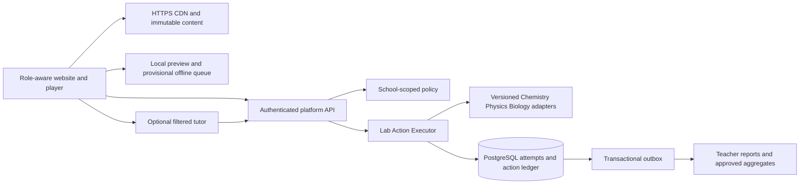

# Website, player and data contracts



The CDN supplies only signed/fingerprinted content and locale assets. The website establishes role and roster identity and resolves an assignment → experiment/mode/content digest. The player renders confirmed state. API validates each action and routes to a model adapter selected by the pinned content. PostgreSQL stores commit, immutable model identity, checkpoint, observation and outbox in the same unit. Async workers produce tenant-scoped report materializations and future LMS sync. A bounded browser queue replays student's intent when online. Tutor proposes typed steps with no direct science-write privilege.

## Canonical data ownership

| Entity | Ownership and lifecycle |
|---|---|
| District, school, class | Tenant/scoped operator. District only aggregate. Class membership must be active to create or access a new attempt. Each link carries the enforcement keys. |
| Person and pseudonym | Authentication identity is broker/local school mapping. Domain records use opaque learner IDs and tenant ID. Split and encrypt optional contact metadata. |
| Curriculum, lab, experiment version | Editorial provenance, content/locale digest and immutable version on release. Lab ID chemistry/physics/biology; a subject has one reusable scene plus configuration. |
| Assignment, attempt, session | Assignment pins content, permitted modes and rubric. Attempt owns mode, learner and progress state. Session owns revision, authoritative state and execution timestamps. |
| Lab action, observation, checkpoint | Unique session/revision and idempotency keys; bounded payload; output/digest references; any regrading appends a rubric decision linked to old one. Persist deterministic checkpoint state. |
| Assessment, report, audit | Assessment has unique attempt/rubric version; audit for permissions/exports/key state with trusted clock. District/state reports aggregate and suppress small cohorts. |
| Locale, consent and policy | Student preferences are separate from grade. Retention is configurable and reviewed. Minimize operational telemetry, pseudonymize and apply school and statutory retention. |

## Lifecycle and failure

Role-authenticated student requests launch with an approved experiment/mode and assignment. API creates/reuses attempt under idempotency key. Returns short-lived single-use token with audience, attempt, subject/mode, expiry, manifest hash and ABI. The same-origin player redeems server-side over HTTPS from body under CSRF-safe session, never puts it into query, referrer or persistent client logs. A row-locked token identifier limits replay. Renewal requires active owner and assignment policy. Use opaque one-time grants with server lookup or signed claims with row-backed JTI and expiration. Player session reads revisions; mutations send idempotency key and expected revision. Commit path is:
```
authenticate + school/assignment/mode scope → inspect idempotency
→ lock owning session → check expectedRevision and state
→ validate target + ports + versioned model domain → calculate model
→ append action/observations, checkpoint and outbox → set revision → return
```
An identical key/payload returns original result. Same key/different body gives 409. Stale revision gives 409 with current revision. The client derives the same-session GET /sessions/{sessionId}/checkpoints/{revision} from this value. 422 covers unsupported/safety/calibration without advancing state. 401/403 cover auth; 404 masks other tenant's private resources. 410 covers expired or revoked content/attempt; 429 throttles. Long model experiments use job version/outbox with CAS and cancellation before commit; the three initial slices use short deterministic steps. Potential cue rendering failures never trigger re-commit.

The offline queue is assigned to device-scoped encrypted state where supported, clears on logout, and stores immutable action, expected revision and idempotency key. Browser can never commit grade offline. On reconnect read server state; replay only a contiguous admissible chain. On conflict present confirmed state and allow explicit restart/branch as a separate draft where allowed. Teacher score reflects submitted server result only. Online outbox is at-least-once with consumers deduped by event ID. Ended methods emit no false successes during transient outages. Schemas and example payloads in the specification bundle are tied to these behaviors.
